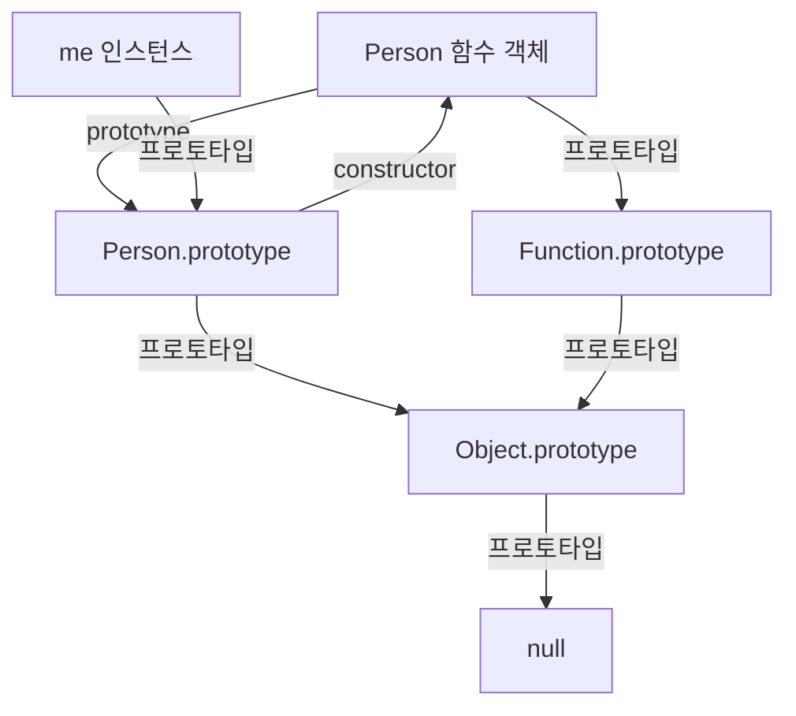

## 19.3 프로토타입 객체

프로토타입 객체(줄여서 프로토타입)는 JavaScript의 객체 간 상속을 구현하기 위해 사용한다. 프로토타입은 다른 객체의 상위(부모) 객체 역할을 하며, 공유 프로퍼티와 메서드를 제공한다. 하위(자식) 객체는 상위 객체의 프로퍼티를 자신의 프로퍼티처럼 사용할 수 있다.

모든 객체는 `[[Prototype]]` 내부 슬롯을 가지며, 그 값은 다른 객체에 대한 참조 또는 `null`이다. 객체의 프로토타입은 객체 생성 방식에 따라 결정되고, 객체가 생성될 때 `[[Prototype]]`에 저장된다.

프로토타입으로 사용하는 객체가 반드시 생성자 함수와 한 쌍을 이루는 것은 아니다. 예를 들어 `Object.create`의 인수로 임의의 객체를 전달할 수도 있다.

`[[Prototype]]` 내부 슬롯에 직접 접근할 수는 없다. `Object.prototype`을 상속받는 일반 객체에서는 `__proto__` 접근자 프로퍼티를 이용할 수 있으며, 일반적으로는 `Object.getPrototypeOf`를 이용해 프로토타입을 조회한다.

- **프로토타입 → `constructor` 프로퍼티 → 생성자 함수**
- **생성자 함수 → `prototype` 프로퍼티 → 인스턴스의 기본 프로토타입**

### 19.3.1 `__proto__` 접근자 프로퍼티

`Object.prototype`을 상속받는 일반 객체는 `__proto__` 접근자 프로퍼티를 통해 `[[Prototype]]` 내부 슬롯이 가리키는 프로토타입에 간접적으로 접근할 수 있다.

브라우저 개발자 도구에서 `person` 객체를 펼쳐 보면 객체 자체의 프로퍼티와 `[[Prototype]]` 항목을 구분해 볼 수 있다. `[[Prototype]]` 항목은 해당 객체가 상속하는 프로토타입을 나타낸다.

**`__proto__`는 접근자 프로퍼티다.**

내부 슬롯은 일반적인 프로퍼티가 아니다. JavaScript는 원칙적으로 내부 슬롯이나 내부 메서드에 직접 접근하는 방법을 제공하지 않는다. `__proto__` 접근자 프로퍼티에는 getter와 setter가 정의되어 있어 프로토타입을 읽거나 변경할 수 있다. 접근자 프로퍼티는 `[[Get]]`, `[[Set]]` 어트리뷰트로 표현되는 내부 동작을 가진다.

**예제 19-06**

```js
const obj = {};
const parent = { x: 1 };

// getter인 get __proto__를 통해 obj의 프로토타입을 조회한다.
obj.__proto__;

// setter인 set __proto__를 통해 obj의 프로토타입을 교체한다.
obj.__proto__ = parent;

console.log(obj.x); // 1
```

**`__proto__` 접근자 프로퍼티는 상속을 통해 사용된다.**

`__proto__` 접근자 프로퍼티는 `Object.prototype`에 정의되어 있다. 따라서 이를 상속받지 않는 객체에는 접근자가 없을 수 있다. 보편적인 프로토타입 조회에는 `Object.getPrototypeOf`를 사용하는 편이 좋다.

**예제 19-07**

```js
const person = { name: "kim" };

// person 객체는 __proto__를 고유 프로퍼티로 갖지 않는다.
console.log(person.hasOwnProperty("__proto__")); // false

// __proto__ 접근자는 Object.prototype에 정의되어 있다.
console.log(Object.getOwnPropertyDescriptor(Object.prototype, "__proto__"));
// { get: [Function], set: [Function], enumerable: false, configurable: true }

// Object.prototype을 상속받는 일반 객체는 __proto__ 접근자를 사용할 수 있다.
console.log({}.__proto__ === Object.prototype); // true
```

**참고: `Object.prototype`과 프로토타입 체인**

객체는 프로토타입 관계에 따라 계층 구조로 연결된다. JavaScript 엔진은 객체에서 프로퍼티를 찾을 수 없으면 그 객체의 `[[Prototype]]`을 따라 상위 객체에서 프로퍼티를 검색한다. 일반적인 객체의 체인은 `Object.prototype`을 거쳐 `null`에서 끝나지만, `Object.create(null)`로 만든 객체처럼 예외도 있다.

**`__proto__`를 통한 프로토타입 교체와 순환 참조 방지**

객체의 프로토타입을 변경할 때 JavaScript 엔진은 순환하는 프로토타입 체인이 생기지 않도록 검사한다. `Object.setPrototypeOf`를 사용해도 순환 설정은 거부된다.

**예제 19-08**

```js
const parent = {};
const child = {};

// child의 프로토타입을 parent로 설정
child.__proto__ = parent;

// parent의 프로토타입을 child로 설정하려 하면 순환 참조가 발생한다.
parent.__proto__ = child; // TypeError 발생
```

프로토타입 체인은 프로퍼티를 상위 방향으로 순차적으로 검색할 수 있어야 한다. 순환 참조를 허용하면 체인의 종점이 없어져 정상적인 검색이 불가능해진다.

**`__proto__` 접근자 프로퍼티를 코드에서 직접 사용하는 것은 권장하지 않는다.**

`__proto__`는 과거 비표준 기능이었으며, `Object.prototype`을 상속하지 않는 객체에는 접근자가 없을 수 있다.

**예제 19-09**

```js
// obj는 Object.prototype을 상속받지 않는다.
const obj = Object.create(null);

// __proto__ 접근자가 없다.
console.log(obj.__proto__); // undefined

// 따라서 Object.getPrototypeOf로 프로토타입을 조회하는 편이 좋다.
console.log(Object.getPrototypeOf(obj)); // null
```

프로토타입 조회에는 `Object.getPrototypeOf`, 변경에는 `Object.setPrototypeOf`를 사용할 수 있다. 이들은 `__proto__` 접근자를 통해 수행하려는 작업과 대응하지만, `Object.prototype` 상속 여부에 의존하지 않는다.

### 19.3.2 함수 객체의 `prototype` 프로퍼티

**생성자 함수의 `prototype` 프로퍼티는 그 함수를 `new`와 함께 호출해 만든 인스턴스의 기본 프로토타입을 가리킨다.**

**예제 19-11**

```js
// 일반 함수 객체는 prototype 프로퍼티를 소유한다.
console.log((function () {}).hasOwnProperty("prototype")); // true

// 일반 객체는 prototype 프로퍼티를 소유하지 않는다.
console.log(({}).hasOwnProperty("prototype")); // false
```

생성자 함수로 호출할 수 없는 화살표 함수와 메서드 축약 표현으로 정의한 메서드는 고유한 `prototype` 프로퍼티를 생성하지 않는다.

**예제 19-12**

```js
// 화살표 함수: non-constructor
const Person = (name) => {
  this.name = name;
};

// 화살표 함수는 prototype 프로퍼티를 소유하지 않는다.
console.log(Person.hasOwnProperty("prototype")); // false
console.log(Person.prototype); // undefined

// 메서드 축약 표현으로 정의한 메서드
const obj = {
  foo() {},
};

// 메서드도 constructor가 아니므로 prototype 프로퍼티가 없다.
console.log(obj.foo.hasOwnProperty("prototype")); // false
console.log(obj.foo.prototype); // undefined
```

일반 함수가 실제로 객체 생성에 사용되지 않더라도 `prototype` 프로퍼티를 가질 수 있다. 이 프로퍼티는 해당 함수를 생성자 함수로 호출할 때 의미가 있다.

**`new Person()`으로 만든 `me`의 프로토타입은 생성 시점의 `Person.prototype`이다. `Person` 함수 객체 자신의 프로토타입과 `Person.prototype`은 서로 다르다.**

**예제 19-13**

```js
function Person(name) {
  this.name = name;
}

const me = new Person("Lee");

// Person.prototype과 me.__proto__는 같은 객체를 가리킨다.
console.log(Person.prototype === me.__proto__); // true
```

### 19.3.3 프로토타입의 `constructor` 프로퍼티와 생성자 함수

일반적인 생성자 함수의 기본 `prototype` 객체에는 `constructor` 프로퍼티가 존재한다. 이 프로퍼티는 자신의 프로토타입을 가리키는 생성자 함수를 참조한다. 단, 모든 프로토타입 객체가 `constructor`를 고유 프로퍼티로 갖는다는 뜻은 아니다.

**예제 19-14**

```js
function Person(name) {
  this.name = name;
}

const me = new Person("Lee");

// me는 프로토타입에서 상속받은 constructor를 통해 Person을 참조한다.
console.log(me.constructor === Person); // true
```

`Person` 생성자 함수는 `me` 객체를 생성한다. `me`는 프로토타입의 `constructor` 프로퍼티를 통해 생성자 함수와 연결된다.

### 연결 관계를 그림으로 확인



**`Person.prototype`과 `Object.getPrototypeOf(Person)`은 다르다.** 전자는 `Person`으로 만든 인스턴스가 상속할 객체이고, 후자는 함수 객체 `Person` 자신이 상속하는 객체다.

### `prototype` 프로퍼티와 생성자 가능 여부는 별도로 확인

| 함수 종류 | 기본 고유 `prototype` 프로퍼티 | `new` 호출 |
| --- | --- | --- |
| 일반 함수 선언·표현식 | 있음 | 가능 |
| 화살표 함수 | 없음 | 불가능 |
| 메서드 축약 표현 | 없음 | 불가능 |
| 제너레이터 함수 | 있음 | 불가능 |
| 바인딩된 생성자 함수(`bind`) | 기본적으로 없음 | 원래 함수가 생성자라면 가능 |

따라서 "`prototype`이 있으면 항상 생성자다" 또는 "`prototype`이 없으면 항상 생성자가 아니다"라고 일반화할 수 없다.

```js
function Person(name) {
  this.name = name;
}

const me = new Person("Lee");

console.log(Object.getPrototypeOf(me) === Person.prototype); // true
console.log(Object.getPrototypeOf(Person) === Function.prototype); // true
console.log(Person.prototype === Object.getPrototypeOf(Person)); // false
```
