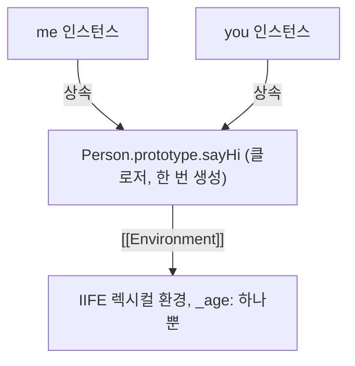

# 24.5 캡슐화와 정보 은닉

- **캡슐화**: 상태(프로퍼티)와 동작(메서드)을 하나로 묶는 것
- **정보 은닉**: 캡슐화 중 일부를 외부에 감추는 것 -> 상태 보호 및 결합도 감소
- 일반 객체 프로퍼티는 외부에서 접근할 수 있다. JavaScript 클래스에는 언어 차원에서 접근을 제한하는 `#private` 요소가 있다. Java나 TypeScript의 접근 제한자 키워드와는 구분해야 한다.
- 클로저로 비공개 상태를 구현할 수 있으나 한계가 있다.

## 생성자 함수와 지역 변수(인스턴스 메서드)

**예제 24-16**

> 예제 24-16~24-19는 `Person` 이름이 반복되므로 **각 예제를 독립적으로 실행**한다.


```js
function Person(name, age) {
  this.name = name; // public
  let _age = age; // 스코프로 숨김

  // 인스턴스 메서드
  this.sayHi = function () {
    console.log(`Hi! My name is ${this.name}. I am ${_age}.`);
  };
}

const me = new Person("Lee", 20);
me.sayHi(); // Hi! My name is Lee. I am 20.
console.log(me.name); // Lee
console.log(me._age); // undefined

const you = new Person("Kim", 30);
you.sayHi(); // Hi! My name is Kim. I am 30.
console.log(you.name); // Kim
console.log(you._age); // undefined
```

**특성:** `sayHi` 함수 객체가 **인스턴스마다 별도로 생성**된다. 인스턴스별 은닉 상태를 얻는 대신 프로토타입 메서드를 공유하는 방식보다 함수 객체 수가 늘어난다.

## 프로토타입 메서드

**예제 24-17**

```js
function Person(name, age) {
  this.name = name; // public
  let _age = age; // 스코프로 은닉
}

// 프로토타입 메서드
Person.prototype.sayHi = function () {
  // Person 생성자 함수의 지역 변수 _age를 참조할 수 없다!
  console.log(`Hi! My name is ${this.name}. I am ${_age}`);
};

const me = new Person("Lee", 20);
try {
  me.sayHi();
} catch (error) {
  console.log(error.name); // ReferenceError
}
```

**문제:** 프로토타입 메서드는 생성자 함수 밖에 정의되어 `_age`를 직접 참조할 수 없다.

## IIFE로 접근 가능하게 만들기(공유 상태에 주의)

**예제 24-18**

```js
const Person = (function () {
  let _age = 0; // 스코프로 은닉

  // 생성자 함수
  function Person(name, age) {
    this.name = name; // public
    _age = age;
  }

  // 프로토타입 메서드
  Person.prototype.sayHi = function () {
    console.log(`Hi! My name is ${this.name}. I am ${_age}.`);
  };

  // 생성자 함수를 반환
  return Person;
})();

const me = new Person("Lee", 20);
me.sayHi(); // Hi! My name is Lee. I am 20.
console.log(me.name); // Lee
console.log(me._age); // undefined

const you = new Person("Kim", 30);
you.sayHi(); // Hi! My name is Kim. I am 30.
console.log(you.name); // Kim
console.log(you._age); // undefined
```

## 인스턴스가 `_age`를 공유하는 문제

예제 24-18은 `_age`에 접근할 수 있게 만들지만, 모든 인스턴스가 같은 `_age`를 공유하는 한계가 있다.

**예제 24-19**

```js
// 이 블록만 복사해도 실행할 수 있도록 Person 정의를 포함
const Person = (function () {
  let _age = 0; // 스코프로 숨김

  // 생성자 함수
  function Person(name, age) {
    this.name = name; // public
    _age = age;
  }

  // 프로토타입 메서드
  Person.prototype.sayHi = function () {
    console.log(`Hi! My name is ${this.name}. I am ${_age}.`);
  };

  // 생성자 함수를 반환
  return Person;
})();

const me = new Person("Lee", 20);
me.sayHi(); // Hi! My name is Lee. I am 20.

const you = new Person("Kim", 30);
you.sayHi(); // Hi! My name is Kim. I am 30.

// _age 변수 값이 변경된다!
me.sayHi(); // Hi! My name is Lee. I am 30
```



> `sayHi`는 IIFE 실행 시 한 번 만들어지고, 모든 인스턴스가 동일한 `_age`를 참조한다.

> **정리**
>
> - 생성자 안의 지역 변수는 해당 호출에 만들어진 함수가 접근할 수 있다
> - 생성자 밖에 정의한 프로토타입 메서드는 생성자 호출의 지역 변수에 직접 접근할 수 없다.
> - 인스턴스마다 독립적인 상태가 필요하면 아래 `#private` 필드 또는 `WeakMap` 방식을 검토한다.

## 클래스의 `#private` 필드

> 아래 클래스 예제와 `WeakMap` 예제 역시 서로 독립적으로 실행한다.

`#age`는 인스턴스마다 존재하고, 이를 선언한 클래스 내부 코드에서 접근할 수 있다. 일반 메서드 `sayHi`는 프로토타입을 통해 공유된다.

```js
class Person {
  #age;

  constructor(name, age) {
    this.name = name;
    this.#age = age;
  }

  sayHi() {
    return "이름: " + this.name + ", 나이: " + this.#age;
  }
}

const me = new Person("Lee", 20);
const you = new Person("Kim", 30);

console.log(me.sayHi()); // 이름: Lee, 나이: 20
console.log(you.sayHi()); // 이름: Kim, 나이: 30
console.log(me.sayHi()); // 이름: Lee, 나이: 20
console.log(me.sayHi === you.sayHi); // true
```

## 클로저 안의 WeakMap, 프로토타입 메서드

인스턴스를 키로 사용해 상태를 분리하고, `WeakMap` 자체는 외부에서 접근할 수 없는 지역 변수에 둔다.

```js
const Person = (() => {
  const ages = new WeakMap();

  function Person(name, age) {
    this.name = name;
    ages.set(this, age);
  }

  Person.prototype.sayHi = function () {
    return '이름: ' + this.name + ', 나이: ' + ages.get(this);
  };

  return Person;
})();

const me = new Person('Lee', 20);
const you = new Person('Kim', 30);

console.log(me.sayHi()); // 이름: Lee, 나이: 20
console.log(you.sayHi()); // 이름: Kim, 나이: 30
console.log(me.sayHi()); // 이름: Lee, 나이: 20
console.log(me.sayHi === you.sayHi); // true
```
