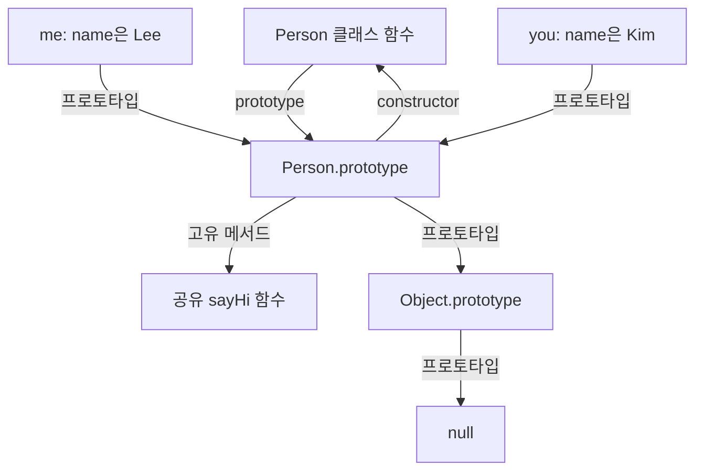

## 25.5 메서드

### 25.5.1 constructor

constructor는 new 호출에서 인스턴스를 초기화하는 특수한 클래스 멤버다. 클래스에 최대 한 개만 정의할 수 있음

```js
class Person {
  constructor(name, address = "Seoul") {
    this.name = name;
    this.address = address;
  }
}

const me = new Person("Lee");
console.log(me.name, me.address); // Lee Seoul
```

| 형태                         | 동작                             |
| ---------------------------- | -------------------------------- |
| 기본 클래스 constructor 생략 | 기본 생성자가 사용됨             |
| this.name = name             | 인스턴스 프로퍼티 생성, 대입     |
| constructor 두 개 선언       | SyntaxError                      |
| 기본 생성자가 객체 반환      | 반환한 객체가 new의 결과가 된다  |
| 기본 생성자가 원시 값 반환   | 원시 값은 무시되고 인스턴스 반환 |

#### `constructor`와 `prototype.constructor`는 다르다

| 이름                         | 의미                                                   |
| ---------------------------- | ------------------------------------------------------ |
| 클래스 본문의 constructor    | 인스턴스를 초기화하는 생성자 본문                      |
| Person.prototype.constructor | 기본적으로 Person 클래스 함수를 가리키는 일반 프로퍼티 |

```js
class Person {
  constructor(name) {
    this.name = name;
  }
}

console.log(Person.prototype.constructor === Person); // true
console.log(typeof Person); // function
```

`Person.prototype.constructor`를 바꾼다고 클래스의 생성자 본문 자체가 바뀌지는 않는다.

#### 생성자의 명시적 반환

```js
class ReturnsObject {
  constructor() {
    this.name = "Lee";
    return {
      name: "Kim",
    };
  }
}

class ReturnsPrimitive {
  constructor() {
    this.name = "Lee";
    return 100;
  }
}

const first = new ReturnsObject();
const second = new ReturnsPrimitive();

console.log(first.name); // Kim
console.log(first instanceof ReturnsObject); // false
console.log(second.name); // Lee
console.log(second instanceof ReturnsPrimitive); // true
```

일반적인 클래스에서는 명시적인 객체 반환을 생략하고, 생성·초기화한 인스턴스를 반환하도록 작성한다.

### 25.5.2 프로토타입 메서드

클래스의 일반 메서드는 `prototype`에 정의되어 인스턴스들이 공유한다.

```js
class Person {
  constructor(name) {
    this.name = name;
  }

  sayHi() {
    return this.name;
  }
}

const me = new Person("Lee");
const you = new Person("Kim");

console.log(me.sayHi()); // Lee
console.log(you.sayHi()); // Kim
console.log(me.sayHi === you.sayHi); // true
console.log(Object.hasOwn(me, "sayHi")); // false
console.log(Object.hasOwn(Person.prototype, "sayHi")); // true
```



두 인스턴스는 같은 메서드를 사용하지만 호출 수신 객체가 달라 `this.name` 결과가 달라진다.

### 25.5.3 정적 메서드

static 메서드는 클래스 함수 객체에 정의, 인스턴스를 만들지 않고 호출

```js
class Square {
  static area(width, height) {
    return width * height;
  }
}

console.log(Square.area(10, 10)); // 100

const square = new Square();
console.log(typeof square.area); // undefined
```

`square.area()`를 호출하면 `TypeError`가 발생한다. `Square.area`는 인스턴스의 프로토타입 체인에 있는 메서드가 아니다

### 25.5.4 정적 메서드와 프로토타입 메서드의 차이

| 비교          | 프로토타입 메서드    | 정적 메서드                              |
| ------------- | -------------------- | ---------------------------------------- |
| 저장 위치     | ClassName.prototype  | ClassName 함수 객체                      |
| 대표 호출     | instance.method()    | ClassName.method()                       |
| 호출 this     | 인스턴스             | 클래스                                   |
| 용도          | 인스턴스 상태        | 유틸리티, 생성, 팩터리, 클래스 상태 사용 |
| 인스턴스 필요 | 보통 인스턴스로 호출 | 없어도 호출 가능                         |

정적 메서드도 인수로 전달받은 인스턴스의 프로퍼티를 읽을 수 있다. '정적 메서드는 인스턴스 정보를 절대로 읽을 수 없다'는 의미가 아님

```js
class Player {
  constructor(name) {
    this.name = name;
  }

  static getName(player) {
    return player.name;
  }
}

console.log(Player.getName(new Player("Kim"))); // Kim
```

this를 사용하지 않는다고 모든 메서드를 무조건 static으로 바꿀 필요도 없다. 기능의 소속과 공개 API를 기준으로 결정

### 25.5.5 클래스 메서드 특징

- 메서드 정의에 function 키워드나 쉼표를 사용하지 않음
- 클래스 본문의 코드는 strict mode로 실행
- 일반·정적 클래스 메서드는 기본적으로 열거되지 않음
- 일반 클래스 메서드는 생성자로 호출할 수 없다

```js
class Person {
  name = "Lee";

  sayHi() {
    return this.name;
  }
}

const me = new Person();
console.log(Object.keys(me)); // ['name']
console.log(Object.keys(Person.prototype)); // []
console.log(Object.getOwnPropertyNames(Person.prototype)); // ['constructor', 'sayHi']

const descriptor = Object.getOwnPropertyDescriptor(Person.prototype, "sayHi");
console.log(descriptor.enumerable); // false
```

**클래스 메서드의 열거 불가와 public 인스턴스 필드의 열거 가능을 구분**
