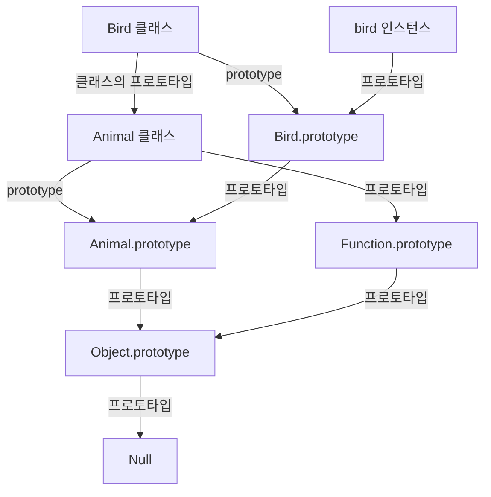
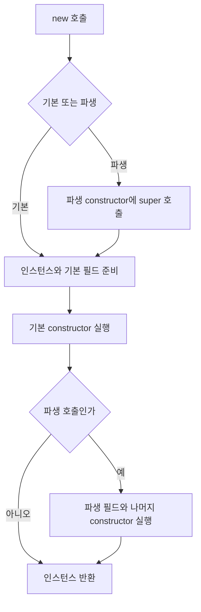

## 25.8 상속에 의한 클래스 확장

### 25.8.1 클래스 상속과 생성자 함수 상속

**extends는 기존 클래스를 확장하는 문법이고 실제 상속 관계는 프로토타입을 통해 구현된다** 프로토타입 기반 상속과 무관한 별도의 엔진 모델이 생기는 것은 아니다.

```js
class Animal {
  constructor(age, weight) {
    this.age = age;
    this.weight = weight;
  }

  eat() {
    return "eat";
  }

  move() {
    return "move";
  }
}

class Bird extends Animal {
  fly() {
    return "fly";
  }
}

const bird = new Bird(1, 5);
console.log(bird.age, bird.weight); // 1 5
console.log(bird.eat(), bird.move(), bird.fly()); // eat move fly
console.log(bird instanceof Bird); // true
console.log(bird instanceof Animal); // true
```

생성자 함수의 상속도 구현할 수 있으나 prototype 연결과 부모 생성자 호출 등을 직접 구성해야 한다. class의 extends·super는 이를 명확하게 표현

### 25.8.2 extends 키워드와 두 프로토타입 체인

클래스 자체의 체인과 인스턴스의 체인을 구분

| 관계                       | 대표 코드                                                  | 상속 기능                |
| -------------------------- | ---------------------------------------------------------- | ------------------------ |
| Bird 클래스 상위객체       | Object.getPrototypeOf(Bird) === Animal                     | 부모의 public 정적 멤버  |
| Bird.prototype의 상위 객체 | Object.getPrototypeOf(Bird.prototype) === Animal.prototype | 부모의 프로토타입 메서드 |
| bird의 상위 객체           | Object.getPrototypeOf(bird) === Bird.prototype             | Bird의 프로토타입 메서드 |



```js
class Base {
  static type() {
    return "base";
  }

  run() {
    return "run";
  }
}

class Derived extends Base {}

console.log(Derived.type()); // base
console.log(new Derived().run()); // run
console.log(Object.getPrototypeOf(Derived) === Base); // true
console.log(Object.getPrototypeOf(Derived.prototype) === Base.prototype); // true
```

### 25.8.3 동적 상속

`extends` 뒤에는 클래스뿐 아니라 상속 가능한 생성자로 평가되는 표현식을 사용할 수 있다.

```js
function Base1(value) {
  this.value = value;
}

class Base2 {}

const condition = true;
class Derived extends (condition ? Base1 : Base2) {}

const derived = new Derived(10);
console.log(derived.value); // 10
console.log(derived instanceof Base1); // true
console.log(derived instanceof Base2); // false
```

상속 대상은 클래스 정의를 평가할 때 결정된다. 이후 조건 변수의 값을 바꾼다고 이미 정의된 클래스의 부모가 자동으로 바뀌지 않음. 화살표 함수처럼 생성자로 사용할 수 없는 함수는 일반적인 상속 대상이 될 수 없음

### 25.8.4 서브클래스의 constructor

| 종류        | constructor 동작                                            |
| ----------- | ----------------------------------------------------------- |
| 기본 클래스 | constructor() {}                                            |
| 파생 클래스 | constructor(...args) { super(...args); }와 유사한 인수 전달 |

```js
class Base {
  constructor(a, b) {
    this.a = a;
    this.b = b;
  }
}

class Derived extends Base {
  constructor(a, b, c) {
    super(a, b);
    this.c = c;
  }
}

const derived = new Derived(1, 2, 3);
console.log(derived.a, derived.b, derived.c); // 1 2 3
```

`...args`는 인수를 모으는 rest 매개변수고, `super(...args)`의 `...args`는 모은 인수를 펼쳐 전달하는 spread다

### 25.8.5 super 키워드

| 표현              | 의미                                 | 위치              |
| ----------------- | ------------------------------------ | ----------------- |
| super(...)        | 상위 생성자의 생성, 초기화 경로 실행 | 파생 constructor  |
| super.method(...) | 상위 메서드를 현재 수신 객체로 호출  | 일반, 정적 메서드 |

#### super()와 this

```js
class Base {}

class Derived extends Base {
  constructor(value) {
    try {
      console.log(this);
    } catch (error) {
      console.log(error.name); // ReferenceError
    }

    super();
    this.value = value;
  }
}

console.log(new Derived(10).value); // 10
```

일반적인 파생 인스턴스 초기화에서는 **`super()` 이후에 `this`를 사용한다.** 기본 클래스의 constructor이나 일반 함수에서 super()를 직접 호출하는 문법은 허용되지 않음

#### 생성자 반환 규칙 예외

| 생성자      | 반환                       | 결과                                                    |
| ----------- | -------------------------- | ------------------------------------------------------- |
| 기본 생성자 | 객체                       | 객체를 반환                                             |
| 기본 생성자 | 원시 값                    | 무시하고 인스턴스 반환                                  |
| 파생 생성자 | undefined 또는 반환문 생략 | 초기화된 this 필요                                      |
| 파생 생성자 | undefined 이외 원시 값     | TypeError                                               |
| 파생 생성자 | 객체                       | 객체를 반환, this를 사용하지 않았으면 super 없이도 가능 |

#### super.method() 오버라이딩

```js
class Base {
  constructor(name) {
    this.name = name;
  }

  sayHi() {
    return `Hi! ${this.name}`;
  }
}

class Derived extends Base {
  sayHi() {
    return `${super.sayHi()} how are you doing?`;
  }
}

const derived = new Derived("Lee");
console.log(derived.sayHi()); // Hi! Lee how are you doing?
```

상위 메서드를 찾더라도 호출 시 this는 현재 인스턴스다.

```text
Base.prototype.sayHi.call(this)
```

#### 객체 리터럴에서 super 참조 가능

```js
const base = {
  sayHi() {
    return `Hi! ${this.name}`;
  },
};

const derived = {
  __proto__: base,
  name: "Lee",

  sayHi() {
    return `${super.sayHi()} how are you doing?`;
  },
};

console.log(derived.sayHi()); // Hi! Lee how are you doing?
```

`super` 참조는 메서드 정의 문법을 사용하기 때문에 가능하다. `sayHi: function () { ... }`로 정의한 일반 함수에서 같은 super 참조를 직접 작성할 수 없음
정적 메서드에서 `super.method()`는 상위 클래스의 정적 메서드를 찾는다. 이때 대표 this는 호출한 클래스다

### 25.8.6 상속 클래스의 인스턴스 생성 과정

```js
class Rectangle {
  constructor(width, height) {
    console.log(new.target.name); // ColorRectangle
    console.log(Object.getPrototypeOf(this) === new.target.prototype); // true

    this.width = width;
    this.height = height;
  }

  getArea() {
    return this.width * this.height;
  }

  toString() {
    return `width = ${this.width}, height = ${this.height}`;
  }
}

class ColorRectangle extends Rectangle {
  constructor(width, height, color) {
    super(width, height);
    this.color = color;
  }

  toString() {
    return `${super.toString()}, color = ${this.color}`;
  }
}

const rectangle = new ColorRectangle(2, 4, 'red');
console.log(rectangle.getArea()); // 8
console.log(rectangle.toString()); // width = 2, height = 4, color = red
console.log(rectangle instanceof Rectangle); // true
console.log(rectangle instanceof ColorRectangle); // true
```

| 단계 | 처리                                                             |
| ---- | ---------------------------------------------------------------- |
| 1    | ColorRectangle constructor 진입, 파생 this 초기화 전             |
| 2    | super(width, height)로 상위 생성 경로 실행                       |
| 3    | 기본 생성 경로에서 인스턴스 생성, new.target 기준 prototype 연결 |
| 4    | 부모 필드와 Rectangle constructor에 너비, 높이 초기화            |
| 5    | super 반환 후 파생 this 바인딩, 자식 필드 초기화                 |
| 6    | ColorRectangle constructor 나머지 본문에서 color 초기화          |
| 7    | 같은 인스턴스를 최종 반환                                        |

**부모, 자식이 각각 다른 인스턴스를 만들어 합치는 것이 아님** 일반적인 생성 경로에 같은 인스턴스를 부모와 자식이 순서대로 초기화



일반적인 생성 흐름을 나타냄

#### 필드 초기화 순서 확인

```js
class Base {
  name = "base";

  constructor() {
    console.log(this.name); // base
  }
}

class Derived extends Base {
  name = "derived";

  constructor() {
    super();
    console.log(this.name); // derived
  }
}

new Derived();
```

부모 `constructor` 실행 중에는 자식의 필드가 아직 초기화되지 않는다. 부모 constructor 자식 메서드를 호출하고 메서드가 자식 #private에 접근하면 초기화 전 접근 오류가 생길 수 있음

### 25.8.7 표준 빌트인 생성자 함수 확장

```js
class MyArray extends Array {
  uniq() {
    return this.filter((value, index, self) => self.indexOf(value) === index);
  }

  average() {
    return this.reduce((sum, value) => sum + value, 0) / this.length;
  }
}

const values = new MyArray(1, 1, 2, 3);
console.log([...values.uniq()]); // [1, 2, 3]
console.log(values.average()); // 1.75
console.log(values.filter((value) => value >= 2) instanceof MyArray); // true
console.log(
  values
    .filter((value) => value >= 2)
    .uniq()
    .average(),
); // 2.5
```

예제는 숫자 배열을 가정한다. indexOf 기반 중복 제거는 NaN에 별도 주의 필요, 빈 배열의 `average()`는 `NaN`이다. 실제 함수에서는 입력과 빈 배열 처리 정책을 정함

#### 반환 타입과 체이닝

| 호출               | 기본 반환 | 다음 호출                     |
| ------------------ | --------- | ----------------------------- |
| values.filter(...) | MyArray   | uniq, average 사용 가능       |
| values.uniq()      | MyArray   | average 사용 가능             |
| values.average()   | Number    | MyArray 메서드 호출 경로 종료 |

filter, map 등은 기본 species 동작에서 서브클래스의 배열을 반환할 수 있음. 모든 새 배열 반환 메서드가 반드시 같은 서브클래스를 반환하는 뜻은 아님.

#### Symbol.species로 Array 반환

```js
class MyArray extends Array {
  static get [Symbol.species]() {
    return Array;
  }

  uniq() {
    return this.filter((value, index, self) => self.indexOf(value) === index);
  }

  average() {
    return this.reduce((sum, value) => sum + value, 0) / this.length;
  }
}

const values = new MyArray(1, 1, 2, 3);
const unique = values.uniq();

console.log(unique instanceof MyArray); // false
console.log(unique instanceof Array); // true
console.log(typeof unique.average); // undefined
```

`unique`는 일반 `Array`이므로 `unique.average()`를 호출하면 `TypeError`가 발생한다. 메서드가 어떤 타입을 반환하는지 알아야 체이닝 가능 여부를 판단할 수 있음

---

## 복습 질문·답변

### 1. 클래스도 프로토타입을 사용하는가?

그렇다. 일반 메서드는 클래스의 prototype에 정의되고 인스턴스가 이를 상속한다. extends도 클래스, 인스턴스의 프로토타입 관계를 구성

### 2. 클래스와 일반 생성자 함수의 대표적인 차이는 무엇인가?

클래스는 `new` 없이 호출할 수 없고, 선언 전 접근이 TDZ에 제한되며, 본문이 strict mode다. extends, super와 필드 문법도 제공한다

### 3. `constructor`와 `prototype.constructor`는 같은가?

전자는 인스턴스 초기화 본문, 후자는 기본적으로 클래스 함수를 가리키는 일반 프로퍼티다. 후자의 값을 변경해도 생성자 본문이 바뀌지 않는다

### 4. 클래스 메서드를 여러 인스턴스가 공유하는 이유는 무엇인가?

일반 메서드를 prototype에 한 번 정의하고 각 인스턴스가 객체를 상속하기 때문

### 5. 클래스 필드로 정의한 함수도 인스턴스들이 공유하는가?

아니다. 필드는 각 인스턴스의 고유 프로퍼티다. 함수 초기화 표현식으로 정의하면 함수 객체가 생성된다

### 6. 화살표 함수 필드가 콜백에서 유용한 이유는 무엇인가?

필드 초기화 환경의 this를 사용하므로 객체에서 분리해 호출하거나 콜백으로 전달해도 해당 인스턴스를 참조할 수 있음

### 7. getter와 setter는 어떻게 사용하는가?

getter는 프로퍼티를 읽는 문법으로, setter는 대입 문법으로 사용한다. getter의 매개변수는 0개, setter는 1개다

### 8. 클래스 메서드가 `Object.keys()`에 보이지 않는 이유는 무엇인가?

인스턴스가 아닌 prototype에 있고 클래스 메서드 자체도 기본적으로 열거 불가다. public 인스턴스 필드는 별개의 프로퍼티다

### 9. private 필드를 `constructor`에서 처음 선언해도 되는가?

안된다. 클래스 본문에서 #field를 먼저 선언, constructor에 값을 대입한다

### 10. 인스턴스 필드와 static 필드의 차이는 무엇인가?

인스턴스 필드는 각 인스턴스에, static 필드는 클래스에 정의. 인스턴스 메서드와 정적 메서드의 소속도 구분

### 11. 파생 `constructor`에서 `super()` 전에 `this`를 쓰면 어떻게 되는가?

일반적인 생성 경로에 아직 this가 초기화되지 않아 ReferenceError가 발생

### 12. `super.method()`에서 `this`는 무엇인가?

현재 호출의 수신 객체. 부모 메서드를 찾는 위치와 그 메서드에 사용하는 this를 구분

### 13. 부모 `constructor`에서 `new.target`은 무엇을 가리키는가?

해당 생성 호출에서 사용할 클래스를 가리킨다. new ColorRectangle(...) 경로면 부모 constructor에서도 ColorRectangle이다

### 14. 기본 클래스와 파생 클래스의 필드 초기화 시점은 같은가?

기본 클래스는 자기 constructor 본문 전에, 파생 클래스는 super 반환 직후 자기 constructor 나머지 본문 전에 초기화

### 15. `Symbol.species`를 `Array`로 지정하면 왜 체이닝이 끊길 수 있는가?

filter 등으로 얻은 결과가 일반 Array면 서브클래스에 추가한 메서드가 없어 해당 메서드를 이어 호출할 수 없기 때문이다
