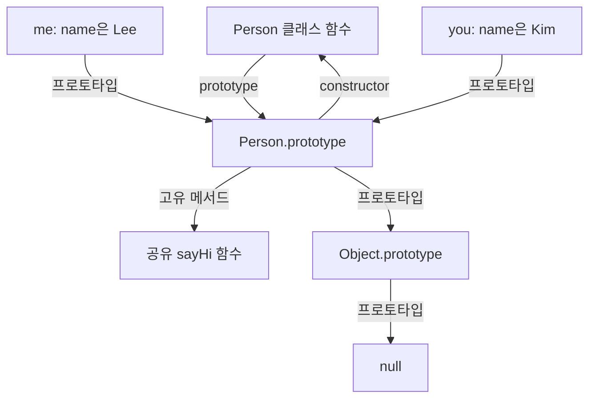
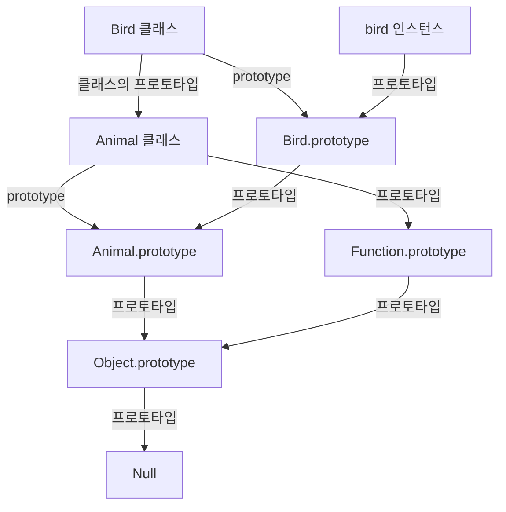
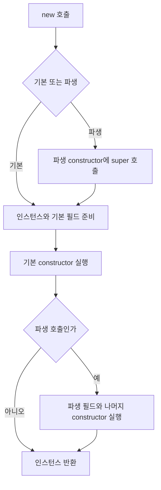

# 25장 클래스

- **클래스도 프로토타입을 사용한다**
- 인스턴스 프로퍼티, 프로토타입 메서드, 정적 메서드를 구분
- 클래스의 TDZ, 생성자 함수의 호이스팅 차이를 설명
- public 필드, `#private` 필드, getter, setter를 사용할 수 있다
- `extends`, `super()`, `super.method()` 의 동작을 구분
- 기본 클래스와 파생 클래스의 초기화 순서를 설명

## 25.1 클래스는 프로토타입 기반 문법인가?

**클래스는 프로토타입 기반 객체 생성과 상속을 더 명확한 문법으로 표현하지만, 생성자 함수의 단순한 별칭은 아니다.**

### 생성자 함수와 프로토타입으로 구현

```js
function Person(name) {
  this.name = name;
}

Person.prototype.sayHi = function () {
  return `Hi! My name is ${this.name}`;
};
```

### 같은 기능을 클래스로 구현

```js
class Person {
  constructor(name) {
    this.name = name;
  }

  sayHi() {
    return `Hi! My name is ${this.name}`;
  }
}

const me = new Person("Lee");
console.log(me.sayHi()); // Hi! My name is Lee
```

| 비교            | 생성자 함수                           | 클래스                         |
| --------------- | ------------------------------------- | ------------------------------ |
| 인스턴스 생성   | new로 호출                            | new로 호출                     |
| `new` 없는 호출 | 일반 함수로 실행                      | TypeError                      |
| 상속 문법       | 프로토타입 연결 등을 직접 구성        | extends, super 제공            |
| 선언 이전 접근  | 함수 선언문은 미리 호출 가능          | 초기화 전 TDZ에 접근 불가      |
| strict mode     | 코드 문맥, 지시문에 따라 결정         | 클래스 본문은 자동 적용        |
| 메서드 추가     | prototype에 직접 대입 가능            | 메서드 문법으로 정의           |
| 메서드 열거     | 일반 대입으로 추가하면 기본 열거 가능 | 클래스 메서드는 기본 열거 불가 |

**프로토타입 메서드는 공유되나 인스턴스의 상태는 각각 다르다** 클래스 문법을 사용해도 이 원리는 바뀌지 않음

---

## 25.2 클래스 정의

클래스 이름은 보통 `Person`, `Player`, `GameRoom`처럼 PascalCase로 작성한다.

### 25.2.1 클래스 선언문과 표현식

```js
// 클래스 선언문
class Person {}

// 익명 클래스 표현식
const Player = class {};

// 기명 클래스 표현식
const Room = class GameRoom {};

console.log(typeof Person); // function
console.log(typeof Player); // function
console.log(Room.name); // GameRoom
```

기명 클래스 표현식의 내부 이름은 클래스 내부에서 사용한다. 외부에서는 해당 클래스를 저장한 변수 `Room`으로 접근한다.

### 25.2.2 클래스도 일급 객체

| 특징              | 예                         |
| ----------------- | -------------------------- |
| 변수 저장         | const PlayerClass = Player |
| 배열, 객체에 저장 | const types = [Player]     |
| 함수 인수로 전달  | createInstance(Player)     |
| 함수에서 반환     | return class Player {}     |

```js
class Person {
  constructor(name) {
    this.name = name;
  }

  sayHi() {
    return `Hi! My name is ${this.name}`;
  }

  static sayHello() {
    return "Hello!";
  }
}

const me = new Person("Lee");
console.log(me.name); // Lee
console.log(me.sayHi()); // Hi! My name is Lee
console.log(Person.sayHello()); // Hello!
```

| 멤버            | 역할              | 저장, 호출 위치                     |
| --------------- | ----------------- | ----------------------------------- |
| constructor     | 인스턴스 초기화   | new Person(...) 과정에서 실행       |
| this.name       | 인스턴스 상태     | me.name                             |
| sayHi           | 프로토타입 메서드 | Person.prototype에 정의, me.sayHi() |
| static sayHello | 정적 메서드       | Person.sayHello()                   |

현재 클래스 본문에는 메서드뿐 아니라 public·private 필드, 정적 멤버, 정적 초기화 블록도 정의할 수 있다.

---

## 25.3 클래스 호이스팅

**클래스 선언의 바인딩은 미리 준비되나, 클래스 정의가 평가되기 전에는 초기화되지 않아 TDZ에 놓인다**

```js
const Person = "외부 값";

{
  try {
    console.log(Person);
  } catch (error) {
    console.log(error.name); // ReferenceError
  }

  class Person {}
  console.log(typeof Person); // function
}
```

안쪽 클래스의 바인딩이 바깥 `Person`을 가리고 있으나 초기화되기 전이라 바깥 값 대신 ReferenceError가 발생

| 선언 형태                    | 이전 상태            | 선언 이전 사용        |
| ---------------------------- | -------------------- | --------------------- |
| function Person() {}         | 함수 객체가 준비된다 | 호출이 가능           |
| var Person = class {}        | var 값이 undefined   | 클래스 값은 아직 없다 |
| let, const Person = class {} | 초기화되지 않음      | ReferenceError        |
| class Person {}              | 초기화되지 않음      | ReferenceError        |

클래스 평가에 상속 대상 결정, 클래스 객체, 프로토타입, 메서드 준비, 정적 필드 초기화 등이 포함된다. 정적 필드의 초기화 코드도 클래스 정의가 평가될 때 실행된다

---

## 25.4 인스턴스 생성

### new가 필요

```js
class Person {}

const me = new Person();
console.log(me instanceof Person); // true

try {
  Person();
} catch (error) {
  console.log(error.name); // TypeError
}
```

### `new` 호출 필요성 재확인 (원문에 반복 수록된 예제)

```js
class Person {}

const me = new Person();
console.log(me instanceof Person); // true

try {
  Person();
} catch (error) {
  console.log(error.name); // TypeError
}
```

### 기명 클래스 표현식의 이름 범위

```js
const Person = class MyClass {
  static getInternalName() {
    return MyClass.name;
  }
};

const me = new Person();
console.log(me.constructor === Person); // true
console.log(Person.getInternalName()); // MyClass
console.log(typeof MyClass); // undefined: 외부에 해당 식별자가 없음
```

`new MyClass()`를 외부에서 직접 실행하면 식별자를 찾지 못해 `ReferenceError`가 발생한다.

---

## 25.5 메서드

### 25.5.1 constructor

constructor는 new 호출에서 인스턴스를 초기화하는 특수한 클래스 멤버다. 클래스에 최대 한 개만 정의할 수 있음

```js
class Person {
  constructor(name, address = "Seoul") {
    this.name = name;
    this.address = address;
  }
}

const me = new Person("Lee");
console.log(me.name, me.address); // Lee Seoul
```

| 형태                         | 동작                             |
| ---------------------------- | -------------------------------- |
| 기본 클래스 constructor 생략 | 기본 생성자가 사용됨             |
| this.name = name             | 인스턴스 프로퍼티 생성, 대입     |
| constructor 두 개 선언       | SyntaxError                      |
| 기본 생성자가 객체 반환      | 반환한 객체가 new의 결과가 된다  |
| 기본 생성자가 원시 값 반환   | 원시 값은 무시되고 인스턴스 반환 |

#### `constructor`와 `prototype.constructor`는 다르다

| 이름                         | 의미                                                   |
| ---------------------------- | ------------------------------------------------------ |
| 클래스 본문의 constructor    | 인스턴스를 초기화하는 생성자 본문                      |
| Person.prototype.constructor | 기본적으로 Person 클래스 함수를 가리키는 일반 프로퍼티 |

```js
class Person {
  constructor(name) {
    this.name = name;
  }
}

console.log(Person.prototype.constructor === Person); // true
console.log(typeof Person); // function
```

`Person.prototype.constructor`를 바꾼다고 클래스의 생성자 본문 자체가 바뀌지는 않는다.

#### 생성자의 명시적 반환

```js
class ReturnsObject {
  constructor() {
    this.name = "Lee";
    return {
      name: "Kim",
    };
  }
}

class ReturnsPrimitive {
  constructor() {
    this.name = "Lee";
    return 100;
  }
}

const first = new ReturnsObject();
const second = new ReturnsPrimitive();

console.log(first.name); // Kim
console.log(first instanceof ReturnsObject); // false
console.log(second.name); // Lee
console.log(second instanceof ReturnsPrimitive); // true
```

일반적인 클래스에서는 명시적인 객체 반환을 생략하고, 생성·초기화한 인스턴스를 반환하도록 작성한다.

### 25.5.2 프로토타입 메서드

클래스의 일반 메서드는 `prototype`에 정의되어 인스턴스들이 공유한다.

```js
class Person {
  constructor(name) {
    this.name = name;
  }

  sayHi() {
    return this.name;
  }
}

const me = new Person("Lee");
const you = new Person("Kim");

console.log(me.sayHi()); // Lee
console.log(you.sayHi()); // Kim
console.log(me.sayHi === you.sayHi); // true
console.log(Object.hasOwn(me, "sayHi")); // false
console.log(Object.hasOwn(Person.prototype, "sayHi")); // true
```



두 인스턴스는 같은 메서드를 사용하지만 호출 수신 객체가 달라 `this.name` 결과가 달라진다.

### 25.5.3 정적 메서드

static 메서드는 클래스 함수 객체에 정의, 인스턴스를 만들지 않고 호출

```js
class Square {
  static area(width, height) {
    return width * height;
  }
}

console.log(Square.area(10, 10)); // 100

const square = new Square();
console.log(typeof square.area); // undefined
```

`square.area()`를 호출하면 `TypeError`가 발생한다. `Square.area`는 인스턴스의 프로토타입 체인에 있는 메서드가 아니다

### 25.5.4 정적 메서드와 프로토타입 메서드의 차이

| 비교          | 프로토타입 메서드    | 정적 메서드                              |
| ------------- | -------------------- | ---------------------------------------- |
| 저장 위치     | ClassName.prototype  | ClassName 함수 객체                      |
| 대표 호출     | instance.method()    | ClassName.method()                       |
| 호출 this     | 인스턴스             | 클래스                                   |
| 용도          | 인스턴스 상태        | 유틸리티, 생성, 팩터리, 클래스 상태 사용 |
| 인스턴스 필요 | 보통 인스턴스로 호출 | 없어도 호출 가능                         |

정적 메서드도 인수로 전달받은 인스턴스의 프로퍼티를 읽을 수 있다. '정적 메서드는 인스턴스 정보를 절대로 읽을 수 없다'는 의미가 아님

```js
class Player {
  constructor(name) {
    this.name = name;
  }

  static getName(player) {
    return player.name;
  }
}

console.log(Player.getName(new Player("Kim"))); // Kim
```

this를 사용하지 않는다고 모든 메서드를 무조건 static으로 바꿀 필요도 없다. 기능의 소속과 공개 API를 기준으로 결정

### 25.5.5 클래스 메서드 특징

- 메서드 정의에 function 키워드나 쉼표를 사용하지 않음
- 클래스 본문의 코드는 strict mode로 실행
- 일반·정적 클래스 메서드는 기본적으로 열거되지 않음
- 일반 클래스 메서드는 생성자로 호출할 수 없다

```js
class Person {
  name = "Lee";

  sayHi() {
    return this.name;
  }
}

const me = new Person();
console.log(Object.keys(me)); // ['name']
console.log(Object.keys(Person.prototype)); // []
console.log(Object.getOwnPropertyNames(Person.prototype)); // ['constructor', 'sayHi']

const descriptor = Object.getOwnPropertyDescriptor(Person.prototype, "sayHi");
console.log(descriptor.enumerable); // false
```

**클래스 메서드의 열거 불가와 public 인스턴스 필드의 열거 가능을 구분**

---

## 25.6 클래스의 인스턴스 과정

기본 클래스의 일반적인 `new` 호출은 다음 흐름으로 이해할 수 있다.

| 단계 | 처리                                       |
| ---- | ------------------------------------------ |
| 1    | 인스턴스 생성, prototype 연결, this 바인딩 |
| 2    | 기본 클래스의 인스턴스 필드 초기화         |
| 3    | constructor 본문 실행과 추가 초기화        |
| 4    | 완성된 인스턴스를 new 호출 결과로 반환     |

```js
class Person {
  constructor(name) {
    console.log(Object.getPrototypeOf(this) === Person.prototype); // true
    this.name = name;
  }
}

const me = new Person("Lee");
console.log(me.name); // Lee
```

`constructor`를 생략해도 선언한 인스턴스 필드는 초기화된다. 파생 클래스의 필드는 `super()`가 반환된 직후 초기화되므로 기본 클래스와 순서가 다르다.

---

## 25.7 프로퍼티

### 25.7.1 인스턴스 프로퍼티

```js
class Person {
  constructor(name) {
    this.name = name;
  }
}

const me = new Person("Lee");
console.log(Object.hasOwn(me, "name")); // true
console.log(me.name); // Lee

me.name = "Kim";
console.log(me.name); // Kim
```

일반 public 프로퍼티는 외부에서 읽거나 변경할 수 있다. 현재 JavaScript는 `#private` 문법도 제공하므로 모든 클래스의 상태가 반드시 public인 것은 아니다.

### 25.7.2 접근자 프로퍼티

getter·setter는 프로퍼티 읽기·대입을 처리하는 함수다. 메서드처럼 괄호를 붙여 호출하지 않음

```js
class Person {
  constructor(firstName, lastName) {
    this.firstName = firstName;
    this.lastName = lastName;
  }

  get fullName() {
    return `${this.firstName} ${this.lastName}`;
  }

  set fullName(name) {
    [this.firstName, this.lastName] = name.split(" ");
  }
}

const me = new Person("Ungmo", "Lee");
console.log(me.fullName); // Ungmo Lee

me.fullName = "Heegun Lee";
console.log(me.fullName); // Heegun Lee

console.log(Object.hasOwn(me, "fullName")); // false
console.log(Object.hasOwn(Person.prototype, "fullName")); // true
```

위 setter는 공백으로 구분된 두 부분의 예제.

| 구분        | 문법               | 실행 시점               |
| ----------- | ------------------ | ----------------------- |
| getter      | get fullName()     | me.fullName 읽을 때     |
| setter      | set fullName(name) | me.fullName에 대입      |
| 일반 메서드 | getFullName()      | me.getFullName()을 호출 |

getter 매개변수는 0개, setter 매개변수는 1개다. getter에 return이 없으면 읽기 결과는 undefined다

| 위치                          | 일반적인 접근자 저장 | 기본 enumerable |
| ----------------------------- | -------------------- | --------------- |
| 객체 리터럴의 getter·setter   | 해당 객체            | true            |
| 클래스의 일반 getter·setter   | ClassName.prototype  | false           |
| 클래스의 static getter·setter | ClassName 함수 객체  | false           |

### 25.7.3 클래스 필드 - 표준

클래스 본문에 필드를 선언하면 인스턴스에 고유 프로퍼티가 만들어진다. 초기값을 생략하면 `undefined`로 초기화된다.

```js
class Person {
  name = "Lee";
  address;
  greeting = `Hi! ${this.name}`;
}

const me = new Person();
console.log(me.name); // Lee
console.log(me.address); // undefined
console.log(me.greeting); // Hi! Lee
console.log(Object.keys(me)); // ['name', 'address', 'greeting']
```

필드 선언의 이름 앞에 `this`를 붙이지 않는다. 반면 **필드 초기화 표현식에서 `this`를 사용하는 것은 가능하다.**

```text
잘못된 선언: class Person { this.name = 'Lee'; }
올바른 선언: class Person { name = 'Lee'; }
올바른 참조: class Person { name = 'Lee'; greeting = this.name; }
```

#### 외부 인수로 초기화

필드 초기화 표현식은 constructor의 매개변수 스코프 안에 있지 않음. 생성자 인수는 `constructor`에서 `this`의 프로퍼티에 대입한다.

```js
class Person {
  name;

  constructor(name) {
    this.name = name;
  }
}

console.log(new Person("Kim").name); // Kim
```

public 프로퍼티는 사전 필드 선언 없이 constructor에 `this.name = name`으로 추가할 수도 있음. #private 필드는 사전에 클래스 본문에 선언해야 한다

#### 함수 필드와 프로토타입 메서드

```js
class Person {
  name = "Lee";

  getName() {
    return this.name;
  }

  readName = () => this.name;
}

const first = new Person();
const second = new Person();

console.log(first.getName === second.getName); // true
console.log(first.readName === second.readName); // false

const detached = first.readName;
console.log(detached()); // Lee
```

| 정의                     | 위치      | 함수              | this                         |
| ------------------------ | --------- | ----------------- | ---------------------------- |
| getName() {}             | prototype | 인스턴스들이 공유 | 호출 방식으로 결정           |
| getName = function () {} | 인스턴스  | 인스턴스마다 생성 | 호출 방식으로 결정           |
| getName = () => ...      | 인스턴스  | 인스턴스마다 생성 | 필드 초기화 환경의 this 사용 |

함수 필드를 무조건 금지하거나 무조건 사용하는 대신 호출 방식과 함수 객체 생성 비용을 비교. 콜백에서 인스턴스 this를 유지해야 할 때 화살표 함수 필드가 유용

### 25.7.4 private 필드 - 현재 표준 문법

**#private는 이름 관례가 아니라 JavaScript 언어가 접근을 제한하는 문법**

```js
class Person {
  #name;

  constructor(name) {
    this.#name = name;
  }

  get name() {
    return this.#name.trim();
  }
}

const me = new Person(" Lee ");
console.log(me.name); // Lee
console.log(Object.keys(me)); // [];
```

| 접근                                       | public name                | private #name                    |
| ------------------------------------------ | -------------------------- | -------------------------------- |
| 선언한 클래스의 코드에서 직접 접근         | 가능                       | 가능                             |
| 자식 클래스 코드에서 부모 상태에 직접 접근 | 가능                       | 부모의 #name에 직접 접근 불가    |
| 인스턴스를 통해 외부에서 직접 접근         | 가능                       | 일반 소스 코드에 SyntaxError     |
| 일반 프로퍼티 열거                         | 열거 가능 여부에 따라 표시 | 일반 프로퍼티 키로 열거되지 않음 |

부모 클래스가 정의한 getter·메서드를 상속받아 private 상태를 간접적으로 사용할 수 있다. `_name`이나 `obj['#name']` 같은 문자열 키는 #private와 다르다

```text
외부의 me.#name 접근: SyntaxError
클래스 본문에 #name 선언 없이 this.#name 대입: SyntaxError
```

### 25.7.5 static 필드 - 현재 표준 문법

static 필드는 각 인스턴스가 아니라 클래스에 정의된다

```js
class MyMath {
  static PI = 22 / 7;
  static #num = 10;

  static increment() {
    return ++MyMath.#num;
  }
}

console.log(MyMath.PI); // 3.14285714...
console.log(MyMath.increment()); // 11
console.log(typeof new MyMath().PI); // undefined
```

일반적인 원주율 계산에는 Math.PI를 사용

| 선언              | 소속                       | 외부 접근                   |
| ----------------- | -------------------------- | --------------------------- |
| name = 'Lee'      | 각 인스턴스                | 가능                        |
| #name = 'Lee'     | 각 인스턴스의 private 상태 | 직접 접근 불가              |
| static count = 0  | 클래스                     | ClassName.count             |
| static #count = 0 | 클래스의 private 상태      | 선언한 클래스 코드에서 접근 |

정적 메서드에서 this는 대표적인 `ClassName.method()` 호출의 수신 클래스다. 상속받은 정적 메서드를 자식 클래스로 호출하면 this는 자식 클래스가 될 수 있어 부모의 static #private를 this로 접근할 때 주의한다

#### 정적 초기화 블록 보충

```js
class Config {
  static values = [];

  static {
    this.values.push("initialized");
  }
}

console.log(Config.values); // ['initialized']
```

정적 필드와 정적 초기화 블록은 클래스 평가 과정에 선언 순서대로 처리된다. 인스턴스를 생성할 때마다 반복되는 초기화와 구분

---

## 25.8 상속에 의한 클래스 확장

### 25.8.1 클래스 상속과 생성자 함수 상속

**extends는 기존 클래스를 확장하는 문법이고 실제 상속 관계는 프로토타입을 통해 구현된다** 프로토타입 기반 상속과 무관한 별도의 엔진 모델이 생기는 것은 아니다.

```js
class Animal {
  constructor(age, weight) {
    this.age = age;
    this.weight = weight;
  }

  eat() {
    return "eat";
  }

  move() {
    return "move";
  }
}

class Bird extends Animal {
  fly() {
    return "fly";
  }
}

const bird = new Bird(1, 5);
console.log(bird.age, bird.weight); // 1 5
console.log(bird.eat(), bird.move(), bird.fly()); // eat move fly
console.log(bird instanceof Bird); // true
console.log(bird instanceof Animal); // true
```

생성자 함수의 상속도 구현할 수 있으나 prototype 연결과 부모 생성자 호출 등을 직접 구성해야 한다. class의 extends·super는 이를 명확하게 표현

### 25.8.2 extends 키워드와 두 프로토타입 체인

클래스 자체의 체인과 인스턴스의 체인을 구분

| 관계                       | 대표 코드                                                  | 상속 기능                |
| -------------------------- | ---------------------------------------------------------- | ------------------------ |
| Bird 클래스 상위객체       | Object.getPrototypeOf(Bird) === Animal                     | 부모의 public 정적 멤버  |
| Bird.prototype의 상위 객체 | Object.getPrototypeOf(Bird.prototype) === Animal.prototype | 부모의 프로토타입 메서드 |
| bird의 상위 객체           | Object.getPrototypeOf(bird) === Bird.prototype             | Bird의 프로토타입 메서드 |



```js
class Base {
  static type() {
    return "base";
  }

  run() {
    return "run";
  }
}

class Derived extends Base {}

console.log(Derived.type()); // base
console.log(new Derived().run()); // run
console.log(Object.getPrototypeOf(Derived) === Base); // true
console.log(Object.getPrototypeOf(Derived.prototype) === Base.prototype); // true
```

### 25.8.3 동적 상속

`extends` 뒤에는 클래스뿐 아니라 상속 가능한 생성자로 평가되는 표현식을 사용할 수 있다.

```js
function Base1(value) {
  this.value = value;
}

class Base2 {}

const condition = true;
class Derived extends (condition ? Base1 : Base2) {}

const derived = new Derived(10);
console.log(derived.value); // 10
console.log(derived instanceof Base1); // true
console.log(derived instanceof Base2); // false
```

상속 대상은 클래스 정의를 평가할 때 결정된다. 이후 조건 변수의 값을 바꾼다고 이미 정의된 클래스의 부모가 자동으로 바뀌지 않음. 화살표 함수처럼 생성자로 사용할 수 없는 함수는 일반적인 상속 대상이 될 수 없음

### 25.8.4 서브클래스의 constructor

| 종류        | constructor 동작                                            |
| ----------- | ----------------------------------------------------------- |
| 기본 클래스 | constructor() {}                                            |
| 파생 클래스 | constructor(...args) { super(...args); }와 유사한 인수 전달 |

```js
class Base {
  constructor(a, b) {
    this.a = a;
    this.b = b;
  }
}

class Derived extends Base {
  constructor(a, b, c) {
    super(a, b);
    this.c = c;
  }
}

const derived = new Derived(1, 2, 3);
console.log(derived.a, derived.b, derived.c); // 1 2 3
```

`...args`는 인수를 모으는 rest 매개변수고, `super(...args)`의 `...args`는 모은 인수를 펼쳐 전달하는 spread다

### 25.8.5 super 키워드

| 표현              | 의미                                 | 위치              |
| ----------------- | ------------------------------------ | ----------------- |
| super(...)        | 상위 생성자의 생성, 초기화 경로 실행 | 파생 constructor  |
| super.method(...) | 상위 메서드를 현재 수신 객체로 호출  | 일반, 정적 메서드 |

#### super()와 this

```js
class Base {}

class Derived extends Base {
  constructor(value) {
    try {
      console.log(this);
    } catch (error) {
      console.log(error.name); // ReferenceError
    }

    super();
    this.value = value;
  }
}

console.log(new Derived(10).value); // 10
```

일반적인 파생 인스턴스 초기화에서는 **`super()` 이후에 `this`를 사용한다.** 기본 클래스의 constructor이나 일반 함수에서 super()를 직접 호출하는 문법은 허용되지 않음

#### 생성자 반환 규칙 예외

| 생성자      | 반환                       | 결과                                                    |
| ----------- | -------------------------- | ------------------------------------------------------- |
| 기본 생성자 | 객체                       | 객체를 반환                                             |
| 기본 생성자 | 원시 값                    | 무시하고 인스턴스 반환                                  |
| 파생 생성자 | undefined 또는 반환문 생략 | 초기화된 this 필요                                      |
| 파생 생성자 | undefined 이외 원시 값     | TypeError                                               |
| 파생 생성자 | 객체                       | 객체를 반환, this를 사용하지 않았으면 super 없이도 가능 |

#### super.method() 오버라이딩

```js
class Base {
  constructor(name) {
    this.name = name;
  }

  sayHi() {
    return `Hi! ${this.name}`;
  }
}

class Derived extends Base {
  sayHi() {
    return `${super.sayHi()} how are you doing?`;
  }
}

const derived = new Derived("Lee");
console.log(derived.sayHi()); // Hi! Lee how are you doing?
```

상위 메서드를 찾더라도 호출 시 this는 현재 인스턴스다.

```text
Base.prototype.sayHi.call(this)
```

#### 객체 리터럴에서 super 참조 가능

```js
const base = {
  sayHi() {
    return `Hi! ${this.name}`;
  },
};

const derived = {
  __proto__: base,
  name: "Lee",

  sayHi() {
    return `${super.sayHi()} how are you doing?`;
  },
};

console.log(derived.sayHi()); // Hi! Lee how are you doing?
```

`super` 참조는 메서드 정의 문법을 사용하기 때문에 가능하다. `sayHi: function () { ... }`로 정의한 일반 함수에서 같은 super 참조를 직접 작성할 수 없음
정적 메서드에서 `super.method()`는 상위 클래스의 정적 메서드를 찾는다. 이때 대표 this는 호출한 클래스다

### 25.8.6 상속 클래스의 인스턴스 생성 과정

```js
class Rectangle {
  constructor(width, height) {
    console.log(new.target.name); // ColorRectangle
    console.log(Object.getPrototypeOf(this) === new.target.prototype); // true

    this.width = width;
    this.height = height;
  }

  getArea() {
    return this.width * this.height;
  }

  toString() {
    return `width = ${this.width}, height = ${this.height}`;
  }
}

class ColorRectangle extends Rectangle {
  constructor(width, height, color) {
    super(width, height);
    this.color = color;
  }

  toString() {
    return `${super.toString()}, color = ${this.color}`;
  }
}

const rectangle = new ColorRectangle(2, 4, 'red');
console.log(rectangle.getArea()); // 8
console.log(rectangle.toString()); // width = 2, height = 4, color = red
console.log(rectangle instanceof Rectangle); // true
console.log(rectangle instanceof ColorRectangle); // true
```

| 단계 | 처리                                                             |
| ---- | ---------------------------------------------------------------- |
| 1    | ColorRectangle constructor 진입, 파생 this 초기화 전             |
| 2    | super(width, height)로 상위 생성 경로 실행                       |
| 3    | 기본 생성 경로에서 인스턴스 생성, new.target 기준 prototype 연결 |
| 4    | 부모 필드와 Rectangle constructor에 너비, 높이 초기화            |
| 5    | super 반환 후 파생 this 바인딩, 자식 필드 초기화                 |
| 6    | ColorRectangle constructor 나머지 본문에서 color 초기화          |
| 7    | 같은 인스턴스를 최종 반환                                        |

**부모, 자식이 각각 다른 인스턴스를 만들어 합치는 것이 아님** 일반적인 생성 경로에 같은 인스턴스를 부모와 자식이 순서대로 초기화



일반적인 생성 흐름을 나타냄

#### 필드 초기화 순서 확인

```js
class Base {
  name = "base";

  constructor() {
    console.log(this.name); // base
  }
}

class Derived extends Base {
  name = "derived";

  constructor() {
    super();
    console.log(this.name); // derived
  }
}

new Derived();
```

부모 `constructor` 실행 중에는 자식의 필드가 아직 초기화되지 않는다. 부모 constructor 자식 메서드를 호출하고 메서드가 자식 #private에 접근하면 초기화 전 접근 오류가 생길 수 있음

### 25.8.7 표준 빌트인 생성자 함수 확장

```js
class MyArray extends Array {
  uniq() {
    return this.filter((value, index, self) => self.indexOf(value) === index);
  }

  average() {
    return this.reduce((sum, value) => sum + value, 0) / this.length;
  }
}

const values = new MyArray(1, 1, 2, 3);
console.log([...values.uniq()]); // [1, 2, 3]
console.log(values.average()); // 1.75
console.log(values.filter((value) => value >= 2) instanceof MyArray); // true
console.log(
  values
    .filter((value) => value >= 2)
    .uniq()
    .average(),
); // 2.5
```

예제는 숫자 배열을 가정한다. indexOf 기반 중복 제거는 NaN에 별도 주의 필요, 빈 배열의 `average()`는 `NaN`이다. 실제 함수에서는 입력과 빈 배열 처리 정책을 정함

#### 반환 타입과 체이닝

| 호출               | 기본 반환 | 다음 호출                     |
| ------------------ | --------- | ----------------------------- |
| values.filter(...) | MyArray   | uniq, average 사용 가능       |
| values.uniq()      | MyArray   | average 사용 가능             |
| values.average()   | Number    | MyArray 메서드 호출 경로 종료 |

filter, map 등은 기본 species 동작에서 서브클래스의 배열을 반환할 수 있음. 모든 새 배열 반환 메서드가 반드시 같은 서브클래스를 반환하는 뜻은 아님.

#### Symbol.species로 Array 반환

```js
class MyArray extends Array {
  static get [Symbol.species]() {
    return Array;
  }

  uniq() {
    return this.filter((value, index, self) => self.indexOf(value) === index);
  }

  average() {
    return this.reduce((sum, value) => sum + value, 0) / this.length;
  }
}

const values = new MyArray(1, 1, 2, 3);
const unique = values.uniq();

console.log(unique instanceof MyArray); // false
console.log(unique instanceof Array); // true
console.log(typeof unique.average); // undefined
```

`unique`는 일반 `Array`이므로 `unique.average()`를 호출하면 `TypeError`가 발생한다. 메서드가 어떤 타입을 반환하는지 알아야 체이닝 가능 여부를 판단할 수 있음

---

## 복습 질문·답변

### 1. 클래스도 프로토타입을 사용하는가?

그렇다. 일반 메서드는 클래스의 prototype에 정의되고 인스턴스가 이를 상속한다. extends도 클래스, 인스턴스의 프로토타입 관계를 구성

### 2. 클래스와 일반 생성자 함수의 대표적인 차이는 무엇인가?

클래스는 `new` 없이 호출할 수 없고, 선언 전 접근이 TDZ에 제한되며, 본문이 strict mode다. extends, super와 필드 문법도 제공한다

### 3. `constructor`와 `prototype.constructor`는 같은가?

전자는 인스턴스 초기화 본문, 후자는 기본적으로 클래스 함수를 가리키는 일반 프로퍼티다. 후자의 값을 변경해도 생성자 본문이 바뀌지 않는다

### 4. 클래스 메서드를 여러 인스턴스가 공유하는 이유는 무엇인가?

일반 메서드를 prototype에 한 번 정의하고 각 인스턴스가 객체를 상속하기 때문

### 5. 클래스 필드로 정의한 함수도 인스턴스들이 공유하는가?

아니다. 필드는 각 인스턴스의 고유 프로퍼티다. 함수 초기화 표현식으로 정의하면 함수 객체가 생성된다

### 6. 화살표 함수 필드가 콜백에서 유용한 이유는 무엇인가?

필드 초기화 환경의 this를 사용하므로 객체에서 분리해 호출하거나 콜백으로 전달해도 해당 인스턴스를 참조할 수 있음

### 7. getter와 setter는 어떻게 사용하는가?

getter는 프로퍼티를 읽는 문법으로, setter는 대입 문법으로 사용한다. getter의 매개변수는 0개, setter는 1개다

### 8. 클래스 메서드가 `Object.keys()`에 보이지 않는 이유는 무엇인가?

인스턴스가 아닌 prototype에 있고 클래스 메서드 자체도 기본적으로 열거 불가다. public 인스턴스 필드는 별개의 프로퍼티다

### 9. private 필드를 `constructor`에서 처음 선언해도 되는가?

안된다. 클래스 본문에서 #field를 먼저 선언, constructor에 값을 대입한다

### 10. 인스턴스 필드와 static 필드의 차이는 무엇인가?

인스턴스 필드는 각 인스턴스에, static 필드는 클래스에 정의. 인스턴스 메서드와 정적 메서드의 소속도 구분

### 11. 파생 `constructor`에서 `super()` 전에 `this`를 쓰면 어떻게 되는가?

일반적인 생성 경로에 아직 this가 초기화되지 않아 ReferenceError가 발생

### 12. `super.method()`에서 `this`는 무엇인가?

현재 호출의 수신 객체. 부모 메서드를 찾는 위치와 그 메서드에 사용하는 this를 구분

### 13. 부모 `constructor`에서 `new.target`은 무엇을 가리키는가?

해당 생성 호출에서 사용할 클래스를 가리킨다. new ColorRectangle(...) 경로면 부모 constructor에서도 ColorRectangle이다

### 14. 기본 클래스와 파생 클래스의 필드 초기화 시점은 같은가?

기본 클래스는 자기 constructor 본문 전에, 파생 클래스는 super 반환 직후 자기 constructor 나머지 본문 전에 초기화

### 15. `Symbol.species`를 `Array`로 지정하면 왜 체이닝이 끊길 수 있는가?

filter 등으로 얻은 결과가 일반 Array면 서브클래스에 추가한 메서드가 없어 해당 메서드를 이어 호출할 수 없기 때문이다
