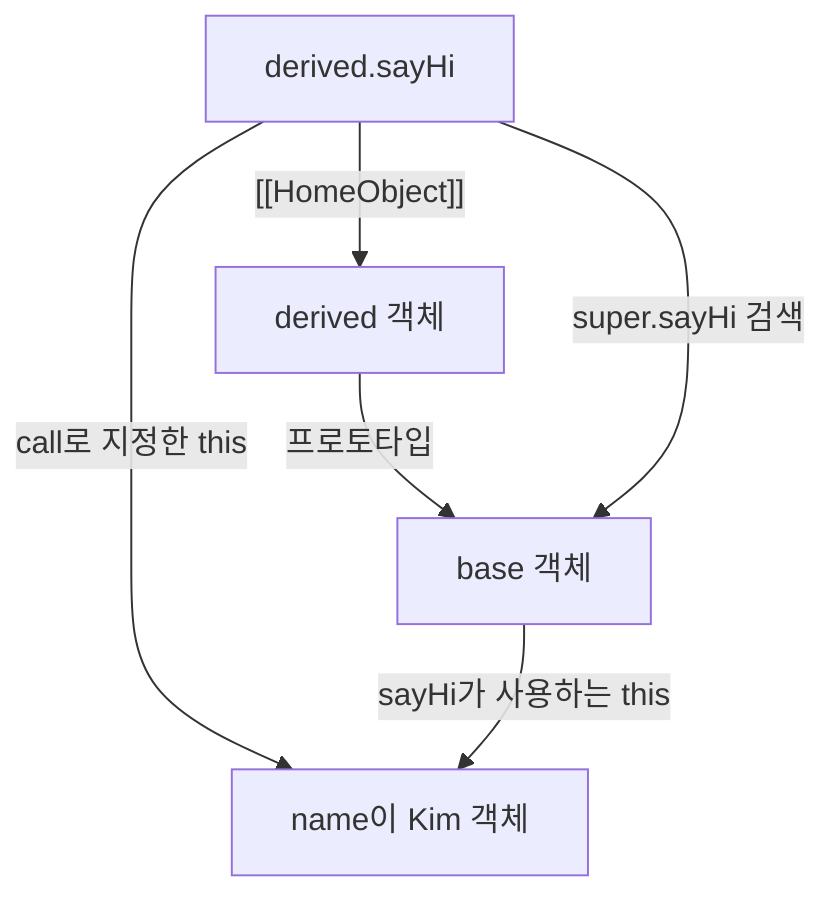

# 26.2 메서드

## 26.2.1 메서드 축약 표현과 함수 프로퍼티의 차이

일상적으로 객체의 함수 프로퍼티를 모두 메서드라고 부른다. ES6 메서드 문법으로 정의한 함수와 일반 함수 값 프로퍼티를 구분한다

```js
const obj = {
  x: 10,

  foo() {
    return this.x;
  },

  bar: function () {
    return this.x;
  },
};

console.log(obj.foo()); // 10
console.log(obj.bar()); // 10
console.log(Object.hasOwn(obj.foo, "prototype")); // false
console.log(Object.hasOwn(obj.bar, "prototype")); // true
console.log(new obj.bar() instanceof obj.bar); // true

try {
  new obj.foo();
} catch (error) {
  console.log(error.name); // TypeError
}
```

`obj.foo`와 `obj.bar`는 호출 결과가 같지만 생성자 사용 가능 여부가 다르다. `Object.hasOwn`은 ES2022 기능.
ES6 환경에서 `Object.prototype.hasOwnProperty.call(함수, 'prototype')`으로 확인할 수 있음

`Array.prototype.map`, `String.prototype.toUpperCase`, `Number.prototype.toFixed`, `Number.isFinite`, `Array.from` 같은 표준 메서드 생성자로 사용할 수 없다

## 26.2.2 `[[HomeObject]]`와 `super`

메서드의 `[[HomeObject]]`는 **메서드가 정의된 객체**를 기억하는 내부 슬롯이다. `super.prop`은 이 객체의 프로토타입에서 프로퍼티 검색을 시작한다.

```js
const base = {
  sayHi() {
    return `Hi ${this.name}`;
  },
};

const derived = {
  __proto__: base,
  name: "Lee",

  sayHi() {
    return `${super.sayHi()}, how are you doing?`;
  },
};

console.log(derived.sayHi());
// Hi! Lee, how are you doing?

const detached = derived.sayHi;
console.log(detached.call({ name: "Kim" }));
// Hi! Kim, how are you doing?
```

위 객체 리터럴에서 `derived.sayHi`의 `[[HomeObject]]`는 **`derived` 객체 자체**다. `derived.prototype`이 아니다. `super.sayHi()`로 찾은 메서드에도 현재 호출의 `this`가 전달된다.



**메서드를 다른 객체로 옮기거나 `call`로 호출해도 `[[HomeObject]]`는 바뀌지 않음.** 객체의 프로토타입 자체가 변경되면 `super`의 검색 대상도 달라질 수 있다.

```text
// 문법 오류 예제
const obj = {
  sayHi: function () {
    return super.sayHi(); // SyntaxError
  },
};
```

## 26.2.3 프로토타입에 메서드 추가하기

생성자 함수의 프로토타입에 일반 함수 값을 추가할 수 있음. 화살표 함수는 호출한 인스턴스를 `this`로 받지 않으므로 프로토타입 메서드 용도로는 적절하지 않다.

```js
function Person(name) {
  this.name = name;
}

Person.prototype.sayHi = function () {
  return `Hi! ${this.name}`;
};

console.log(new Person("Lee").sayHi()); // Hi! Lee
```

`Person.prototype = { constructor: Person, sayHi() {} }`처럼 새 객체로 교체할 수 있지만, 기존 인스턴스의 프로토타입은 자동으로 바뀌지 않음. 클래스 프로토타입 메서드는 25장에서 배운 `sayHi() {}` 문법으로 정의
