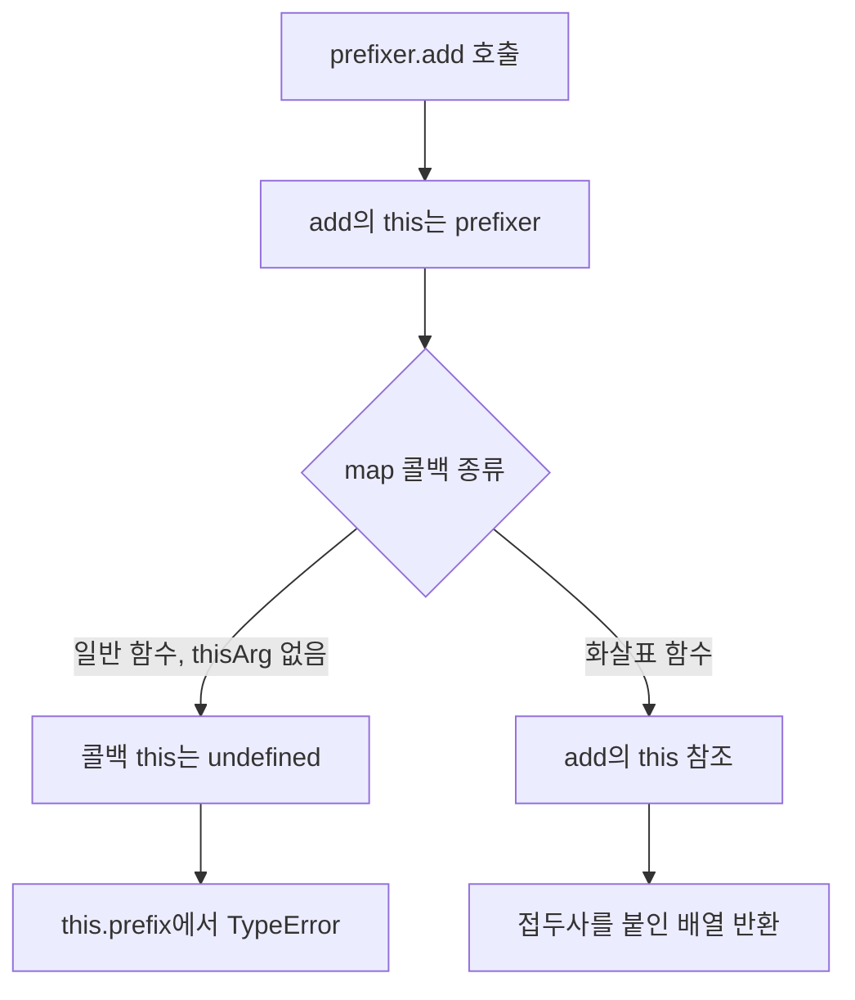

# 26.3 화살표 함수

화살표 함수는 `=>`로 정의하는 함수 표현식이다. 짧은 콜백을 작성하기 편하고, **자체 `this`를 만들지 않는다는 점**이 일반 함수와 가장 큰 차이

## 26.3.1 화살표 함수 정의

### 1. 매개변수 문법

| 매개변수                | 문법                                | 괄호 생략 |
| ----------------------- | ----------------------------------- | --------- |
| 없음                    | `() => 1`                           | 불가능    |
| 단순 매개변수 하나      | `x => x * 2`                        | 가능      |
| 둘 이상                 | `(x, y) => x + y`                   | 불가능    |
| 기본값, Rest, 구조 분해 | `(x = 1) => x`, `(...args) => args` | 불가능    |

```js
const double = (x) => x * 2;
const add = (x, y) => x + y;
const getNumber = () => 10;

console.log(double(3)); // 6
console.log(add(1, 2)); // 3
console.log(getNumber()); // 10
```

화살표 함수 자체에 함수 선언문 문법이 없다. `const add = ...`는 변수 선언문에 화살표 함수 표현식을 넣은 것

### 2. 표현식 본문과 블록 본문

| 본문                     | 반환 방식                          |
| ------------------------ | ---------------------------------- |
| `x => x * 2`             | 표현식 평가 결과를 암묵적으로 반환 |
| `x => { return x * 2; }` | `return`으로 명시적으로 반환       |
| `x => { x * 2; }`        | `return`이 없어 `undefined` 반환   |

```js
const implicit = (x) => x * 2;
const explicit = (x) => {
  const result = x * 2;
  return result;
};
const noReturn = (x) => {
  x * 2;
};

console.log(implicit(3)); // 6
console.log(explicit(3)); // 6
console.log(noReturn(3)); // undefined
```

표현식 본문에 `const x = 1` 같은 선언문을 바로 넣을 수 없다. 여러 문장을 실행하거나 변수를 선언하려면 블록 본문을 사용

### 3. 객체 리터럴 반환

객체 리터럴을 바로 반환하려면 **소괄호로 감싼다**

```js
const makeTodo = (id, content) => ({ id, content });
const wrong = () => {
  id: 1;
};

console.log(makeTodo(1, "JavaScript")); // { id: 1, content: 'JavaScript' }
console.log(wrong()); // undefined
```

`wrong`의 `{}`는 함수 본문, `id:`는 레이블이고 객체 반환이 아님

### 4. 즉시 실행 함수와 콜백

```js
const person = ((name) => ({ name }))("Lee");
const doubled = [1, 2, 3].map((value) => value * 2);

console.log(person.name); // Lee
console.log(doubled); // [2, 4, 5]
```

## 26.3.2 화살표 함수와 일반 함수의 차이

| 차이             | 화살표 함수 동작                          |
| ---------------- | ----------------------------------------- |
| 생성자           | `new` 호출 시 `TypeError`                 |
| 자체 `prototype` | 없음                                      |
| 중복 매개변수    | strict mode 여부와 무관하게 `SyntaxError` |
| `this`           | 바깥의 `this` 참조                        |
| `arguments`      | 바깥의 `arguments` 참조                   |
| `super`          | 유효한 바깥 문맥의 `super` 참조           |
| `new.target`     | 바깥 함수의 `new.target` 참조             |

```js
const Foo = () => {};

console.log(Object.hasOwn(Foo, "prototype")); // false

try {
  new Foo();
} catch (error) {
  console.log(error.name); //TypeError
}
```

중복 매개변수는 보통의 일반 함수에서 **비엄격 모드이며 매개변수 목록이 단순할 때만** 허용된다. 기본값, Rest, 구조분해가 있거나 strict mode이면 허용되지 않음

```text
const add = (a, a) => a + a;// SyntaxError
```

> **주의:** 자체 `this` 바인딩이 없다는 말은 화살표 함수에 스코프가 없다는 뜻은 아니다. 매개변수와 지역 변수는 정상적으로 자기 스코프에 속한다. `super`와 `new.target`도 문법적으로 허용되는 바깥 문맥이 있어야 참조할 수 있음.

## 26.3.3 `this`

### 1. 일반 콜백 함수의 `this` 문제

`Array.prototype.map`은 기본적으로 콜백에 전달할 `thisArg`를 지정하지 않음. 클래스 메서드 안에 정의한 함수는 strict mode로 실행, 아래 콜백의 `this`는 `undefined`다

```js
class Prefixer {
  constructor(prefix) {
    this.prefix = prefix;
  }

  add(items) {
    return items.map(function (item) {
      return this.prefix + item;
    });
  }
}

try {
  new Prefixer('pre-').add(['A', 'B']);
} catch (error) {
  console.log(error.name); // TypeError
}
```

`prefixer.add()`의 `this`가 인스턴스라는 사실만으로, 내부의 일반 콜백에도 같은 `this`가 자동으로 전달되지 않음

### 2. 해결 방법 비교

| 방법             | 코드                                    | 동작                          |
| ---------------- | --------------------------------------- | ----------------------------- |
| 외부 변수에 저장 | `const that = this`                     | 콜백에서 `that` 참조          |
| `thisArg` 전달   | `items.map(callback, this)`             | `map`이 콜백의 `this`로 사용  |
| `bind`           | `callback.bind(this)`                   | 바인딩한 함수를 콜백으로 전달 |
| 화살표 함수      | `items.map(item => this.prefix + item)` | `add`의 `this`를 렉시컬 참조  |

```js
class Prefixer {
  constructor(prefix) {
    this.prefix = prefix;
  }

  usingVariable(items) {
    const that = this;
    return items.map(function (item) {
      return that.prefix + item;
    });
  }

  usingThisArg(items) {
    return items.map(function (item) {
      return this.prefix + item;
    }, this);
  }

  usingBind(items) {
    return items.map(
      function (item) {
        return this.prefix + item;
      }.bind(this),
    );
  }

  usingArrow(items) {
    return items.map((item) => this.prefix + item);
  }
}

const prefixer = new Prefixer("pre-");
for (const method of [
  "usingVariable",
  "usingThisArg",
  "usingBind",
  "usingArrow",
]) {
  console.log(prefixer[method](["A", "B"]));
  //모두 ['pre-A', 'pre-B']
}
```

`thisArg`를 받는 API인지 확인해야 한다. 모든 콜백 API가 `map`과 같은 방식으로 `this`를 제공하지는 않는다.



### 3. 렉시컬 `this`

화살표 함수의 `this`는 **정의된 환경의 바깥 `this` 바인딩**을 참조한다. 호출 시점에 `call`, `apply`, `bind`로 바꿀 수 없다

```js
function createArrow() {
  return () => this.value;
}

const arrow = createArrow.call({ value: 10 });

console.log(arrow()); // 10
console.log(arrow.call({ value: 20 })); // 10
console.log(arrow.apply({ value: 30 })); // 10
console.log(arrow.bind({ value: 40 })()); // 10
```

바깥 함수가 일반 함수면 그 함수의 `this`는 호출 방식으로 결정. 화살표 함수는 결정된 바깥 바인딩을 참조한다.
중첩된 화살표 함수도 자체 `this`를 만들지 않아 바깥으로 계속 탐색

```js
function createNested() {
  return () => () => this.value;
}

const nested = createNested.call({ value: 10 });
console.log(nested()()); // 10
```

화살표 함수를 `function () {}.bind(this)`와 비교할 수는 있지만 **모든 동작이 동일한 것은 아니다** `arguments`, 생성자 사용 여부 등이 다르다.

### 4. `call`, `apply`, `bind`는 사용할 수 있음

메서드들이 사라지는 것이 아닌, 화살표 함수의 `this`를 교체하지 못하는 것. 인수 전달과 `bind`의 인수 고정은 가능하다

```js
const add = (a, b) => a + b;

console.log(add.call(null, 1, 2)); // 3
console.log(add.apply(null, [1, 2])); // 3

const addOne = add.bind(null, 1);
console.log(addOne(2)); // 3
```

### 5. 객체의 화살표 함수 프로퍼티

객체 리터럴의 `{}`는 새로운 `this` 바인딩을 만들지 않음. 따라서 함수 프로퍼티를 화살표 함수로 만들면 그 객체가 아니라 바깥 환경의 `this`를 참조한다

```js
function createPerson() {
  return {
    name: "Lee",
    arrow: () => this.name,
    method() {
      return this.name;
    },
  };
}

const person = createPerson.call({ name: "Outer" });

console.log(person.arrow()); // Outer
console.log(person.method()); // Lee
```

호출한 객체를 `this`로 사용해야 하는 메서드는 메서드 문법으로 정의. 다만 바깥 `this`를 유지하려는 의도가 분명하면 화살표 함수 프로퍼티도 사용할 수 있음

### 6. 전역 화살표 함수의 `this`는 환경에 따라 다르다

| 최상위 실행환경          | 최상위 `this`                 |
| ------------------------ | ----------------------------- |
| 브라우저 일반 `<script>` | 전역 객체를 가리키는 `window` |
| ES 모듈                  | `undefined`                   |
| Node.js CommonJS 파일    | `module.exports`              |

"전역에서 만든 화살표 함수의 `this`는 항상 전역 객체"라고 암기하면 안 된다. REPL은 파일 실행과 동작이 다를 수 있음

### 7. 클래스의 화살표 함수 필드

클래스의 **인스턴스 필드 초기화 문맥**에서 `this`는 생성 중인 인스턴스다. 화살표 함수는 인스턴스를 렉시컬하게 참조한다.

```js
class Person {
  constructor(name) {
    this.name = name;
  }

  sayHi = () => `Hi! ${this.name}`;

  greet() {
    return `Hi! ${this.name}`;
  }
}

const a = new Person("Lee");
const b = new Person("Kim");
const detached = a.sayHi;

console.log(detached()); // Hi! Lee
console.log(detached.call(b)); // Hi! Lee
console.log(a.sayHi === b.sayHi); // false
console.log(a.greet === b.greet); // true
console.log(Object.hasOwn(a, "sayHi")); // true
console.log(Object.hasOwn(b, "greet")); // false

try {
  const greet = a.greet;
  greet();
} catch (error) {
  console.log(error.name); // TypeError
}
```

| 구분               | 프로토타입 메서드 `greet() {}` | 화살표 함수 필드 `sayHi = () => ...` |
| ------------------ | ------------------------------ | ------------------------------------ |
| 저장 위치          | `Person.prototype`             | 인스턴스                             |
| 함수 공유          | 인스턴스끼리 공유              | 인스턴스마다 별도 함수 생성          |
| `this`             | 호출 방식에 따라 결정          | 필드 초기화 시 인스턴스 참조         |
| 분리해서 일반 호출 | 인스턴스 `this` 유지 안 됨     | 인스턴스 `this` 유지                 |
| 적합한 상황        | 여러 인스턴스가 공유할 동작    | 분리해서 전달한 콜백의 `this` 유지   |

**화살표 함수 필드를 무조건 나쁜 코드로 볼 필요는 없음** 콜백으로 전달할 때 유용하나 함수와 클로저가 인스턴스마다 만들어짐. 공용 동작은 프로토타입 메서드를 우선 고려.

## 26.3.4 `super`

화살표 함수는 자체 `super` 바인딩이 없지만, 유효한 바깥 메서드 문맥의 `super`를 참조할 수 있다.

```js
class Base {
  constructor(name) {
    this.name = name;
  }

  sayHi() {
    return `Hi! ${this.name}`;
  }
}

class Derived extends Base {
  sayHi() {
    const append = () => `${super.sayHi()}, how are you doing?`;
    return append();
  }
}

console.log(new Derived("Lee").sayHi()); // Hi! Lee, how are you doing?
```

인스턴스 필드 화살표 함수에서 부모의 프로토타입 메서드를 참조할 수 있음

```js
class Base {
  sayHi() {
    return `Hi ${this.name}`;
  }
}

class Derived extends Base {
  name = "Lee";
  sayHi = () => `${super.sayHi()}, how are you doing?`;
}

console.log(new Derived().sayHi()); // Hi! Lee, how are you doing?
```

위 `super.sayHi`의 검색은 `Base.prototype`에서 시작한다. **부모 클래스의 인스턴스 필드에 저장한 화살표 함수는 인스턴스 프로퍼티**이므로 `super`로 찾는 부모 프로토타입 메서드와 구분해야 한다. `super.prop` 참조와 파생 생성자의 `super()` 호출도 서로 다른 동작.

## 26.3.5 `arguments`

화살표 함수는 자체 `arguments` 객체가 없다. 참조 가능한 바깥 일반 함수의 `arguments`를 사용

```js
function order(a, b) {
  const arrow = () => [...arguments];
  return arrow(3, 4);
}

console.log(order(1, 2)); // [1, 2]
```

`arrow(3, 4)` 를 호출했으나 `arguments`는 `order(1, 2)`의 인수다. 화살표 함수 자신의 인수 목록이 필요하면 Rest 파라미터를 사용한다

```js
const collect = (...args) => args;

console.log(collect(1, 2, 3)); // [1, 2, 3]
console.log(collect()); // []
```

브라우저 일반 스크립트와 ES 모듈의 최상위에 함수 호출의 `arguments`가 없다. Node.js CommonJS에서 모듈 래퍼의 `arguments`가 보일 수 있어 최상위 실험 결과를 모든 환경에 일반화하지 않음.

## 26.3.6 `new.target`

`new.target`은 생성자 호출에 사용된 대상을 확인하는 메타 프로퍼티다. 일반 함수를 `new` 없이 호출하면 `undefined`, `new`와 함께 호출하면 생성자 함수가 된다. 내부 화살표 함수는 바깥 함수의 값을 참조한다.

```js
function foo() {
  const getTarget = () => new.target;
  return getTarget();
}

console.log(foo()); // undefined
console.log(new foo() === foo); // true
```

`new foo()`는 화살표 함수가 읽은 `new.target`을 반환한다. 이 값은 생성자 함수 `foo`이며, 함수도 객체이므로 `new`로 만든 인스턴스 대신 반환된다.
