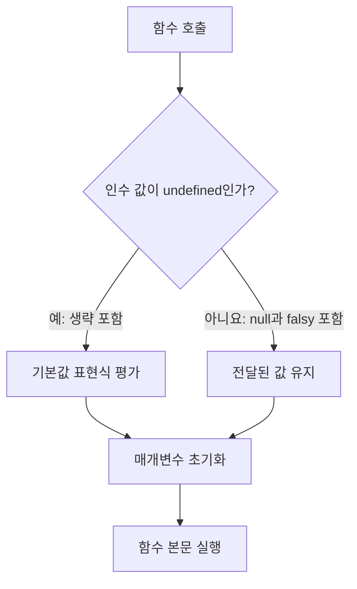

# 26.5 매개변수 기본값

## 26.5.1 인수가 누락되면 `undefined`

JavaScript는 일반적으로 함수 호출 시 매개변수 개수와 인수 개수가 다르다는 이유만으로 오류가 발생하지 않는다. 누락된 인수에 해당하는 매개변수는 `undefined`가 된다

```js
function sum(x, y) {
  return x + y;
}

console.log(sum(1)); // NaN
```

`1 + undefined`의 결과가 `NaN`이 되기 때문이다. 기본값을 정의하면 누락된 인수를 처리할 수 있음

```js
function sum(x = 0, y = 0) {
  return x + y;
}

console.log(sum(1, 2)); // 3
console.log(sum(1)); // 1
console.log(sum()); // 0
console.log(sum(undefined, 2)); // 2
```

## 26.5.2 기본값은 생략 또는 `undefined`일 때만 적용

```js
function identity(value = "default") {
  return value;
}

console.log(identity()); // default
console.log(identity(undefined)); // default
console.log(identity(null)); // null
console.log(identity(0)); // 0
console.log(identity(false)); // false
console.log(identity("")); // 빈 문자열
```

| 전달한 인수 | 기본값 적용 | 매개변수 값 |
| ----------- | ----------- | ----------- |
| 생략        | 예          | 기본값      |
| `undefined` | 예          | 기본값      |
| `null`      | 아니요      | `null`      |
| `0`         | 아니요      | `0`         |
| `false`     | 아니요      | `false`     |
| `''`        | 아니요      | 빈 문자열   |

**기본값은 타입 검증을 대신하지 않음**

## 26.5.3 `||`을 이용한 기본값과의 차이

`value || defaultValue`는 `0`, `false`, `''` 같은 유효한 값도 바꿀 수 있음

```js
function oldPrice(price) {
  price = price || 100;
  return price;
}

function priceWithDefault(price = 100) {
  return price;
}

console.log(oldPrice(0)); // 100
console.log(priceWithDefault(0)); // 0
```

| 방식                                     | 대체하는 값           |
| ---------------------------------------- | --------------------- |
| 매개변수 기본값                          | 생략 또는 `undefined` |
| `value === undefined ? fallback : value` | `undefined`           |
| `value ?? fallback`                      | `null`, `undefined`   |
| 논리 OR 연산자                           | 모든 falsy 값         |

`null`도 기본값으로 대체하려면 함수 본문에서 `value ?? fallback`을 사용할 수 있다.



## 26.5.4 함수 `length`에 미치는 영향

> 기본값은 함수 `length`에 영향을 준다. `length`는 **첫 번째 기본값 매개변수 앞까지의 매개변수 개수**이며, Rest 파라미터는 제외된다.

```js
function a(x, y) {}
function b(x, y = 0) {}
function c(x = 0, y) {}
function d(x, y = 0, z) {}
function e(x, ...rest) {}

console.log(a.length); // 2
console.log(b.length); // 1
console.log(c.length); // 0
console.log(d.length); // 1
console.log(e.length); // 1
```

| 함수 정의       | `length` | 이유                    |
| --------------- | -------- | ----------------------- |
| `(x, y)`        | 2        | 기본값 없음             |
| `(x, y = 0)`    | 1        | 첫 기본값 앞은 `x` 하나 |
| `(x = 0, y)`    | 0        | 첫 매개변수부터 기본값  |
| `(x, y = 0, z)` | 1        | 기본값 뒤의 `z`도 제외  |
| `(x, ...rest)`  | 1        | Rest 제외               |

함수 객체의 `length`는 실제 호출에 전달한 인수 개수가 아님. 실제 인수 개수는 일반 함수 내부의 `arguments.length` 등으로 확인. 구조 분해 매개변수는 패턴 하나를 매개변수 하나로 계산한다

## 26.5.5 기본값과 `arguments`

기본값을 적용해도 호출자가 전달하지 않은 인수가 `arguments`에 추가되지 않음

```js
function sum(x, y = 0) {
  console.log(y);
  console.log(arguments.length);
  console.log([...arguments]);
  return x + y;
}

console.log(sum(1)); // 0 -> 1 -> [1] -> 1
console.log(sum(1, undefined)); // 0 -> 2 -> [1, undefined] -> 1
console.log(sum(1, 2)); // 2 -> 2 -> [1, 2] -> 3
```

"기본값은 `arguments`에 아무 영향도 없다"라고 일반화해서 안 된다. 기본값, Rest, 구조 분해 매개변수가 있으면 비엄격 모드에서 **매개변수와 `arguments` 원소가 자동으로 동기화되지 않음**

```js
function update(x = 0) {
  x = 10;
  return arguments[0];
}

console.log(update(1)); // 1
```

비엄격 모드의 단순 매개변수 목록에 대응하는 매개변수와 `arguments` 원소가 동기화될 수 있음

## 26.5.6 기본값의 평가 시점과 순서

기본값 표현식은 **기본값이 필요한 호출에서만**, 매개변수의 **왼쪽에서 오른쪽 순서**로 평가된다.

```js
function append(value, items = []) {
  items.push(value);
  return items;
}

console.log(append(1)); // [1]
console.log(append(2)); // [2]

function makePair(x = 1, y = x + 1) {
  return [x, y];
}

console.log(makePair()); // [1, 2]
console.log(makePair(10)); // [10, 11]
```

위 `items = []`는 기본값이 필요한 호출마다 새 배열을 만든다. 호출자가 배열을 직접 전달하면 그 배열을 사용

초기화되지 않은 뒤쪽 매개변수를 기본값에서 참조하면 TDZ로 인한 오류가 발생

```js
function wrong(x = y, y = 1) {
  return [x, y];
}

try {
  wrong();
} catch (error) {
  console.log(error.name); // ReferenceError
}
```

기본값 초기화 문맥에서 함수 본문 안의 선언을 참조할 수 없음. 바깥 스코프에 같은 이름이 없다는 전제에 아래 호출은 오류가 발생

```js
function create(value = makeValue()) {
  function makeValue() {
    return 1;
  }
  return value;
}

try {
  create();
} catch (error) {
  console.log(error.name); // ReferenceError
}
```

## 복습 질문·답변

### 객체의 `f: function () {}`와 `f() {}`는 무엇이 다른가?

- 전자는 일반 함수 값 프로퍼티로 생성자 사용이 가능하다. 후자는 일반 축약 메서드로 생성자 사용이 불가능하고 `[[HomeObject]]`를 가진다

### 생성자 여부를 `.prototype` 유무만으로 판단해도 되는가?

- 아니다. 제너레이터 함수는 `.prototype`이 있어도 생성자가 아니고, 생성자를 바인딩한 함수는 자체 `.prototype`이 없어도 생성자로 사용할 수 있음

### `derived.sayHi`를 분리해 `call(other)`로 호출하면 `super`의 검색 기준도 `other`로 바뀌는가?

- 아니다. `this`는 `other`가 되나 `super`의 검색 기준은 `[[HomeObject]]`의 프로토타입이다

### `() => { value: 1 }`은 무엇을 반환하는가?

- `undefined`다. `{}`가 블록 본문으로 해석된다. 객체 반환은 `() => ({ value: 1 })`이다

### 화살표 함수를 `new`로 호출하면 어떻게 되는가?

- `TypeError`가 발생한다. 화살표 함수는 생성자로 사용할 수 없다.

### 메서드 안의 일반 콜백은 `this`를 자동으로 받는가?

- 아니다. 콜백의 호출 방식과 API에 따라 결정. 화살표 함수는 바깥 메서드의 `this`를 참조할 수 있음

### 화살표 함수의 `this`를 `bind`로 바꿀 수 있는가?

- 바꿀 수 없다. 다만 `bind`로 인수를 미리 지정할 수 있다.

### 객체 리터럴의 화살표 함수가 그 객체를 `this`로 사용하지 않는 이유는 무엇인가?

- 객체 리터럴은 자체 `this` 바인딩을 만들지 않음. 화살표 함수는 정의된 바깥 문맥의 `this`를 참조

### 클래스의 화살표 함수 필드는 인스턴스끼리 공유되는가?

- 아니다. 인스턴스마다 별도 함수가 만들어짐. 일반 프로토타입 메서드는 공유된다

### 화살표 함수에서 `arguments`를 읽으면 누구의 인수를 얻는가?

- 참조 가능한 바깥 함수의 인수. 화살표 함수 자신의 가변 인수는 Rest 파라미터로 수집

### `function f(x, ...rest) {}`에 `f(1, 2, 3)`을 호출하면 어떻게 되는가?

- `x`는 `1`, `rest`는 `[2, 3]`이 되며, `arguments`에는 세 인수가 모두 들어간다.

### Rest와 Spread의 차이는 무엇인가?

- Rest는 함수 매개변수에 인수를 배열로 모으고, 함수 호출의 Spread는 이터러블을 개별 인수로 펼친다.

### 기본값이 적용되는 인수는 무엇인가?

- 생략 또는 `undefined`다. `null`, `0`, `false`, `''` 는 그대로 유지된다

### `function f(x, y = 0, z, ...rest) {}`의 `length`는 얼마인가?

`1`이다. 첫 기본값 매개변수 `y`, `x`만 계산한다

### `function f(x = y, y = 1) {}`를 `f()`로 호출하면 어떻게 되는가?

`ReferenceError`가 발생한다. `x`의 기본값 평가 시 `y`는 아직 초기화되지 않음.
