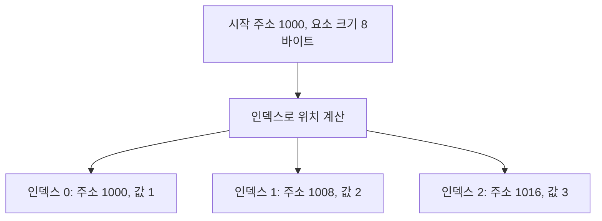
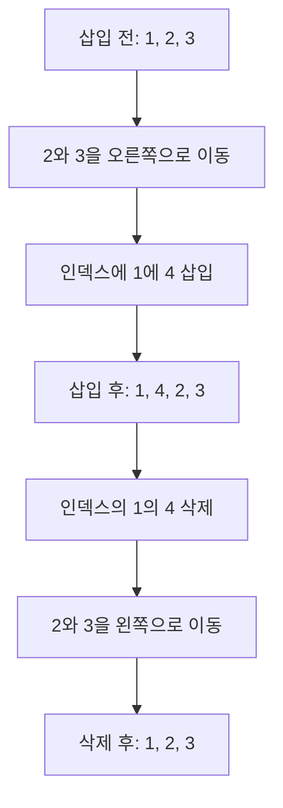

## 27.2 JavaScript 배열은 일반적인 배열과 다르다

자료구조에 전형적인 배열은 같은 크기의 저장 공간이 연속해서 배치된다. 요소 주소를 인덱스로 계산할 수 있어 임의 접근이 빠르다

JavaScript의 `Array`는 길이가 변하고 서로 다른 타입을 담을 수 있는 **배열 특수 객체**다. 메모리 배치 방식은 언어사양이 고정하지 않아 엔진이 최적화된다

| 구분        | 연속 배열                          | JavaScript `Array`               |
| ----------- | ---------------------------------- | -------------------------------- |
| 요소 타입   | 같은 타입을 사용하는 경우가 일반적 | 서로 다른 타입 가능              |
| 길이        | 구현,언어에 따라 고정 또는 재할당  | 동적으로 변경 가능               |
| 빈 스롯     | 보통 없음                          | 존재할 수 있음                   |
| 메모리 배치 | 연속 저장을 전제로 설명            | 사양이 특정 구현을 강제하지 않음 |
| 인덱스      | 요소 주소 계산                     | 배열 인덱스 프로퍼티 규칙        |

```js
const descriptors = Object.getOwnPropertyDescriptors([1, 2]);

console.log(descriptors["0"].value); // 1
console.log(descriptors["0"].enumerable); // true
console.log(descriptors.length.value); // 2
console.log(descriptors.length.enumerable); // false
console.log(descriptors.length.configurable); // false
```

### 주의할 점

- JavaScript 배열이 항상 해시 테이블로 저장되는 건 아님
- 모든 JavaScript 배열이 희소 배열인 것은 아님
- 특정 값 검색이나 중간 삽입, 삭제가 항상 다른 배열 구현보다 빠르다고 단정할 수 없다
- `arr[arr.length] = value`가 `push` 빠르다는 보장도 없음
- 단일 측정의 "배열이 객체보다 2배 빠르다"는 보편적인 규칙이 아님

V8 같은 엔진은 요소 종류와 빈 슬롯 유무에 따라 배열을 최적화한다. 가독성과 올바른 동작을 먼저 확보, 성능이 실제 문제일 때 해당 환경에서 측정

고정된 숫자 타입을 다루려면 `Uint8Array`, `Float64Array` 같은 TypedArray도 별도로 학습할 수 있음

### 연속 메모리 배열 주소 계산

전형적인 연속 배열은 같은 크기 저장 공간을 나란히 배치. 시작 주소와 요소 크기를 알면 인덱스로 주소를 계산

```text
요소의 주소 = 시작 주소 + 인덱스 x 요소 바이트 수
```

| 인덱스 |  값 | 게산         | 주소 |
| -----: | --: | ------------ | ---: |
|      0 |   1 | 1000 + 0 x 8 | 1000 |
|      1 |   2 | 1000 + 1 x 8 | 1008 |
|      2 |   3 | 1000 + 2 x 8 | 1016 |



### 중간 삽입, 삭제와 요소 이동

연속 배열에 [1, 2, 3]의 인덱스 1에 4를 끼워 넣으면 2와 3의 자리를 뒤로 옮김.



### 선형 검색 예제

정렬되지 않은 값 목록에 순서대로 찾은 선형 검색은 최악의 경우 모든 요소를 확인

```js
function linearSearch(array, target) {
  for (let index = 0; index < array.length; index++) {
    if (array[index] === target) {
      return index;
    }
    return -1;
  }
}

console.log(linearSearch([1, 2, 3, 4], 3)); // 2
console.log(linearSearch([1, 2, 3, 4], 0)); // -1
```

구현의 시간 복잡도는 최악의 경우 `O(n)`이다. 모든 배열 메서드의 시간 복잡도가 ECMAScript가 사양에 고정되어 있다는 것은 아님.

### 배열은 인덱스와 length를 특별하게 다루는 객체

```js
const descriptors = Object.getOwnPropertyDescriptors([1, 2, 3]);

console.log(descriptors["0"]); // { value: 1, writable: true, enumerable: true, configurable: ture}
console.log(descriptors.length); // { value: 3, writable: true, enumerable: false, configurable: false}
```

인덱스 0 값은 이름이 '0'인 프로퍼티로 관찰. length는 일반 요소와 달리 열거되지 않고 삭제할 수 없고, 인덱스 변경과 연결되는 동작을 가짐
