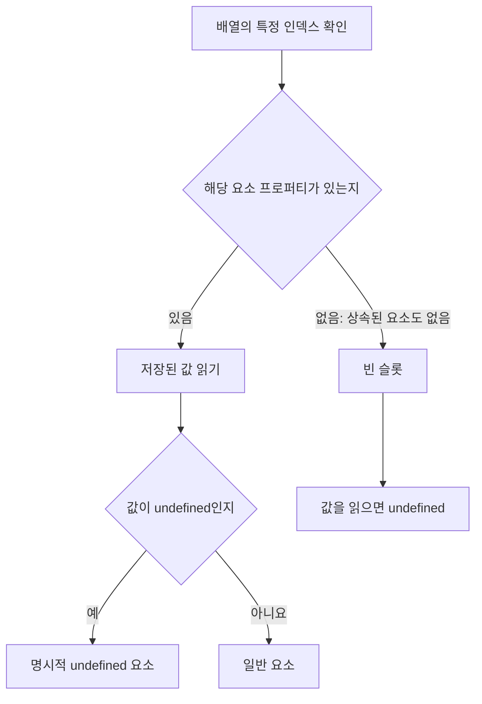

## 27.3 `length` 프로퍼티와 희소 배열

### 1. `length`의 의미와 범위

빈 슬롯이 없는 보통의 배열에서 `length`와 요소 수가 같다. 희소 배열에서 다를 수 있다

| 항목             | 범위                       |
| ---------------- | -------------------------- |
| 유효한 `length`  | `0`부터 `2 ** 32 - 1` 까지 |
| 최대 `length`    | `4,294,967,295`            |
| 배열 인덱스      | `0`부터 `2 **32 - 2` 까지  |
| 최대 배열 인덱스 | `4,294,967,294`            |

일반적인 밀집 배열의 마지막 인덱스는 `length - 1`이다. `length`를 크게 늘릴 수 있어 **마지막 위치에 요소가 존재하는 것은 아니다(항상)**

### 2. `length`를 줄이거나 늘리기

```js
const numbers = [1, 2, 3, 4, 5];

numbers.length = 3;
console.log(numbers); // [1, 2, 3]

numbers.length = 5;
console.log(numbers.length); // 5
console.log(numbers[3]); // undefined
console.log(Object.hasOwn(numbers, 3)); // false
console.log(Object.keys(numbers)); // ['0', '1', '2']
```

| 변경                       | 결과                                           |
| -------------------------- | ---------------------------------------------- |
| `length` 감소              | 범위 밖의 요소 삭제                            |
| `length` 증가              | 길이 증가, 값을 가진 요소는 자동 생성되지 않음 |
| 음수, 소수, 범위 초과 할당 | `RangeError`                                   |

```js
for (const length of [-1, 1.5, 2 ** 32]) {
  try {
    const array = [];
    array.length = length;
  } catch (error) {
    console.log(error.name); // RangeError
  }
}
```

> `Object.hasOwn`은 ES2022기능.

### 3. 빈 슬롯과 `undefined`는 다르다

```js
const sparse = [1, , 3];
const explicit = [1, undefined, 3];

console.log(sparse[1]); // undefined
console.log(explicit[1]); // undefined
console.log(Object.hasOwn(sparse, 1)); // false
console.log(Object.hasOwn(explicit, 1)); // true
console.log(Object.hasOwn(sparse.length)); // 3
```

| 구분                      | 빈 슬롯          | `undefined` 요소 |
| ------------------------- | ---------------- | ---------------- |
| 값 읽기                   | 보통 `undefined` | `undefined`      |
| 해당 인덱스 자체 프로퍼티 | 없음             | 있음             |
| `map`, `forEach`의 콜백   | 보통 호출 안함   | 호출함           |

프로토타입에 숫자 프로퍼티를 추가한 특수한 경우에 상속된 값이 읽힐 수 있음.



### 4. 메서드마다 빈 슬롯을 다루는 방식이 다름

| 처리                                   | 예시                                                  |
| -------------------------------------- | ----------------------------------------------------- |
| 콜백 호출에서 빈 슬롯 건너뜀           | `forEach`, `map`, `filter`, `reduce`, `some`, `every` |
| 빈 슬롯도 `undefined`처럼 방문         | `find`, `findIndex`, 배열의 `for...of`                |
| 복사하면서 빈 슬롯 유지                | `slice`, `concact`                                    |
| 빈 슬롯을 `undefined`로 채운 배열 생성 | `[...array]`, `Array.from(array)`                     |
| 빈 슬롯을 제거하며 평탄화              | `flat`이 평탄화하는 범위                              |

```js
const sparse = [1, , 3];
const visited = [];

sparse.forEach((value, index) => visited.push(index));
console.log(visited); // [0, 2]

const mapped = sparse.map((value) => value * 2);
console.log(mapped.length); // 3
console.log(Object.hasOwn(mapped, 1)); // false

console.log([...sparse]); // [1, undefined, 3]
console.log(sparse.filter(() => true)); // [1, 3]
console.log(sparse.findIndex((value) => value === undefined)); // 1
```
