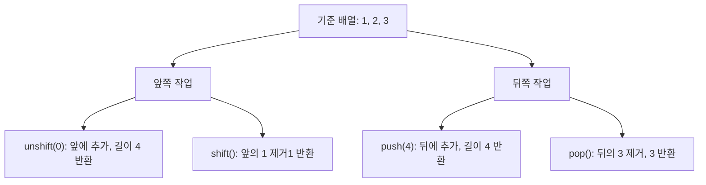
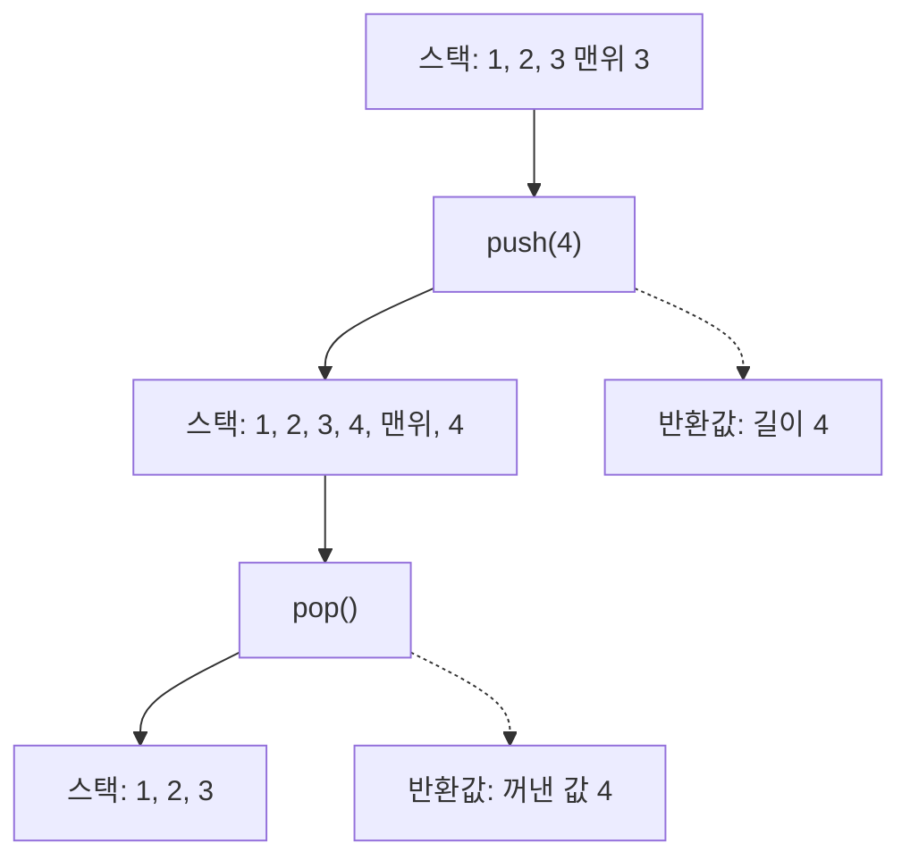
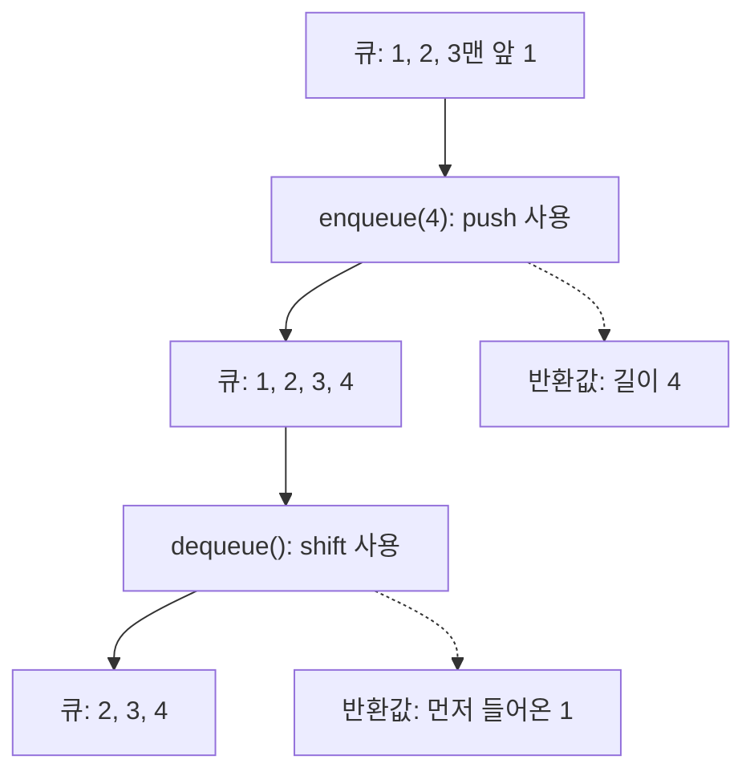
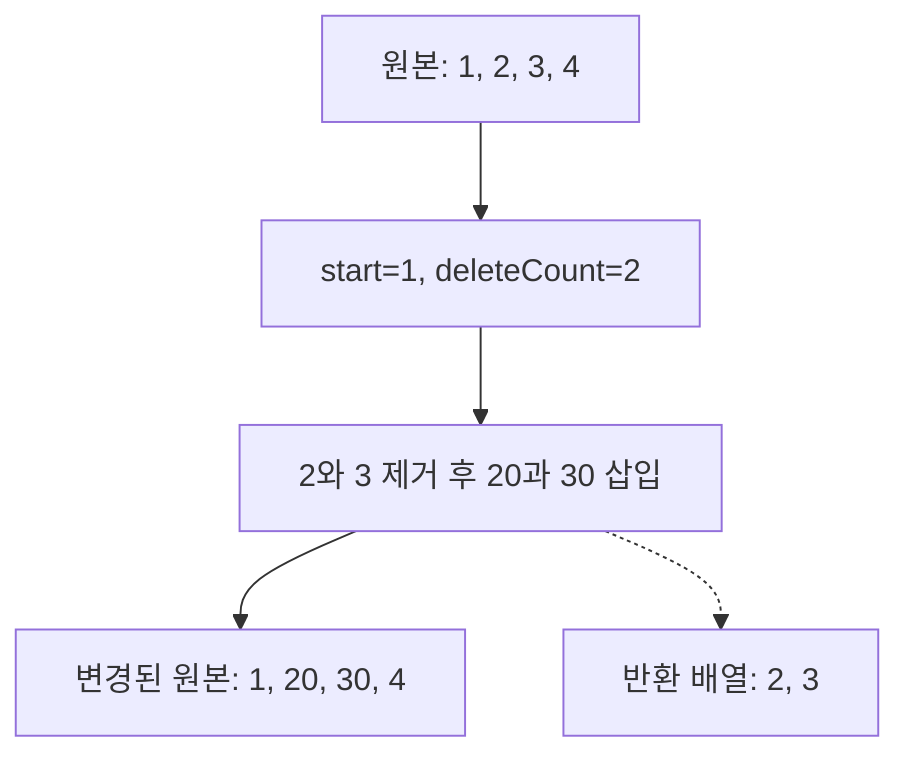
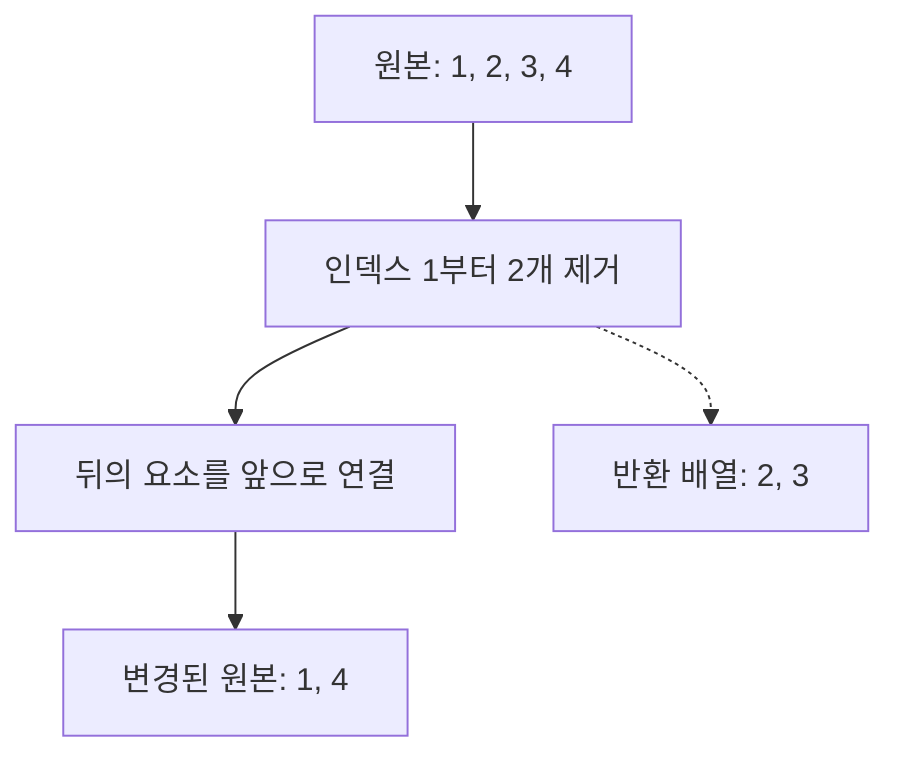
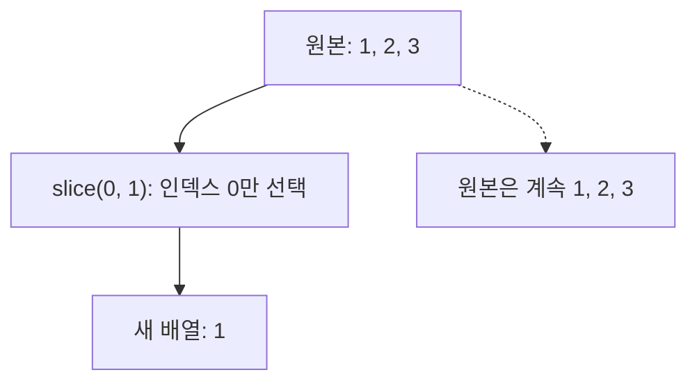
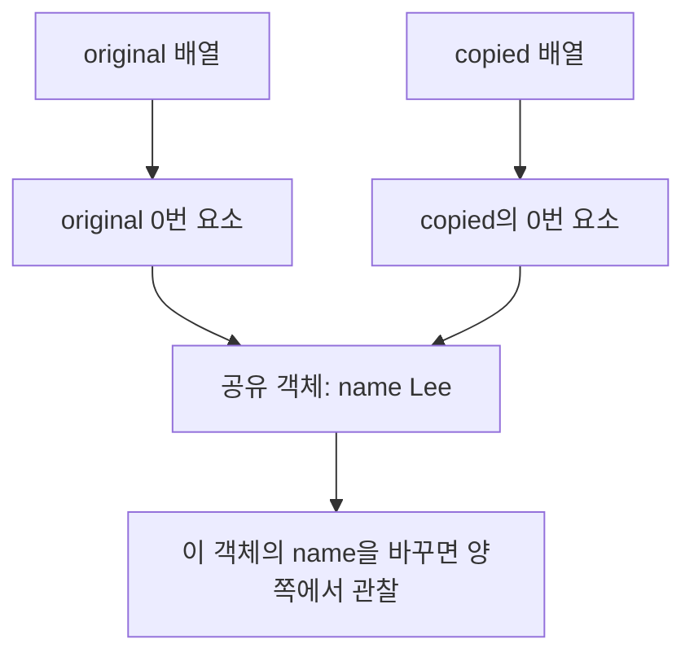

## 27.8 배열 메서드

1. 원본 배열을 바꾸는 지
2. 반환값이 배열인지, 요소인지, 길이인지

| 메서드            | 원본 변경 | 반환값                       |
| ----------------- | --------- | ---------------------------- |
| `Array.isArray`   | 없음      | 불리언                       |
| `indexOf`         | 없음      | 첫 인덱스 또는 `-1`          |
| `push`, `unshift` | 있음      | 변경된 길이                  |
| `pop`, `shift`    | 있음      | 제거한 요소 또는 `undefined` |
| `concat`          | 없음      | 새 배열                      |
| `splice`          | 있음      | 제거한 요소의 배열           |
| `join`            | 없음      | 문자열                       |
| `reverse`, `fill` | 있음      | 원본 배열 참조               |
| `includes`        | 없음      | 불리언                       |
| `flat`            | 없음      | 평탄화한 새 배열             |

원본을 바꾸지 않는 메서드도 중첩 객체를 깊게 복사하는 것은 아님. 콜백을 받는 메서드에 콜백이 원본을 변경할수도 있다

### 배열 양 끝 작업

경로는 독립적으로 [1, 2, 3]에 시작



### 27.8.1. `Array.isArray`

값이 실제 배열인지 확인. `typeof`만으로 일반 객체와 구분할 수 없음

```js
// 실제 배열인지 확인하여 true 또는 false 반환
console.log(Array.isArray([])); // true
console.log(Array.isArray([1, 2])); // true

// 배열과 비슷한 구조 객체나 실제 배열이 아님
console.log(Array.isArray({ 0: 1, length: 1 })); // false
console.log(Array.isArray(null)); // false
console.log(Array.isArray("abc")); // false
```

### 27.8.2 `Array.prototype.indexOf`

값과 일치하는 **첫 인덱스**를 반환, 없으면 `-1`이다. 두 번째 인수는 검색 시작 위치

```js
const numbers = [1, 2, 2, 3];
// 값 2를 처음부터 검색하여 첫 번째 인덱스 반환
console.log(numbers.indexOf(2)); // 1

// 인덱스 2부터 검색하여 두 번째 2의 인덱스 반환
console.log(numbers.indexOf(2, 2)); // 2

// 값이 존재하지 않으면 -1 반환
console.log(numbers.indexOf(4)); // -1
console.log([NaN].indexOf(NaN)); // -1
```

첫 인수는 찾을 값, 둘째 인수는 검색을 시작할 인덱스. indexOf(2, 2)는 앞의 인덱스 1을 보지 않고 인덱스 2부터 검색하여 2를 반환한다. 음수 시작점 -2는 길이 4에서 2를 뺀 인덱스 2를 뜻하고, 검색 방향이 역방향으로 바뀌는것 은 아님.

엄격한 동등 비교를 사용하기에 `NaN`을 찾지 못한다. 존재 여부만 필요하면 `includes`가 읽기 쉽다

`if (array.indexOf(value))`는 잘못된 확인 방식. 인덱스 `0`은 falsy, `-1`은 truthy므로 `!== -1`로 비교해야 한다

```js
const foods = ["apple", "banana"];

if (foods.indexOf("orange") === -1) {
  foods.push("orange");
}

if (!foods.includes("orange")) {
  foods.push("oragmegd");
}
```

### 27.8.3 `Array.prototype.push`

끝에 요소를 추가하고 **변경된 길이**를 반환

```js
const numbers = [1, 2];
// 배열 끝에 3, 4를 추가하고 변경된 길이 반환
const length = numbers.push(3, 4);

console.log(length); // 4
console.log(numbers); // [1, 2, 3, 4]

// Spread 문법으로 기존 요소를 복사 5를 추가한 새 배열 생성
const next = [...numbers, 5];
console.log(next); // [1, 2, 3, 4, 5]
// 원본 배열은 추가로 변경되지 않음
console.log(numbers); // [1, 2, 3, 4]
```

`push`는 원본을 변경. Spread는 새 배열을 만든다. 목적이 다르고 Spread가 항상 더 빠른 것은 아님

### 27.8.4 `Array.prototype.pop`과 스택

끝 요소를 제거하고 **제거한 요소**를 반환한다. 빈 배열에서 `undefined`다

```js
const numbers = [1, 2];

// 마지막 요소 2를 제거하고 반환
console.log(numbers.pop()); // 2

// 원본 배열에서 2가 제거
console.log(numbers); // [1]

// 빈 배열에서 pop을 실행하면 undefined 반환
console.log([].pop()); // undefined
```

`push`와 `pop`으로 **스택: LIFO, 후입 선출**을 구현할 수있음

#### 스택: LIFO

스택은 **마지막에 넣은 값을 먼저 꺼내는 후입 선출**



4는 가장 늦게 들어오고 가장 먼저 나간다.

#### 생성자 함수 구현

```js
function Stack(array = []) {
  if (!Array.isArray(array)) {
    throw new TypeError("배열이 필요하다");
  }
  // 원본 배열을 복사하여 별도의 내부 배열 생성
  this.array = array.slice();
}

Stack.prototype = {
  constructor: Stack,

  // 스택 마지막에 요소 추가 후 변경된 길이 반환
  push(value) {
    return this.array.push(value);
  },

  // 마지막 요소를 제거하고 반환 (LIFO)
  pop() {
    return this.array.pop();
  },

  // 내부 배열의 복사본 반환
  entries() {
    return this.array.slice();
  },
};

const stack = new Stack([1, 2]);

// 3을 추가하고 변경된 배열 길이 반환
console.log(stack.push(3)); // 3

// 마지막에 추가한 3을 제거 및 반환
console.log(stack.pop()); // 3

// pop으로 제거되어 [1, 2] 반환
console.log(stack.entries()); // [1, 2]
```

#### 클래스로 구현

```js
class Stack {
  #items;

  constructor(array = []) {
    if (!Array.isArray(array)) {
      throw new TypeError("배열이 필요하다");
    }

    // 원본 배열을 복사해서 별도의 배열 생성
    this.#items = array.slice();
  }
  // 스택의 마지막에 요소 추가 후 변경된 길이 반환
  push(value) {
    return this.#items.push(value);
  }
  // 마지막 요소 제거 후 반환 (LIFO)
  pop() {
    return this.#items.pop();
  }
  // 내부 배열의 복사본 반환
  entries() {
    return this.#items.slice();
  }
}

const source = [1, 2];

// source를 복사 Stack 인스턴스 생성
const stack = new Stack(source);
// 원본 source가 아닌 스택 내부 배열에 3 추가
stack.push(3);

// 내부 배열에 3이 추가 되어 [1, 2, 3]
console.log(stack.entries()); // [1, 2, 3]

// 별도 배열을 사용, 원본 변경되지 않음
console.log(source); // [1, 2]

// 마지막에 추가된 3 제거하고 반환
console.log(stack.pop()); // 3
```

입력 배열을 복사해 외부 배열과 내부 저장 배열의 직접적인 공유를 피한다. 다만 요소가 객체면 객체 참조는 공유하는 얕은 복사다. private 필드는 현재 표준 문법이다

### 27.8.5 `Array.prototype.unshift`

앞에 요소를 추가하고 **변경된 길이**를 반환

```js
const numbers = [1, 2];
const length = numbers.unshift(3, 4);

// 배열 앞에 3, 4를 순서대로 추가하고 변경된 길이 반환
console.log(numbers.unshift(3, 4)); // 4
// 기존 요소 1, 2는 뒤로 이동
console.log(numbers); // [3, 4, 1, 2]
console.log(numbers); // 4

// 원복 복사하여 앞에 0을 추가한 새 배열 생성
const next = [0, ...numbers];
console.log(next); // [0, 3, 4, 1, 2]
```

여러 인수를 전달하면 전달 순서대로 앞에 추가한다. 3,4를 인수의 순서대로 앞에 넣고 길이 4를 반환. 기존 1,2의 인덱스는 뒤로 이동. 스프레드로 만든 next는 별도 배열로 numbers 앞에 0을 직접 넣은 것은 아님.

### 27.8.6 `Array.prototype.shift`와 큐

첫 요소를 제거하고 **제거한 요소**를 반환. 빈 배열에서 `undefined`다

```js
const numbers = [1, 2];

// 첫 번째 요소 1을 제거하고 반환
console.log(numbers.shift()); // 1
// 원본 배열에 첫 번째 요소가 제거된다
console.log(numbers); // [2]

// 빈 배열에 shift를 실행하여 undefined 반환
console.log([].shift()); // undefined
```

`push`와 `shift`로 **큐: FIFO, 선입 선출**을 구현할 수 있음. shift는 첫 요소 1을 제거해 반환하고 남은 요소의 인덱스를 앞으로 조정한다. pop과 달리 앞쪽에서 제거. 빈배열에서 undefined를 반환

#### 큐: FIFO

큐는 **먼저 넣은 값을 먼꺼내는 선입 선출** 자료구조다. push로 뒤에 넣고 shift로 앞에서 꺼내면 이 순서가 된다



스택에서 방금 넣은 4를 꺼내지만 큐에서는 먼저 들어온 1을 꺼낸다.

#### 생성자 함수로 구현

```js
function Queue(array = []) {
  if (!Array.isArray(array)) {
    throw new TypeError("배열이 필요하다");
  }

  this.array = array.slice();
}

Queue.prototype = {
  constructor: Queue,

  // 큐의 마지막에 요소 추가 후 변경된 길이 반환
  enqueue(value) {
    return this.array.push(value);
  },

  // 큐의 첫 번째 요소를 제거하고 반환 (FIFO)
  dequeue() {
    return this.array.shift();
  },

  // 내부 배열 복사본 반환
  entries() {
    return this.array.slice();
  },
};

const queue = new Queue([1, 2]);

// 마지막에 3 추가하고 변경된 길이 반환
console.log(queue.enqueue(3)); // 3

// 가장 먼즐어온 1을 제거하고 반환
console.log(queue.dequeue()); // 1

// 1이 제거되었고 [2, 3] 반환
console.log(queue.entries()); // [2, 3]
```

#### 클래스로 구현

```js
class Queue {
  #items;

  constructor(array = []) {
    if (!Array.isArray(array)) {
      throw new TypeError("배열이 필요하다");
    }
    this.#items = array.slice();
  }

  // 큐의 마지막에 요소 추가 후 변경된 길이 반환
  enqueue(value) {
    return this.#items.push(value);
  }

  // 첫 번째 요소를 제거하고 반환 (FIFO)
  dequeue() {
    return this.#items.shift();
  }

  // 내부 배열 복사본 반환
  entries() {
    return this.#items.slice();
  }
}

const queue = new Queue([1, 2]);
// 큐의 마지막에 3 추가 -> [1, 2, 3]
queue.enqueue(3);

// 가장 먼저 추가된 1을 제거하고 반환
console.log(queue.dequeue()); // 1
// 1이 제거되어 나머지 반환
console.log(queue.entries()); // [2, 3]
```

| 자료구조 | 입력   | 출력    | 먼저 나오는 값   |
| -------- | ------ | ------- | ---------------- |
| 스택     | `push` | `pop`   | 마지막에 넣은 값 |
| 큐       | `push` | `shift` | 먼저 넣은 값     |

대량의 큐 연산에 `shift` 비용이 실제 문제가 되면 읽기 위치를 관리하는 큐나 다른 자료구조를 고려.

### 27.8.7 `Array.prototype.concat`

배열이나 값을 연결한 **새 배열**을 반환. 보통의 배열 인수는 한 단계 푸어서 연결

```js
const a = [1, 2];

// 배열 [3, 4]요소, 값 5를 연결하여 새 배열 반환
console.log(a.concat([3, 4], 5)); // [1, 2, 3, 4, 5]
// concat은 원본 배열을 변경하지 않음
console.log(a); // [1, 2]

const pushed = [1, 2];
// pushsms [3, 4] 배열 자체를 하나의 요소로 추가
pushed.push([3, 4]);
console.log(pushed); // [1, 2, [3, 4]]

// concat은 한 단계만 펼쳐 중첩 배열 [2, 3] 유지
console.log([1].concat([[2, 3]])); // [1, [2, 3]]
// Spread 문법으로 새 배열 생성
console.log([...a, ...[3, 4]]); // [1, 2, 3, 4]
```

| 동작              | 배열 인수 처리               |
| ----------------- | ---------------------------- |
| `push([3, 4])`    | 배열 자체를 요소 하나로 추가 |
| `concat([3, 4])`  | 배열의 요소를 연결           |
| `push(...[3, 4])` | Spread로 개별 인수로 전달    |

`concat`과 Spread는 일반적인 밀집 배열을 연결할 때 비슷하나, 빈 슬롯이나 특수한 객체에서 동작이 다를 수 있다
push에 배열 하나를 전달하면 배열 전체가 하나의 요소로 들어간다. concat은 전달한 바깥 배열을 펼쳐지만 그 안의 [2, 3]까지 재귀적으로 펼치지 않음.

### 27.8.8 `Array.prototype.splice`

`array.splice(start, deleteCount, ..items)` 는 원본에서 요소를 삭제, 삽입, 교체한다. **반환값은 제거한 요소의 배열**이다 start부터 deleteCount개를 제거하고 같은 자리에 items를 삽입. **원본을 바꾸고, 제거한 요소들의 배열을 반환**

| 인수          | 의미                                 |
| ------------- | ------------------------------------ |
| `start`       | 작업 시작 인덱스, 음수면 뒤에서 계산 |
| `deleteCount` | 제거할 요소 수                       |
| `items`       | 그 위치에 삽입할 요소들              |

#### 제거와 삽입을 함께 수정

인덱스 1부터 두 요소인 2,3을 제거한 뒤 20, 30을 넣는다. removed에 새로 넣은 값이나 변경된 원본이 아니라 **제거한 2,3**이 들어 있다



#### 제거만 수행

삽입할 인수가 없어 2,3만 제거. 4는 인덱스 3에서 인덱스 1로 이동하고 length는 2가 된다



```js
const numbers = [1, 2, 3, 4];
// 인덱스 1부터 2개(값 2, 3) 삭제하고 그 뒤 인덱스 값 추가
const removed = numbers.splice(1, 2, 20, 30);
// 삭제된 요소만 새로운 배열로 반환
console.log(removed); // [2, 3]
// splice는 원본 배열 직접 변경
console.log(numbers); // [1, 20, 30, 4]

const inserted = [1, 2, 3];
// 인덱스 1에 100 삽입, 삭제 개수가 0 이므로 반환값은 []
console.log(inserted.splice(1, 0, 100)); // []
// 기존 요소 2, 3은 뒤로 이동 후 100이 추가
console.log(inserted); // [1, 100, 2, 3]

const tail = [1, 2, 3, 4];
// 인덱스 1부터 끝까지 삭제 후 삭제된 요소 반환
console.log(tail.splice(1)); // [2, 3, 4]
console.log(tail); // [1]
```

deleteCount가 0이면 제거한 값이 없어 []를 반환. deleteCount를 생략한 splice(1)은 인덱스 1부터 끝까지 제거. splice(-2, 1)은 길이 4에서 두 칸 앞인 인덱스 2의 값 3을 제거.
splice(1)과 splice(1, undefined)는 다름. 뒤처럼 인수를 명시적으로 전달하면 undefined가 제거 개수 0으로 처리되어 끝까지 삭제하지 않음.

**`deleteCount` 생략과 명시적인 `undefined`는 다름**

```js
const a = [1, 2, 3];
const b = [1, 2, 3];

// 인덱스 1부터 끝까지 삭제
console.log(a.splice(1)); // [2, 3]
// 삭제되는 요소가 없으며 빈 배열 반환
console.log(b.splice(1, undefined)); // []
console.log(b); // [1, 2, 3]
```

아무 인수도 없는 `splice()` 삭제하지 않음. `splice(start)`는 시작부터 끝까지 제거.

#### 특정 값 하나 제거

```js
function removeFirst(array, value) {
  const index = array.indexOf(value);
  if (index !== -1) {
    array.splice(index, 1);
  }
  return array;
}

const numbers = [1, 2, 3, 2];

console.log(removeFirst(numbers, 2)); // [1, 3, 2]
console.log(removeFirst(numbers, 10)); // [1, 3, 2]
console.log(numbers.filter((value) => value !== 2)); // [1, 3]
```

indexOf로 첫 위치만 찾으므로 중복된 2중 하나만 제거한다. 값을 찾지 못했을 때 -1을 검사하지 않고 splice(-1, 1)을 실행하면 마지막 요소를 잘못 제거하므로 조건 검사가 필요. 모든 2를 제거한 새 배열이 필요하면 numbers.filter(value => value !== 2)를 사용.
감색 실패 `-1`을 그대로 `splice`에 전달하여 마지막 요소를 지울 수 있음. 삭제 전 반드시 확인. `removeFirst`는 `indexOf`를 사용 `NaN` 검색에 적합하지 않음

### 27.8.9 `Array.prototype.slice`

`array.slice(start, end)`는 **시작 포함, 끝 제외** 범위를 얕게 복사하여 새 배열을 반환. slice(start, end)는 start 이상 end 미만의 범위를 복사한 새 배열을 반환한다. **end는 개수가 아니라 끝 인덱스이며 포함되지 않음. 원본은 유지**

```js
const numbers = [1, 2, 3, 4];

console.log(numbers.slice(1, 3)); // [2, 3]
console.log(numbers.slice(1)); // [2, 3, 4]
console.log(numbers.slice(-2)); // [3, 4]
console.log(numbers.slice()); // [1, 2, 3, 4]
console.log(numbers); // [1, 2, 3, 4]
```

| 호출        | 실제 복사 범위            | 결과   |
| ----------- | ------------------------- | ------ |
| slice(0, 1) | 인덱스 0 이상, 1 미만     | [1]    |
| slice(1, 2) | 인덱스 1 이상, 2 미만     | [2]    |
| slice(1)    | 인덱스 1부터 끝까지       | [2, 3] |
| slice(-1)   | 마지막 한 위치            | [3]    |
| slice(-2)   | 끝에서 두 번째부터 끝까지 | [2, 3] |

#### slice 범위 반환값



slice는 원본에서 값을 잘라 없애는 기능이 아님. 새 배열로 복사할 범위를 선택하는 기능.

| 구분         | `slice`         | `splice`         |
| ------------ | --------------- | ---------------- |
| 목적         | 범위 복사       | 삭제, 삽입, 교체 |
| 두 번째 인수 | 끝 인덱스, 제외 | 삭제할 개수      |
| 원본 변경    | 없음            | 있음             |
| 반환값       | 복사한 배열     | 제거한 배열      |

#### 얕은 복사와 객체 참조

```js
const todos = [{ id: 1, name: "Lee" }];
const copy = todos.slice();

console.log(copy === todos); // false
console.log(copy[0] === todos[0]); // true

copy[0].completed = true;
console.log(todos[0].completed); // true

copy.push({ id: 2, completed: false });
console.log(copy.length); // 2
console.log(todos.length); // 1
```

바깥 배열은 새 객체이므로 copy에 push해도 todos의 길이는 바뀌지 않음. 첫 요소의 객체는 공유하여 copy[0].completed를 바꾸면 todos[0]에서 변경이 보임. slice, 스프레드, concat 등으로 배열을 복사할 때 참조관계를 구분.
새 배열을 만들어 요소인 객체의 참조는 공유된다. Spread와 `concat`도 기본적으로 얕은 복사.



#### 유사 배열을 배열로 변환

```js
function collect {
  const oldStyle = Array.prototype.slice.call(arguments);
  const from = Array.from(arguments);
  const spread = [...arguments];

  console.log(oldStyle); // [1, 2, 3]
  console.log(from); // [1, 2, 3]
  console.log(spread); // [1, 2, 3]
}

collect(1, 2, 3);
```

새 함수에 가변 인수를 받을 때 26장에서 배운 Rest 파라미터도 고려
첫 방식은 slice를 빌려 호출, 두번째는 Array.from, 세 번째는 이터레이션을 사용한다.

### 27.8.10 `Array.prototype.join`

요소를 문자열로 연결. 기본 구분자는 쉼표. 빈 문자열 구분자는 값들을 붙이고, 콜론은 요소 사이에 콜론을 넣는다.
반환값은 문자열이고 배열 자체는 바뀌지 않음.

```js
const numbers = [1, 2, 3];
// 기본 구분자는 쉼표(,)이며 문자열을 반환
console.log(numbers.join()); // '1,2,3'

// 빈 문자열을 구분자로 사용하여 요소들을 붙임
console.log(numbers.join("")); // '123'

// 콜론(:)을 구분자로 사용
console.log(numbers.join(":")); // '1:2:3'

console.log([1, null, undefined, , 5].join("-")); // 1-----5
```

`null`, `undefined`, 빈 슬롯은 `join`에서 빈 문자열처럼 처리된다

### 27.8.11 `Array.prototype.reverse`

원본 순서를 뒤집고 **원본 배열 참조**를 반환. 순서를 뒤집은 원본 배열의 참조를 반환. 먼저 복사하고 그 복사본을 뒤집는다.

```js
const numbers = [1, 2, 3];
const result = numbers.reverse();

console.log(numbers); // [3, 2, 1]
console.log(result === numbers); // true

const source = [1, 2, 3];
console.log([...source].reverse()); // [3, 2, 1]
console.log(source); // [1, 2, 3]
```

새 배열이 필요하면 복사 후 뒤집거나, 지원 환경에 `toReversed()`를 사용

### 27.8.2 `Array.prototype.fill`

`array.fill(value, start, end)`는 지정 범위를 같은 값으로 채운다. 시작은 포함하고 끝은 제외한다. 원본 배열을 변경하고 원본 참조를 반환
start 이상 end 미만을 덮어씀. fill(0, 1, 3)은 인덱스 1,2만으로 0으로 채운다. start를 생략하면 0부터, end를 생략하면 끝까지며 길이는 늘리지 않는다. 빈 슬롯 위치를 채우면 실제요소가 생긴다.

```js
const numbers = [1, 2, 3, 4, 5];
const result = numbers.fill(0, 1, 3);

console.log(numbers); // [1, 0, 0, 4, 5]
console.log(result === numbers); // true
console.log(Array(3).fill(1)); // [1, 1, 1]
```

#### 객체를 채울 때 참조 공유

```js
const shared = Array(3).fill({ count: 0 });
shared[0].count = 10;

console.log(shared.map((item) => item.count)); // [10, 10, 10]
console.log(shared[0] === shared[1]); // true

const seprate = Array.from({ length: 3 }, () => ({ count: 0 }));
separate[0].count = 10;

console.log(seprate.map((item) => item.count)); // [10, 0 , 0]
console.log(separate[0] === separate[1]); // false
```

`fill({})`은 각 위치에 객체를 새로 만드는 것이 아님, 독립된 객체가 필요하면 `Array.from`의 콜백에서 생성
count를 바꾸면 세 위치에서 모두 보인다. 서로 다른 객체가 필요하면 Array.from의 콜백에서 매번 새 객체를 생성. 인덱스를 반환하면 서로 다른 숫자값으로 초기화 할 수 있음.

### 27.8.13 `Array.prototype.includes`

특정 값의 포함 여부를 불리언으로 반환
includes(1, 1)은 인덱스 1부터만 보므로 옆에 있는 1을 찾지 못함. includes(3, -1)은 마지막 인덱스부터 봐 true다. sameValueZero 비교를 사용하여 NaN도 찾고, 빈 슬롯은 undefined처럼 다룸.

```js
const numbers = [1, 2, 3];

console.log(numbers.includes(2)); // true
console.log(numbers.includes(1, 1)); // false
console.log(numbers.includes(3, -1)); // true
console.log([NaN].includes(NaN)); // true
console.log([,].includes(undefined)); // true
console.log([{}].includes({})); // false
```

| 비교                         | `indexOf`        | `includes`           |
| ---------------------------- | ---------------- | -------------------- |
| 반환값                       | 인덱스 또는 `-1` | 불리언               |
| `NaN` 검색                   | 찾지 못함        | 찾을 수 있음         |
| 빈 슬롯에서 `undefined` 검색 | 슬롯 건너 뜀     | `undefined`처럼 처리 |
| 객체 비교                    | 참조 기준        | 참조 기준            |

`includes`는 SameValueZero 비교를 사용. 값이 같아 보이는 객체여도 참조가 다르면 같은 요소로 보지 않음

### 27.8.14 `Array.prototype.flat`

중첩 배열을 지정한 깊이까지 평탄화하여 새 배열을 반환. 기본 깊이는 `1`, `Infinity`는 모든 중첩 배열을 대상

```js
const nested = [1, [2, [3, [4]]]];

console.log(nested.flat()); // [1, 2, [3, [4]]]
console.log(nested.flat(2)); // [1, 2, 3, [4]]
console.log(nested.flat(Infinity)); // [1, 2, 3, 4]
console.log([1, , [2, , 3]].flat()); // [1, 2, 3]
```

평탄화되는 범위의 빈 슬롯은 제거된다. 요소인 객체를 깊게 복사하는 기능은 아님
기본 깊이는 1. 깊이 2면 중첩 배열을 두 단계 펼치고 Infinity면 모든 중첩 배열을 펼친다. 평탄화하며 방문하는 배열의 빈 슬롯은 결과에서 빠진다. 원본을 변경하지 않으나 결과에 객체가 포함되면 그 객체 참조는 공유
