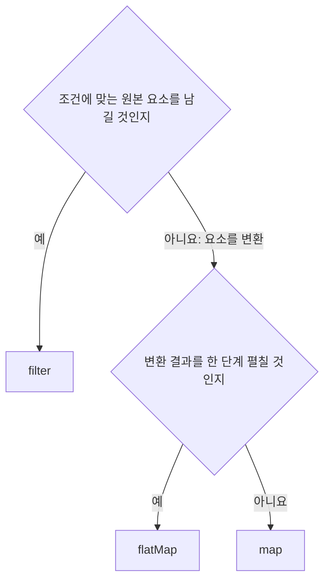
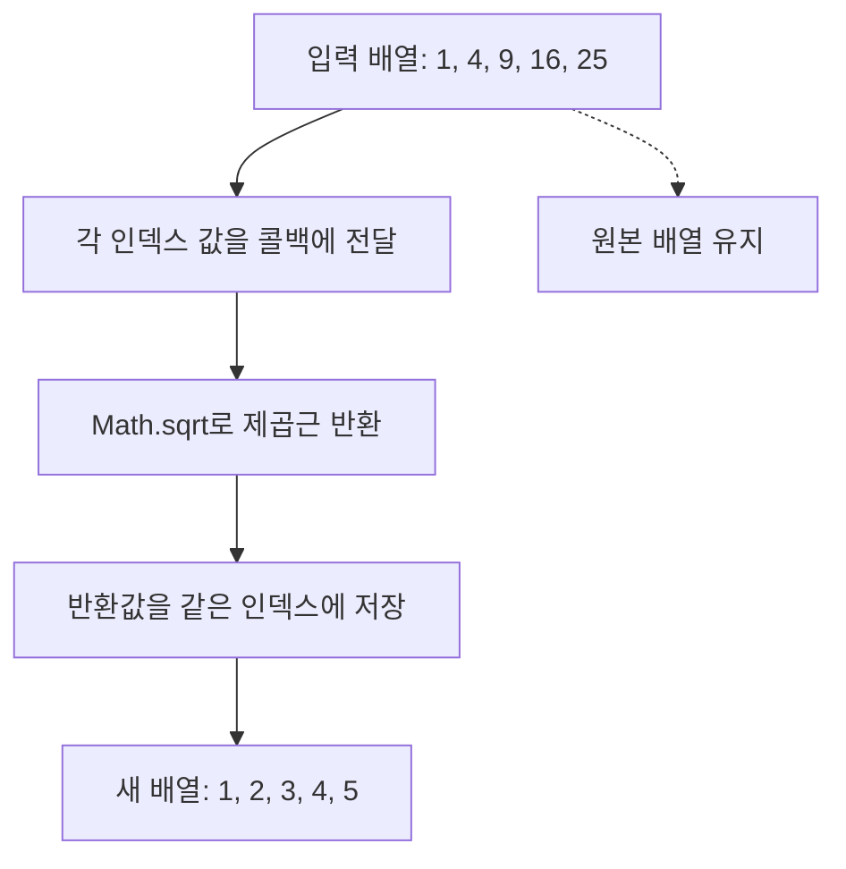
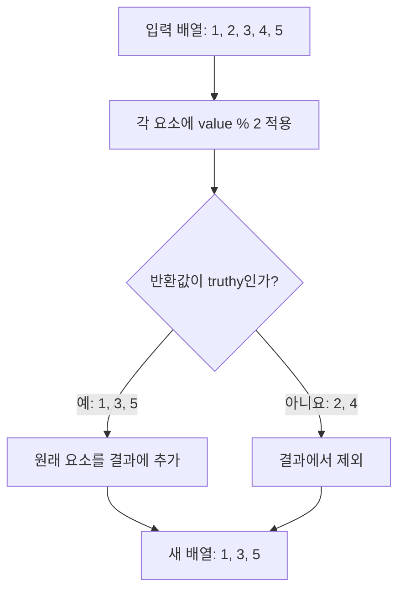
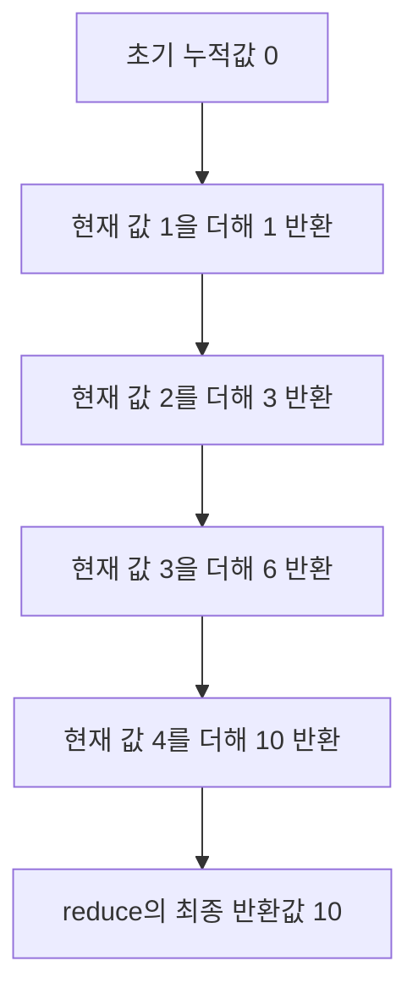

# 27.9 배열 고차 함수

고차 함수는 함수를 인수로 받거나 함수를 반환하는 함수. 배열의 고차 함수는 반복, 검색, 변환 로직을 콜백으로 표현

**고차 함수를 사용했다고 자동으로 순수 함수가 되는 것은 아님** `sort`는 원본을 바꾸고, `forEach`, `map`의 콜백에서도 외부 상태를 변경할 수 있음

## 목적별 비교

| 메서드         | 목적                     | 반환값                   | 조기종료          |
| :---------- | :--------------------- | :-------------------- | :------------ |
| `sort`      | 정렬                     | 원본 배열 참조              | 해당 없음         |
| `forEach`   | 각 요소에 작업 수행            | `undefined`           | 없음            |
| `map`       | 요소 변환                  | 새 배열                  | 없음            |
| `filter`    | 조건에 맞는 요소 추출           | 새 배열                  | 없음            |
| `reduce`    | 누적                     | 누적 결과                 | 없음            |
| `some`      | 하나라도 조건 만족?            | 불리언                   | 참이면 종료        |
| `every`     | 모두 조건 만족?              | 불리언                   | 거짓이면 종료       |
| `find`      | 조건에 맞는 첫 요소            | 요소 또는 `undefined`     | 찾으면 종료        |
| `findIndex` | 조건에 맞는 첫 위치            | 인덱스 또는 `-1`           | 찾으면 종료        |
| `flatMap`   | 변환 후 한 단계 평탄화          | 새 배열                  | 없음            |

## 콜백 인수와 `thisArg`

| 메서드 종류                                                                      | 콜백 인수                                | `thisArg`       |
| :-------------------------------------------------------------------------- | :----------------------------------- | :-------------- |
| `forEach`, `map`, `filter`, `some`, `every`, `find`, `findIndex`, `flatMap` | `(value, index, array)`              | 지원              |
| `reduce`                                                                    | `(accumulator, value, index, array)` | 지원하지 않는다        |
| `sort`                                                                      | `(a, b)`                             | 지원하지 않는다        |

콜백의 세 번째 인수 `array`는 원본 배열. **콜백 내부의 `this`와 다른 개념**. 화살표 함수의 `this`는 `thisArg`로 바뀌지 않는다.



## 27.9.1 `Array.prototype.sort`

원본을 정렬하고 원본 참조를 반환. 비교 함수가 없으면 요소를 문자열로 바꾸어 **UTF-16 코드 단위 순서**로 비교

```js
const numbers = [40, 100, 1, 5, 2, 25, 10];

console.log([...numbers].sort()); // [1, 10, 100, 2, 25, 40, 5]
// sort의 오름차순
console.log([...numbers].sort((a, b) => a - b)); // [1, 2, 5, 10, 25, 40, 100]
// sort의 내림차순
console.log([...numbers].sort((a, b) => b - a)); // [100, 40, 25, 10, 5, 2, 1]
```

**숫자 정렬에 비교 함수를 전달**. 원소가 `NaN`인 경우는 별도 처리 기준을 정한다

| 비교 함수 반환값        | 의미                                    |
| :--------------- | :------------------------------------ |
| 음수               | `a`를 `b`보다 앞에 배치                      |
| 양수               | `a`를 `b`보다 뒤에 배치                      |
| `0`              | 비교 기준상 동등, 기준 상대 순서 유지                |

비교 함수에서 단순히 `a > b`를 반환 `0` 또는 `1`만 나와 일관된 비교 조건을 만족하지 못할 수 있음

### 객체 배열 정렬

```js
const todos = [
  { id: 4, content: "JavaScript" },
  { id: 1, content: "HTML" },
  { id: 2, content: "CSS" },
];

const byId = [...todos].sort((a, b) => a.id - b.id);
const byContent = [...todos].sort((a, b) => {
  if (a.content < b.content) {
    return -1;
  }
  if (a.content > b.content) {
    return 1;
  }
  return 0;
});

console.log(byId.map((todo) => todo.id)); // [1, 2, 4]
console.log(byContent.map((todo) => todo.content)); // ['CSS', 'HTML', 'JavaScript']
console.log(todos.map((todo) => todo.id)); // [4, 1, 2]
```

언어별 문자열 정렬이 필요하면 `localeCompare`나 `Intl.Collator`를 고려. 기본 `sort`가 사용자 언어의 사전순을 항상 제공하는 것은 아님.

## 27.9.2 `Array.prototype.forEach`

각 요소에 작업을 수행하며 반환값은 항상 `undefined`다

```js
const numbers = [1, 2, 3];
const rows = [];

const result = numbers.forEach((value, index, array) => {
  rows.push([value, index, array === numbers]);
});

console.log(rows); // [[1, 0, true], [2, 1, true], [3, 2, true]]
console.log(result); // undefined
```

| 주의점                 | 설명                                            |
| :------------------ | :-------------------------------------------- |
| 반환값                 | 콜백의 반환값은 배열에 모이지 않음                           |
| `break`, `continue` | 콜백에서 바깥 `forEach` 순회에 사용할 수 없음                |
| 콜백의 `return`        | 현재 콜백만 끝냄, 전체 순회는 계속                          |
| 빈 슬롯                | 방문하지 않는다                                      |
| 원본 변경               | 콜백에서 변경할 수 있음                                 |
| 성능                  | 항상 `for`보다 느리다고 단정하지 않는다                      |

```text
[1, 2, 3].forEach(value => {
  if (value === 2) {
    break; // SyntaxError
  }
});
```

조기 종료가 필요하면 `for...of`, `some`, `every`, `find` 등 목적에 맞는 방법을 사용.

### 콜백의 `this`

```js
class Numbers {
  values = [];

  addWithThisArg(array) {
    array.forEach(function (value) {
      this.values.push(value ** 2);
    }, this);
  }

  addWithArrow(array) {
    array.forEach((value) => this.values.push(value ** 2));
  }
}

const numbers = new Numbers();
numbers.addWithThisArg([1, 2]);
numbers.addWithArrow([3]);

console.log(numbers.values); // [1, 4, 9]
```

클래스 안의 일반 콜백에 `thisArg`를 전달하지 않고 `this.values`를 읽으면 `this`가 `undefined`여서 오류가 발생할 수 있음.

### 순회 중 요소를 추가하는 경우

```js
const numbers = [1, 2, 3];
const visited = [];

numbers.forEach((value) => {
  visited.push(value);
  numbers.push(value * 10);
});

console.log(visited); // [1, 2, 3]
console.log(numbers); // [1, 2, 3, 10, 20, 30]
```

순회 시작 시 길이가 기준이므로 끝에 새로 추가한 요소까지 계속 방문하지 않는다. 방문 전 요소를 변경하거나 삭제하면 이후 순회에 영향을 줄 수 있음. 필요하지 않으면 순회 중 원본 변경을 피한다

### 동작 모델

```js
function forEachLike(array, callback, thisArg) {
  if (typeof callback !== "function") {
    throw new TypeError("함수가 필요합니다");
  }
  const length = array.length;

  for (let index = 0; index < length; index++) {
    if (index in array) {
      callback.call(thisArg, array[index], index, array);
    }
  }
}

const visited = [];
const result = forEachLike([1, , 3], (value, index) => visited.push(index));

console.log(visited); // [0, 2]
console.log(result); // undefined
```

`thisArg || window` 처럼 임의의 전역 객체로 대체하지 않는다. `0`, `false` 같은 인수도 보존해야 한다

## 27.9.3 `Array.prototype.map`

콜백 반환값을 모아 새 배열을 만듦. 보통의 변경 없는 순회에서 입력 배열과 출력 배열의 `length`가 같다. 빈 슬롯은 콜백 호출 없이 결과에도 빈 슬롯으로 남는다

```js
const numbers = [1, 4, 9];
const roots = numbers.map((value) => Math.sqrt(value));

console.log(roots); // [1, 2, 3]
console.log(numbers); // [1, 4, 9]

const labels = numbers.map((value, index) => `${index}:${value}`);
console.log(labels); // ['0:1', '1:4', '2:9']
```

### 제곱근 변환



각 입력이 하나의 결과 위치에 대응. 원본이 밀집 배열이고 순회 중 구조를 바꾸지 않으면 요소 수만큼 콜백이 호출. 희소 배열은 빈 슬롯을 건너뛰고 결과에 같은 위치를 비워둬 length가 같다고 실제 콜백 횟수까지 항상 같지 않음.

블록 때문에 `return`을 빠뜨리면 값이 `undefined`가 된다

### 콜백으로 함수 자체를 전달

```js
console.log(["1", "2", "3"].map(parseInt)); // [1, NaN, NaN]
console.log(["1", "2", "3"].map((value) => parseInt(value, 10))); // [1, 2, 3]
```

`map`은 값뿐 아니라 인덱스도 전달. `parseInt` 두 번째 인수는 진법으로 `map(parseInt)` 에서는 인덱스가 진법으로 사용된다

## 27.9.4 `Array.prototype.filter`

콜백 반환값이 **truthy인 원본 요소**만 담은 새 배열을 만든다. 콜백이 반드시 불리언 `true` 자체를 반환해야 하는 것은 아님.

```js
const numbers = [1, 2, 3, 4, 5];
const odds = numbers.filter((value) => value % 2);

console.log(numbers.filter((value) => value % 2)); // [1, 3, 5]
console.log(numbers.filter((value) => value > 3)); // [4, 5]
console.log(numbers.filter((value) => value > 10)); // []

console.log(odds); // [1, 3, 5]
console.log(numbers); // [1, 2, 3, 4, 5]
```

출력 길이는 보통 입력 길이 이하, 남은 요소의 순서는 유지

### 홀수만 선택

|   값 | value % 2 | boolean으로 판단     | 결과에 포함      |
| --: | --------: | :--------------- | :---------- |
|   1 |         1 | true             | 포함          |
|   2 |         0 | false            | 제외          |
|   3 |         1 | true             | 포함          |
|   4 |         0 | false            | 제외          |
|   5 |         1 | true             | 포함          |



조건이 숫자 1을 반환해도 truthy로 포함. "반드시 boolean true를 반환해야 한다"뜻은 아님. `filter((value) => value % 2 !== 0)`처럼 boolean을 명시적으로 반환해도 같은 의도.

```js
const numbers = [1, 2, 3];
const selected = numbers.filter((value, index, array) => {
  console.log(value, index, array === numbers);
  return value > 1;
});
// 1 0 true / 2 1 true / 3 2 true
console.log(selected); // [2, 3]
```

filter의 콜백 요소값, 인덱스, 원본 배열을 받음. 각 요소를 한 번씩 판단하고 2, 3만 담는다. 두 번째 인수 thisArg도 지원, 일반 함수와 화살표 함수의 this 구분은 앞의 map과 같다.

### 객체 목록에서 조회·삭제

```js
class Users {
  constructor(users) {
    this.users = users.slice();
  }

  findById(id) {
    return this.users.filter((user) => user.id === id);
  }

  remove(id) {
    this.users = this.users.filter((user) => user.id !== id);
  }
}

const users = new Users([
  { id: 1, name: "Lee" },
  { id: 2, name: "Kim" },
  { id: 2, name: "Choi" },
]);

console.log(users.findById(2).map((user) => user.name)); // ['Kim', 'Choi']
users.remove(2);
console.log(users.users.map((user) => user.id)); // [1]
```

`filter`로 제거하면 조건에 해당하는 요소가 모두 제거된다. 한 요소만 필요하면 `find`, 한 위치만 삭제하려면 검색 후 `splice` 등을 선택
조회는 id가 같은 요소를 모두 담은 배열을 반환. 삭제는 id가 다른 요소만 남긴 새 배열로 this.users를 교체. 중복 id 2도 모두 제거. remove 메서드는 인스턴스의 users 프로퍼티를 변경.

## 27.9.5 `Array.prototype.reduce`

이전 콜백의 반환값을 다음 누산값으로 전달하여 하나의 결과를 만듦. 결과는 숫자뿐 아니라 객체, 배열 등 어떤 값도 될 수 있음

`array.reduce((accumulator, value, index, array) => nextAccumulator, initialValue)`

| 콜백 인수        | 의미                           |
| :----------- | :--------------------------- |
| accumulator  | 초기값 또는 이전 콜백 반환값             |
| currentValue | 현재 요소                        |
| index        | 현재 인덱스                       |
| array        | reduce를 호출한 원본 배열            |

```js
const sum = [1, 2, 3, 4].reduce((acc, value) => acc + value, 0);
console.log(sum); // 10
```

| 순회   | `acc` | 현재 값    | 반환값    |
| :--- | :---- | :------ | :----- |
| 1    | 0     | 1       | 1      |
| 2    | 1     | 2       | 3      |
| 3    | 3     | 3       | 6      |
| 4    | 6     | 4       | 10     |



0은 첫 콜백의 accumulator가 되고, 첫 반환값 1은 다음 콜백의 accumulator가 된다. 마지막 콜백이 반환한 10이 reduce 전체 결과다. 콜백에서 return을 빼먹으면 다음 누적값이 undefined가 될 수 있음.

### 초기값 생략과 빈 배열

초기값을 생략하면 첫 번째로 존재하는 요소가 누산값이 되고, 그 다음부터 콜백을 호출

```js
console.log([1, 2, 3].reduce((acc, value) => acc + value)); // 6
console.log([].reduce((acc, value) => acc + value, 0)); // 0

try {
  [].reduce((acc, value) => acc + value);
} catch (error) {
  console.log(error.name); // TypeError
}
```

빈 배열뿐 아니라 모든 슬롯이 비어 있는 배열에서 초기값이 없으면 오류가 발생. **누산값의 타입에 맞는 초기값을 명시하는 편이 안전**

### 평균, 최댓값

```js
function average(values) {
  if (values.length === 0) {
    return undefined;
  }
  return values.reduce((sum, value) => sum + value, 0) / values.length;
}

const values = [-5, -2, -9];
const max = values.reduce((acc, value) => Math.max(acc, value), -Infinity);

console.log(average([1, 2, 3, 4, 5, 6])); // 3.5
console.log(average([])); // undefined
console.log(max); // -2
console.log(Math.max(...values)); // -2
```

위 평균 함수는 빈 슬롯 없는 숫자 배열을 전제로 한다. 최댓값 초기값을 `0`으로 두면 모두 음수인 배열에서 잘못된 결과가 나온다. 매우 큰 배열에서 Spread로 모든 값을 함수 인수로 전달하는 방식 대신 순회도 고려

### 요소별 개수 집계

```js
const fruits = ["banana", "apple", "orange", "orange", "apple"];

const counts = fruits.reduce((acc, fruit) => {
  acc[fruit] = (acc[fruit] ?? 0) + 1;
  return acc;
}, Object.create(null));

console.log({ ...counts }); // { banana: 1, apple: 2, orange: 2}
```

프로토타입 없는 객체를 사용하여 이름이 기존 객체 프로퍼티와 겹치는 문제를 줄였다. 범용적인 집계에는 `Map`도 사용할 수 있음

### 평탄화, 중복제거

```js
const nested = [1, [2, 3], 4, [5, 6]];
console.log(nested.reduce((acc, value) => acc.concat(value), [])); // [1, 2, 3, 4, 5, 6]
console.log(nested.flat()); // [1, 2, 3, 4, 5, 6]

const values = [1, 2, 1, 3, 5, 4, 5];
const unique = values.reduce((acc, value, index, array) => {
  if (array.indexOf(value) === index) {
    acc.push(value);
  }
  return acc;
}, []);

console.log(unique); // [1, 2, 3, 5, 4]
console.log(
  values.filter((value, index, array) => array.indexOf(value) === index),
); // [1, 2, 3, 5, 4]
console.log([...new Set(values)]); // [1, 2, 3, 5, 4]
```

의도가 평탄화면 `flat`, 원시값 중복 제거면 `Set`이 더 직접적 일 수 있음. `indexOf` 기반 중복 제거는 `NaN` 올바르게 보존하지 못함. `Set`은 `NaN`도 중복 제거. 객체는 내용이 아닌 참조로 비교

### 객체 프로퍼티 합산

```js
const products = [{ price: 100 }, { price: 200 }, { price: 300 }];

const wrong = products.reduce((acc, product) => acc.price + product.price);
const total = products.reduce((sum, product) => sum + product.price, 0);

console.log(wrong); // NaN
console.log(total); // 600
```

위의 예제는 첫 콜백 뒤 누산값이 객체에서 숫자로 바뀌어 `acc.price`를 읽을 수 없게 된다. 초기값과 콜백 반환 타입을 일관되게 유지

## 27.9.6 `Array.prototype.some`

조건을 만족하는 요소가 하나라도 있으면 `true`를 반환하고 종료. 빈 배열은 `false`다

```js
let calls = 0;
const exists = [5, 10, 15, 20].some((value, index, array) => {
  calls++;
  return value > 10;
});

console.log(exists); // true
console.log(calls); // 3
console.log([5, 10, 15].some((value) => value < 0)); // false
console.log([].some((value) => value > 0)); // false

console.log([5, 10, 15].some((value) => value > 10)); // true
console.log([5, 10, 5].some((value) => value < 0)); // false
console.log([].some((value) => value > 0)); // false
```

15에 조건이 처음 참이 되어 true를 반환, 20은 검사하지 않는다. 만족하는 요소가 없으면 false다. 빈 배열에 만족하는 요소가 하나도 없어 false. 콜백은 요소값, 인덱스, 원본 배열을 받으며 두 번째 인수로 thisArg도 지원.

## 27.9.7. `Array.prototype.every`

모든 방문 대상 요소가 조건을 만족하면 `true`다. 하나라도 실패하면 `false`를 반환하고 종료. **빈 배열은 `true`**다.

```js
let calls = 0;
const all = [5, 10, 15].every((value) => {
  calls++;
  return value > 7;
});

console.log(all); // false
console.log(calls); // 1
console.log([5, 10, 15].every((value) => value > 3)); // true
console.log([].every((value) => value > 3)); // true

console.log([5, 10, 15].every((value) => value > 3)); // true
console.log([5, 10, 15].every((value) => value < 10)); // false
console.log([].every((value) => value > 0)); // true
```

빈 배열에 조건을 위반하는 요소도 없다. "최소 한 요소가 있어야 하며 모두 만족"이 목적이면 `array.length > 0 && array.every(...)`로 확인. 조건은 보통의 밀집 배열을 전제로 한다

첫 값 5가 7보다 크지 않아 false를 반환. 빈 배열 조건을 위반하는 요소가 없어 true다. "목록이 비어 있지 않고 모두 유효함"이 필요하면 array.length > 0 && array.every(predicate)처럼 두 조건을 함께 확인. 콜백인수와 thisArg 규칙은 some과 같다.

## 27.9.8 `Array.prototype.find`

조건을 만족하는 **첫 요소**를 반환한다. 없으면 `undefined`

```js
const users = [
  { id: 1, name: "Lee" },
  { id: 2, name: "Kim" },
  { id: 2, name: "Choi" },
];

console.log(users.find((user) => user.id === 2)); // { id: 2, name: 'Kim' }
console.log(users.filter((user) => user.id === 2).map((user) => user.name)); // ['Kim', 'Choi']
console.log(users.find((user) => user.id === 99)); // undefined
```

`find`는 요소를 반환하고 `filter`는 배열을 반환. 찾은 요소 자체가 `undefined`일 수 있으면 반환값만으로 검색 성공 여부를 판단하기 어렵다. 위치가 필요하면 `findIndex`를 사용
find는 첫 일치 요소 자체를 반환하고 종료. filter는 모든 일치 요소를 담은 배열을 반환. 반환된 객체는 원본 배열 요소와 같은 객체이므로, 이를 수정하면 `users[1]`에서도 변경 내용이 보인다.

조건이 맞는 값이 undefined인 경우에 결과는 undefined일 수 있음. 성공 여부를 위치로 구분하면 findIndex를 사용할 수 있음. find, findIndex는 빈 슬롯 방문하여 희소 배열에 객체 프로퍼티에 접근할 때 주의.

## 27.9.9 `Array.prototype.findIndex`

조건을 만족하는 **첫 인덱스**를 반환. 없으면 `-1`이다

```js
const users = [{ id: 1 }, { id: 2 }, { id: 2 }];
const predicate = (key, value) => (item) => item[key] === value;

console.log(users.findIndex((user) => user.id === 2)); // 1
console.log(users.findIndex(predicate("id", 2))); // 1
console.log(users.findIndex((user) => user.id === 99)); // -1
```

`find`와 `findIndex`는 빈 슬롯도 `undefined`로 방문. 희소 객체 배열에 `value.id`에 바로 접근하여 오류가 발생할 수 있어 실제 데이터 구조를 확인.

## 27.9.10 `Array.prototype.flatMap`

각 요소를 변환한 뒤 결과 배열을 **한 단계만** 평탄화. 보통 배열에서 `map(callback).flat(1)`과 같은 결과를 얻음

```js
const words = ["hello", "world"];

console.log(words.flatMap((word) => word.split(""))); // ['h', 'e', 'l', 'l', 'o', 'w', 'o', 'r', 'l', 'd']
console.log(words.flatMap((word, index) => [index, [word, word.length]])); // [0, ['hello', 5], 1, ['world', 5]]
console.log(words.map((word, index) => [index, [word, word.length]]).flat(2)); // [0, 'hello', 5, 1, 'world', 5]
```

깊이 인수는 없음. 한 요소를 여러 요소로 늘리거나, 빈 배열을 반환하여 제외할 수 있음

```js
const numbers = [-1, 2, 3];
const expanded = numbers.flatMap((value) =>
  value < 0 ? [] : [value, value * 2],
);

console.log(expanded); // [2, 4, 3, 6]
```

## 비동기 작업과 배열 순회

`forEach`는 콜백이 반환하는 Promise를 기다리지 않음. `await array.forEach(async ...)`도 작업 전체의 완료를 기다리는 방식이 아님

| 필요한 동작                                  | 방법                            |
| :-------------------------------------- | :---------------------------- |
| 순서대로 완료 기다리기                            | `for...of`안에서 `await`         |
| 여러 작업을 시작하고 전체 완료 기다리기                  | `Promise.all(array.map(...))` |

```js
(async () => {
  const numbers = [1, 2, 3];
  const sequential = [];

  for (const value of numbers) {
    sequential.push(await Promise.resolve(value * 2));
  }

  const parallel = await Promise.all(numbers.map(async (value) => value * 2));

  console.log(sequential); // [2, 4, 6]
  console.log(parallel); // [2, 4, 6]
})();
```

## 원본을 변경하지 않는 배열 메서드

다음 메서드는 원본을 변경하지 않고 새 배열을 만든다

| 원본을 변경하는 방식            | 새 배열을 만드는 방식               | 차이                      |
| :--------------------- | :------------------------- | :---------------------- |
| `sort(compareFn)`      | `toSorted(compareFn)`      | 정렬한 복사본                 |
| `reverse()`            | `toReversed()`             | 뒤집은 복사본                 |
| `splice(...)`          | `toSpliced(...)`           | 변경 결과의 복사본              |
| `array[index] = value` | `array.with(index, value)` | 특정 위치를 바꾼 복사본           |

```js
const numbers = [3, 1, 2];

console.log(numbers.toSorted((a, b) => a - b)); // [1, 2, 3]
console.log(numbers.toReversed()); // [2, 1, 3]
console.log(numbers.toSpliced(1, 1, 10)); // [3, 10, 2]
console.log(numbers.with(0, 30)); // [30, 1, 2]
console.log(numbers); // [3, 1, 2]
```

`splice`의 반환값은 제거한 요소지만 `toSpliced`는 변경 결과 배열. 복사 메서드들은 빈 슬롯을 `undefined` 요소로 처리하여 희소 배열에서 복사 후 원본 메서드를 호출한 결과와 슬롯 형태가 다를 수 있음

# 헷갈리는 메서드 비교

| 비교                   | 차이                                                 |
| :------------------- | :------------------------------------------------- |
| splice/ slice        | 원본 변경, 제거 개수 / 원본 유지, 끝 인덱스 미포함                    |
| push / concat        | 원본에 추가, 길이 반환 / 새 배열 반환                            |
| forEach / map        | 작업 수행, undefined / 반환값으로 새 배열 구성                   |
| map /filter          | 값을 변환 / 조건에 맞는 원래 요소 선택                            |
| find / filter        | 첫 요소 / 모든 일치 요소의 배열                                |
| indexOf / findIndex  | 값으로 검색 / 콜백 조건으로 검색                                |
| indexOf / includes   | 인덱스, NaN 검색 불가 / boolean, NaN 검색 가능                |
| some / every         | 하나라도 만족 / 모두 만족                                    |
| flat / flatMap       | 깊이를 지정해 평탄화 / 변환 후 한단계 평탄화                         |
| 얕은 복사/ 객체 수정         | 바깥 배열은 분리 / 내부 객체 참조는 공유 가능                        |

# 질문, 답변

## Q1. 배열도 객체인데 `Array.isArray`가 필요한 이유

- `typeof []`와 `typeof {}` 모두 `'object'`이므로 배열 여부를 구분하기 위해서

## Q2. `Array(3)`과 `Array.of(3)`의 차이

- 전자는 길이 3의 희소 배열, 후자는 숫자 3을 요소로 갖는 `[3]`이다

## Q3. `length`를 크게 늘리면 새 요소에 `undefined`가 저장되는지

- 아니다. 빈 슬롯이 생기며 해당 인덱스 프로퍼티는 생성되지 않음.

## Q4. 빈 슬롯과 `undefined` 요소를 어떻게 구분하는지

- `Object.hasOwn(array, index)` 등으로 해당 프로퍼티 존재 여부를 확인

## Q5. `delete array[1]`과 `splice(1, 1)`은 어떻게 다른지

- `delete`는 빈 슬롯을 만들고 길이를 유지. `splice`는 요소를 제거하고 뒤쪽 요소를 당기며 길이를 줄인다

## Q6. `push`와 `pop`의 반환값은

- `push`는 변경된 길이, `pop`은 제거한 마지막 요소. 빈 배열 `pop`은 `undefined`다

## Q7. 스택과 큐를 배열로 구현하면

- 스택은 `push`, `pop`으로 LIFO, 큐는 `push`, `shift`로 FIFO를 구현할 수 있음

## Q8. `push([3, 4])`와 `concat([3, 4])`의 차이는

- `push`는 배열 자체를 하나의 요소로 추가하고 원본을 변경. `concat`은 보통의 배열 인수를 한 단계 풀어 새 배열에 연결

## Q9. `splice(1)`과 `splice(1, undefined)`는 같은지

- 아니다. 전자는 1번부터 끝까지 제거, 후자는 삭제 개수가 0으로 처리되어 제거하지 않는다

## Q10. `slice(1, 3)`은 어떤 요소를 복사하는지

- 1번과 2번 요소다. 3번 요소는 포함하지 않는다.

## Q11. 복사한 배열의 객체를 수정하여 원본에서 바뀌는 이유

- 얕은 복사는 배열만 새로 만들고 요소인 객체의 참조는 공유하기 때문

## Q12. `Array(3).fill({})`의 문제

- 세 위치가 같은 객체를 참조. 독립된 객체는 `Array.from({ length: 3}, () => ({}))` 등으로 만듦.

## Q13. `[2, 10].sort()`가 `[10, 2]`가 되는 이유는

- 기본 정렬은 문자열로 변환하여 비교. 숫자 오름차순은 `(a, b) => a - b`를 전달.

## Q14. `forEach`와 `map` 차이

- `forEach`는 작업 수행 후 `undefined`를 반환, `map`은 콜백 반환값을 모은 새 배열을 반환.

## Q15. `filter`, `find`, `findIndex` 반환값은

- 각각 조건에 맞는 요소 배열, 첫 요소 또는 `undefined` 첫 인덱스 또는 `-1`이다

## Q16. `reduce`에 초기값을 지정하는 이유는

- 빈 배열에서 처리하고 누산값의 타입을 명확히 유지하기 위해

## Q17. 빈 배열의 `some`과 `every`는 무엇을 반환하는지

- `some`은 `false`, `every`는 `true`다

## Q18. `flatMap`에 평탄화 깊이를 지정할 수 있는지

- 없다. 한 단계만 평탄화한다. 다른 깊이가 필요하면 `map(...).flat(depth)`를 사용
