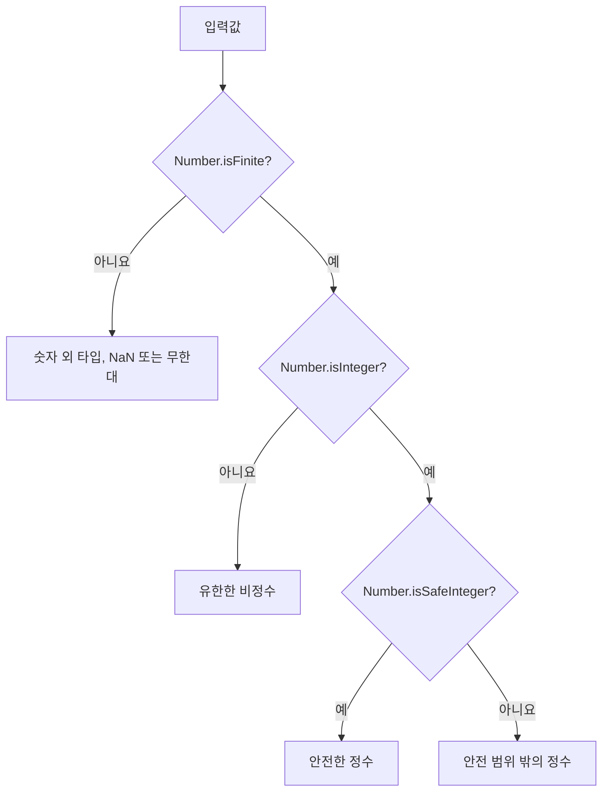

# 28.3 Number 메서드

## 메서드 구분

| 종류              | 호출                   | 목적               |
| ----------------- | ---------------------- | ------------------ |
| 정적 메서드       | Number.isFinite(value) | 전달된 값 검사     |
| 프로토타입 메서드 | value.toFixed(2)       | 숫자를 문자열 표시 |

| 메서드               | 의미                        | 반환값 |
| -------------------- | --------------------------- | ------ |
| Number.isFinite      | 숫자 원시값이고 유한한지    | 불리언 |
| Number.isInteger     | 숫자 원시값이고 정수인지    | 불리언 |
| Number.isNaN         | 실제 NaN인지                | 불리언 |
| Number.isSafeInteger | 안전한 범위의 정수인지      | 불리언 |
| toExponential        | 지수 표기                   | 문자열 |
| toFixed              | 소수점 이하 자릿수로 표시   | 문자열 |
| toPrecision          | 전체 유효숫자 수로 표시     | 문자열 |
| toString             | 지정한 진법의 문자열로 변환 | 문자열 |

## 28.3.1 Number.isFinite

숫자 원시값 중 `NaN`, `Infinity`, `-Infinity`를 제외한 유한수인지 확인한다. 검사 전에 숫자로 변환하지 않는다.

```js
console.log(Number.isFinite(0)); // true
console.log(Number.isFinite(Number.MAX_VALUE)); // true
console.log(Number.isFinite(Number.MIN_VALUE)); // true
console.log(Number.isFinite(Infinity)); // false
console.log(Number.isFinite(-Infinity)); // false
console.log(Number.isFinite(NaN)); // false
console.log(Number.isFinite("10")); // false
console.log(Number.isFinite(null)); // false
```

### 전역 isFinite 비교

```js
console.log(Number.isFinite(null)); // false
console.log(isFinite(null)); // true
console.log(Number.isFinite("10")); // false
console.log(isFinite("10")); // true
```

전역 `isFinite`는 입력을 숫자로 변환해 검사. 숫자 값의 유효성을 검증할 때는 `Number.isFinite`가 명확하다.

## 28.3.2 Number.isInteger

숫자 원시값이 유한한 정수인지 확인한다. 안전한 정수 범위까지 보장하지는 않는다.

```js
console.log(Number.isInteger(0)); // true
console.log(Number.isInteger(123)); // true
console.log(Number.isInteger(-123)); // true
console.log(Number.isInteger(1.0)); // true
console.log(Number.isInteger(0.5)); // false
console.log(Number.isInteger("123")); // false
console.log(Number.isInteger(false)); // false
console.log(Number.isInteger(Infinity)); // false
console.log(Number.isInteger(2 ** 53)); // true
```

`1.0`과 `1`은 Number 값이다. 검사 대상은 원래 문자열 표현이 아니라 이미 저장된 숫자값

## 28.3.3 Number.isNaN

값이 실제 숫자값 `NaN`인지 검사. 검사 전에 변환하지 않는다.

```js
console.log(Number.isNaN(NaN)); // true
console.log(Number.isNaN(undefined)); // false
console.log(Number.isNaN("hello")); // false
console.log(Number.isNaN("123")); // false

console.log(isNaN(undefined)); // true
console.log(isNaN("hello")); // true
console.log(isNaN("123")); // false
```

| 함수                | 동작                          |
| ------------------- | ----------------------------- |
| Number.isNaN(value) | value 자체가 NaN인지 검사     |
| isNaN(value)        | 숫자 변환 결과가 NaN인지 검사 |

`Number.isNaN('hello')`가 `false`라고 해서 `'hello'`가 유효한 숫자라는 뜻은 아니다.

## 28.3.4 Number.isSafeInteger

숫자 원시값이 정수이고 안전한 정수 범위 안에 있는지 확인한다.

```js
console.log(Number.isSafeInteger(0)); // true
console.log(Number.isSafeInteger(10000000000000000)); // false
console.log(Number.isSafeInteger(Number.MAX_SAFE_INTEGER)); // true
console.log(Number.isSafeInteger(2 ** 53)); // false
console.log(Number.isSafeInteger(0.5)); // false
console.log(Number.isSafeInteger("123")); // false
console.log(Number.isSafeInteger(false)); // false
console.log(Number.isSafeInteger(Infinity)); // false
```

### 검증 메서드 비교

| 값        | `Number.isFinite` | `Number.isInteger` | `Number.isSafeInteger` | `Number.isNaN` |
| --------- | ----------------- | ------------------ | ---------------------- | -------------- |
| 10        | true              | true               | true                   | false          |
| 0.5       | true              | false              | false                  | false          |
| '10'      | false             | false              | false                  | false          |
| null      | false             | false              | false                  | false          |
| NaN       | false             | false              | false                  | true           |
| Infinity  | false             | false              | false                  | false          |
| `2 ** 53` | true              | true               | false                  | false          |



## 28.3.5 Number.prototype.toExponential

숫자를 지수 표기 문자열로 반환.

```js
console.log((77.1234).toExponential()); // 7.71234e+1 (문자열)
console.log((77.1234).toExponential(4)); // 7.7123e+1 (문자열)
console.log((77.1234).toExponential(2)); // 7.71e+1 (문자열)
console.log((77).toExponential()); // 7.7e+1 (문자열)
```

인수는 소수점 이하 자릿수며 현재 표준에서 0~100을 지원. 생략하면 값을 표현하는 데 필요한 자릿수를 사용한다

### 숫자 리터럴의 점 표기

```text
77.toExponential(); // SyntaxError
```

정수 리터럴 뒤의 점이 소수점으로 해석될 수 있다. 혼동을 피하려면 괄호나 변수를 사용한다.

```js
const value = 77;

console.log(value.toExponential()); // 7.7e+1 (문자열)
console.log((77).toExponential()); // 7.7e+1 (문자열)
console.log((77).toExponential()); // 7.7e+1 (문자열)
console.log((77).toExponential()); // 7.7e+1 (문자열)
console.log((77.1234).toExponential()); // 7.71234e+1 (문자열)
```

공백이나 점 두 개를 사용하는 표기법도 문법적으로 가능하다.

## 28.3.6 Number.prototype.toFixed

소수점 이하 자릿수를 지정해 반올림한 **문자열**을 반환. 필요한 경우 0을 채운다

```js
const value = 12345.6789;

console.log(value.toFixed()); // 12346 (문자열)
console.log(value.toFixed(1)); // 12345.7 (문자열)
console.log(value.toFixed(2)); // 12345.68 (문자열)
console.log(value.toFixed(3)); // 12345.679 (문자열)
console.log((1.2).toFixed(2)); // 1.20 (문자열)
console.log(typeof value.toFixed(2)); // string
```

**현재 자릿수 범위는 0~100이며 생략하면 0이다.** 범위를 벗어나는 정수 자릿수 인수는 `RangeError`를 발생시킨다.

### 표시 결과와 계산값은 다름

```js
const text = (1.2).toFixed(2);

console.log(text + 1); // 1.201 (문자열 연결)
console.log(Number(text) + 1); // 2.2 (숫자 계산)
console.log((2.55).toFixed(1)); // 2.5 (문자열)
console.log((1e21).toFixed(2)); // 1e+21 (문자열)
```

문자열에 `+`를 사용하면 문자열 연결이 될 수 있다. 저장된 이진 부동소수점 값을 반올림하므로 십진수에 기대한 반올림과 다른 결과가 나올 수도 있다. 절댓값이 `10 ** 21` 이상이면 지수 표기 문자열을 반환할 수 있음

`toFixed`는 표시용이지 모든 정밀도 문제를 해결하는 계산 도구가 아니다.

## 28.3.7 Number.prototype.toPrecision

소수점 이하가 아니라 **전체 유효숫자 수**를 지정한다. 현재 범위는 1~100이다.

```js
const value = 12345.6789;

console.log(value.toPrecision()); // '12345.6789'
console.log(value.toPrecision(1)); // '1e+4'
console.log(value.toPrecision(2)); // '1.2e+4'
console.log(value.toPrecision(6)); // '12345.7'
console.log((0.004).toPrecision(4)); // '0.004000'
```

**인수를 생략하면 기본값 0이 아니라 보통의 숫자 문자열을 반환** `toPrecision(0)`은 `RangeError`다. 값의 크기와 지정한 유효숫자에 따라 지수표기를 사용할 수 있음.

## 28.3.8 Number.prototype.toString

지정한 진법으로 숫자를 문자열로 변환한다. 기본 진법은 10이며 허용 범위는 2~36이다.

```js
console.log((10).toString()); // '10'
console.log((16).toString(2)); // '10000'
console.log((16).toString(8)); // '20'
console.log((16).toString(16)); // '10'
console.log((35).toString(36)); // 'z'
```

반환 문자열에 `0b`, `0o`, `0x` 같은 접두사가 자동으로 붙지 않음. 진법 변환은 값의 타입을 다른 숫자 타입으로 바꾸는 것이 아닌 표시 문자열 만드는 것

---

# 질문과 답변

## Q1. Number(10)과 new Number(10)의 차이는

- 전자는 숫자 원시값, 후자는 숫자 10을 감싼 객체

## Q2. new Number(0)이 조건문에서 참인 이유

- 내부 숫자와 관계없이 객체는 truthy이기 때문

## 03. Number("")와 Number(undefined)의 결과

- 각각0과 NaN이다. 인수가 없는 Number()는 0이다.

## Q4. 0.1 + 0.2가 0.3과 정확히 같지 않은 이유는

- 일부 십진 소수를 이진 부동소수점으로 정확히 표현할 수 없어 가까운 값으로 저장하기 떄문

## Q5. EPSILON을 모든 숫자 비교에 고정해 사용해도 되는 지

- 아니다. 값의 크기와 입력 정밀도에 맞게 절대, 상대 허용오차를 정해야한다.

## Q6. MIN_VALUE는 가장 작은 음수인지

- 아니다, 가장 작은 양수인 5e-324다

## Q7. MAX_VALUE와 MAX_SAFE_INTEGER차이

- 전자는 가장 큰 양의 유한수, 후자는 인접한 정수와 혼동 없이 다룰 수 있는 가장 큰 안전한 정수

## Q8. Number.isFinite(null)과 isFinite(null)의 결과는

- 각각 false, true다. 전역함수는 null을 0으로 변환해 검사한다

## Q9. Number.isNaN('hello')가 false면 유효한 숫자인지

- 아니다. 문자열을 변환하지 않고 값 자체가 NaN인지 검사한 결과

## Q10. NaN === NaN의 결과와 적절한 검사 방법

- false. Number.isNaN(value) 사용

## Q11. toFixed와 toPrecision 인수는 어떻게 다른지

- toFixed는 소수점 이하 자릿수, toPrecision은 전체 유효숫자수
