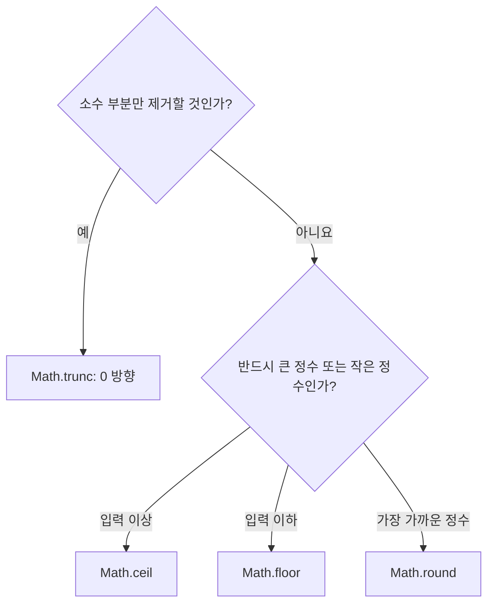

## 29.2 Math 메서드

| 메서드 | 동작                       | 예시               |
| ------ | -------------------------- | ------------------ |
| abs    | 절댓값                     | abs(-3) → 3        |
| round  | 가장 가까운 정수           | round(1.6) → 2     |
| ceil   | 입력 이상인 가장 작은 정수 | ceil(-1.4) → -1    |
| floor  | 입력 이하인 가장 큰 정수   | floor(-1.4) → -2   |
| sqrt   | 제곱근                     | sqrt(9) → 3        |
| random | 0 이상 1 미만의 의사 난수  | 매번 달라지는 숫자 |
| pow    | 거듭제곱                   | pow(2, 8) → 256    |
| max    | 가장 큰 인수               | max(1, 3, 2) → 3   |
| min    | 가장 작은 인수             | min(1, 3, 2) → 1   |

### 29.2.1 Math.abs

숫자의 절댓값을 반환. 정상적인 절댓값은 0 또는 양수다. 숫자로 변환할 수 없는 입력은 NaN이 될 수 있음

```JS
console.log(Math.abs(-1)); // 1
console.log(Math.abs(1)); // 1
console.log(Math.abs(-'1')); // 1
console.log(Math.abs('')); // 0
console.log(Math.abs([])); // 0
console.log(Math.abs(null)); // 1
console.log(Math.abs(undefined)); // NaN
console.log(Math.abs({})); // NaN
console.log(Math.abs()); // NaN
```

빈 문자열·빈 배열·null이 0으로 변환되는 점에 주의. 숫자만 하려면 `Number.isFinite` 등으로 검사.

두 값의 거리나 오차 크기를 구할 때 사용

```js
const target = 100;
const actual = 93;

console.log(Math.abs(actual - target)); // 7
console.log(Math.abs(-Infinity)); // Infinity
console.log(Object.is(Math.abs(-0), 0)); // true
```

### 29.2.2 Math.round

가장 가까운 정수로 반올림. 두 정수의 정확한 중간값이면 **큰 정수, 즉 +Infinity 방향**을 선택.

```JS
console.log(Math.round(1.4)); // 1
console.log(Math.round(1.6)); // 2
console.log(Math.round(1.5)); // 2
console.log(Math.round(-1.4)); // -1
console.log(Math.round(-1.6)); // -2
console.log(Math.round(-1.5)); // -1
console.log(Math.round(1)); // 1
console.log(Math.round()); // NaN
```

**Math.round(-1.5)는 -2가 아닌 -1이다.** 모든 언어의 반올림 규칙이 같은 것은 아님.

#### 음의 0

```JS
console.log(Object.is(Math.round(-0.5), -0)); // true
console.log(Object.is(Math.round(-0.1), -0)); // true
console.log(-0 === 0); // true
console.log(Object.is(-0, 0)); // false
```

`===`는 0과 -0을 길게 보나 `Object.is`는 구분한다. `Math.round(x)`를 모든 경우에 `Math.floor(x + 0.5)`와 같다고 설명하면 음의 0과 정밀도 차이를 놓칠 수 있음

### 29.2.3 Math.ceil

입력보다 크거나 같은 정수 중 가장 작은 정수를 반환. 수직선에서 위쪽, 즉 +Infinity 방향으로 올린다고 생각하면 이해하기 쉽다

```JS
console.log(Math.ceil(1.4)); // 2
console.log(Math.ceil(1.6)); // 2
console.log(Math.ceil(-1.4)); // -
console.log(Math.ceil(-1.6)); // -1
console.log(Math.ceil(1)); // 2
console.log(Math.ceil()); // NaN
```

음수에서 결과가 더 큰 정수가 된다. 절대값이 더 커지는 방향으로 올린다는 뜻이 아님

### 29.2.4 Math.floor

입력보다 작거나 같은 정수 중 가장 큰 정수를 반환. -Infinity 방향으로 내림

```JS
console.log(Math.floor(1.9)); // 1
console.log(Math.floor(9.1)); // 9
console.log(Math.floor(-1.9)); //-2
console.log(Math.floor(-9.1)); // -10
console.log(Math.floor(1)); // 1
console.log(Math.floor()); // NaN
```

**floor는 음수에서 소수점만 제거하는 동작과 다름**

#### Math.trunc 비교

Math.trunc는 소수 부분을 제거하여 **0 방향**으로 정수를 만든다

```javascript
console.log(Math.trunc(1.9)); // 1
console.log(Math.trunc(-1.9)); // -1
console.log(Math.floor(-1.9)); // -2
console.log(Math.ceil(-1.9)); // -1
```

| 입력 | round | ceil | floor | trunc |
| ---- | ----- | ---- | ----- | ----- |
| 1.4  | 1     | 2    | 1     | 1     |
| 1.5  | 2     | 2    | 1     | 1     |
| 1.9  | 2     | 2    | 1     | 1     |
| -1.4 | -1    | -1   | -2    | -1    |
| -1.5 | -1    | -1   | -2    | -1    |
| -1.9 | -2    | -1   | -2    | -1    |



### 29.2.5 Math.sqrt

제곱근을 반환. 양수의 경우 0 이상인 제곱근 선택, 음수는 Number 실수 범위에 제곱근이 없어 NaN이다

```js
console.log(Math.sqrt(9)); // 3
console.log(Math.sqrt(-9)); // NaN
console.log(Math.sqrt(2)); // 약 1.41421356237309951
console.log(Math.sqrt(1)); // 1
console.log(Math.sqrt(0)); // 0
console.log(Math.sqrt()); // NaN
```

#### 두 좌표 사이 거리

```JS
function distance(x1, y1, yx2, y2) {
  const dx = x2 - x1;
  const dy = y2 - y1;
  return Math.sqrt(dx ** 2 + dy ** 2);
}

console.log(distance(0, 0, 3, 4)); // 5
```

### 29.2.6 Math.random

**0이상 1 미만**의 의사 난수를 반환. 0은 포함 1은 포함되지 않음

```js
const value = Math.random();

console.log(value >= 0 && value < 1); // true

const dice = Math.floor(Math.random() * 6) + 1;
console.log(Number.isInteger(dice) && dice >= 1 && dice <= 6); // true
```

| 표현식                              | 범위         |
| ----------------------------------- | ------------ |
| Math.random()                       | 0이상 1 미만 |
| Math.floor(Math.random() \* 10)     | 0~9 정수     |
| Math.floor(Math.random() \* 10) + 1 | 1~10 정수    |

#### 작은 정수 범위 난수 함수

```JS
function randomInt(min, max, random = Math.random) {
  return Math.floor(random() * (max - min + 1)) + min;
}

console.log(randomInt(1, 10, () => 0)); // 1
console.log(randomInt(1, 10, () => 0.999)); // 10
console.log(randomInt(-3, 3, () => 0)); // -3
console.log(randomInt(-3, 3, () => 0.5)); // 0
```

min·max는 정수 min <= max라고 가정. 세 번쨰 인수는 결과물 재현하기 위한 함수, 생략하면 Math.random 사용. 전달한 함수는 0 이상 1 미만을 변환.

### 29.2.7 Math.pow

첫 인수는 밑, 두 번째 인수는 지수. 밑을 지수만큼 거듭제곱한 값을 반환.

```js
console.log(Math.pow(2, 8)); // 256
console.log(Math.pow(2, -1)); // 0.5
console.log(Math.pow(2)); // NaN
console.log(Math.pow(-2, 0.5)); // NaN

console.log(2 ** 8); // 256
console.log(2 ** -1); // 0.5
console.log((-2) ** 2); // 4
console.log(-(2 ** 2)); // -4
console.log(2 ** (3 ** 2)); // 512
console.log(2n ** 3n).toString(); //  '8'
```

| 표현식      | 해석                           |
| ----------- | ------------------------------ |
| (-2) \*\* 2 | 음수 -2를 제곱                 |
| -(2 \*\* 2) | 2를 제곱한 뒤 부호 변경        |
| 2 ** 3 ** 2 | 2 ** (3 ** 2), 오른쪽부터 결합 |

음수 밑에는 괄호를 사용. `**`는 조건에 맞는 BigInt 거듭제곱도 지원하나 Math.pow는 BigInt를 직접 처리하지 않음.

### 29.2.8 Math.max

전달된 인수 중 가장 큰 값을 반환. 인수가 없으면 -Infinity다

```js
console.log(Math.max); // 1
console.log(Math.max(1, 2)); // 2
console.log(Math.max(1, 2, 3)); // 3
console.log(Math.max(-5, -2)); // -2
console.log(Math.max()); // -Infinity
console.log(Math.max(1, NaN)); // NaN
```

#### 배열 최대값

```js
const values = [1, 2, 3];

console.log(Marh.max.apply(null, values)); // 3
console.log(Marh.max.(...values)); // 3
console.log(Marh.max.(values)); // NaN
```

### 29.2.9 Math.min

전달된 인수 중 가장 작은 값은 변환. 인수가 없으면 Infinity

```js
console.log(Math.min(1)); // 1
console.log(Math.min(1, 2)); // 1
console.log(Math.min(1, 2, 3)); // 1
console.log(Math.min()); // NaN
console.log(Math.min(1, NaN)); // NaN

const values = [1, 2, 3];
console.log(Math.min.apply(null, values)); // 1
console.log(Math.min.(...values)); // 1
```

#### 빈 배열과 큰 배열 처리

```javascript
console.log(Math.max(...[])); // -Infinity
console.log(Math.min(...[])); // Infinity

const values = [-5, -2, -9];
const max = values.reduce((acc, value) => Math.max(acc, value), -Infinity);
const min = values.reduce((acc, value) => Math.min(acc, value), Infinity);

console.log(max); // -2
console.log(min); // -9
```

Spread와 apply는 모든 요소를 함수 인수로 전달하므로 매우 큰 배열에서는 인수 개수 제한에 걸릴 수 있다. 대량 데이터에서는 reduce나 반복문으로 계산하는 방법을 고려

| 누적 목적 | 초기값    | 이유                             |
| --------- | --------- | -------------------------------- |
| 최댓값    | -Infinity | 모든 값이 음수여도 올바르게 비교 |
| 최솟값    | Infinity  | 모든 값이 양수여도 올바르게 비교 |

빈 데이터가 정상적인 최댓값·최솟값을 갖는 것은 아니다.
