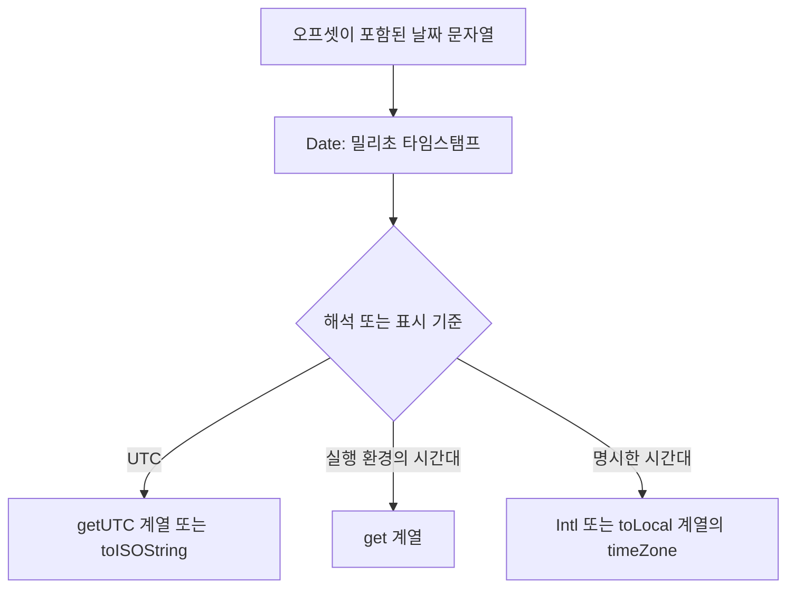

# 30장. Date

> 로컬 날짜, UTC 날짜, API로 전달할 시각을 구분

## 기본 개념

| 용어       | 의미                                   |
| ---------- | -------------------------------------- |
| UTC        | 협정 세계시, 시각 표현 기준            |
| KST        | 현재 한국 표준시, UTC+09:00            |
| 타임스탬프 | 기준 시각부터 경과한 밀리초 숫자       |
| 로컬 시간  | 실행 환경의 시간대에 해석한 날짜, 시간 |

UTC와 GMT는 서로 다른 개념이므로 기술 문서에 UTC 기준을 명시. Date 객체는 입력한 시간대 이름을 보관하지 않음. 같은 시각도 어떤 시간대에 표시하느냐에 따라 날짜와 시간이 달라짐

```js
const date = new Date("202-07-24T12:30:00+09:00");

console.log(date.toISOString()); // '2020-07-24T03:30:00.000Z'
console.log(date.getHours()); // '12: Asia/Seoul 환경'
console.log(date.getUTCHours()); // '3'
```


