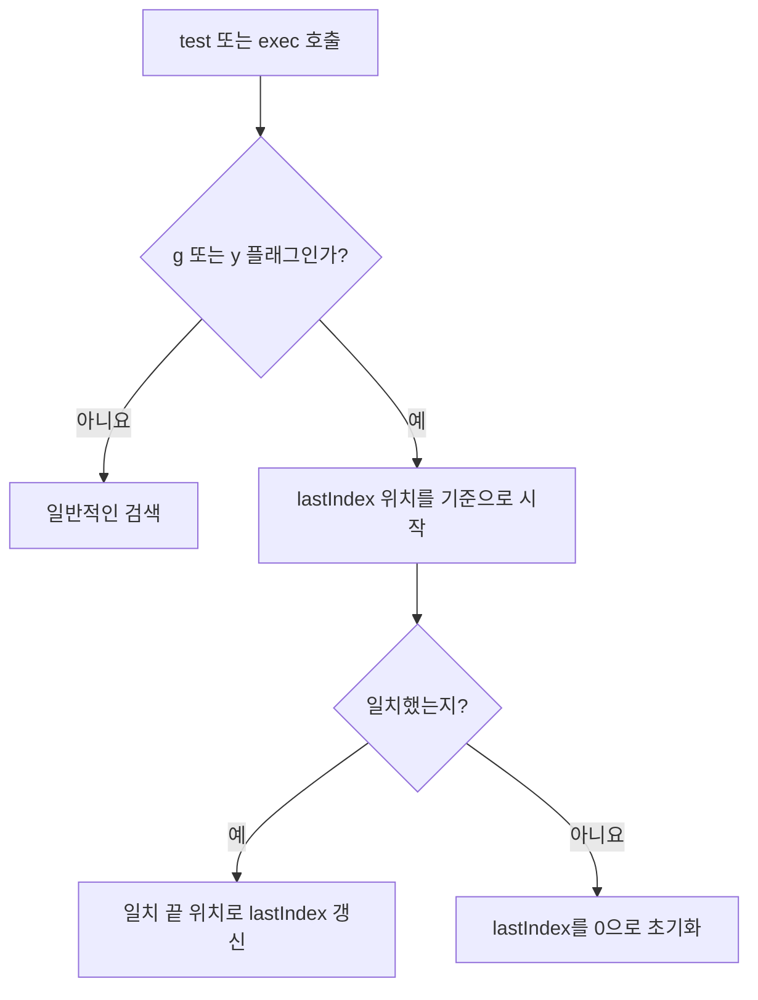

## 31.4 플래그

| 플래그 | 의미                                           |
| ------ | ---------------------------------------------- |
| g      | 전역 검색                                      |
| i      | 대소묹자 구분 완화                             |
| m      | ^와 $가 각 줄의 시작·끝에도 매칭               |
| s      | 점이 줄바꿈 문자도 포함                        |
| u      | Unicode 인식 모드                              |
| v      | Unicode 집합 기능을 확장한 모드                |
| y      | lastIndex 위치에서 매칭을 시도하는 sticky 모드 |
| d      | 매칭 결과의 시작·끝 인덱스 정보 제공           |

u와 v는 함께 사용할 수 없고 같은 플래그를 중복 지정할수도 없다. d·v 등 현대 플래그는 사용하는 환경의 지원 여부를 확인.

### m과 s 차이

```js
console.log(/^B/.test("A\nB")); // false
console.log(/^B/m.test("A\nB")); // true
console.log(/A.B/.test("A\nB")); // false
console.log(/A.B/s.test("A\nB")); // true
```

m은 여러 줄 전체를 검색하게 하는 옵션이 아님. **앵커 ^·$의 의미**를 바꾼다. 점의 줄바꿈 처리는 s다.

### g·y와 lastIndex

```js
const pattern = /a/g;

console.log(pattern.test("a")); // true
console.log(pattern.lastIndex); // 1
console.log(pattern.test("a")); // false
console.log(pattern.lastIndex); // 0

pattern.lastIndex = 0;
console.log(pattern.test("a")); // truiie
```

검증용 패턴을 재사용할 때 g·y를 붙이면 호출 순서에 따라 결과가 달라질 수 있음. 전체 형식 검사에 보통 g가 필요하지 않음


