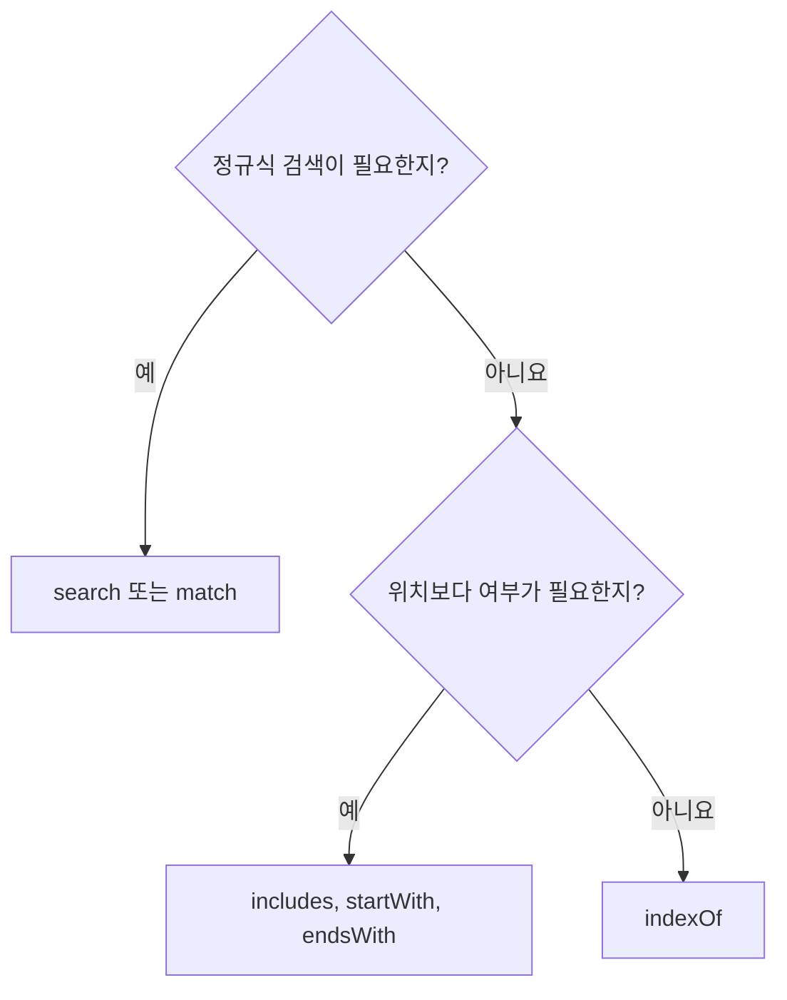

## 32.3 String 메서드

문자열을 바꾸는 메서드도 원본 문자열을 직접 수정하지 않음. 결과를 변수에 저장해야 사용할 수 있음

**모든 String 메서드가 문자열을 반환하는 것은 아님** 숫자·불리언·배열·null 등을 반환하는 메서드도 있음

| 메서드      | 반환값                        |
| ----------- | ----------------------------- |
| indexOf     | 인덱스 또는 - 1               |
| search      | 인덱스 또는 -1                |
| inCludes    | 불리언                        |
| starstWith  | 불리언                        |
| endsWith    | 불리언                        |
| charAt      | 문자열, 범위 밖이면 빈 문자열 |
| substring   | 부분 문자열                   |
| slice       | 부분 문자열                   |
| toUpperCase | 대문자 문자열                 |
| toLowerCase | 소문자 문자열                 |
| trim        | 앞뒤 공백 제거 문자열         |
| repeat      | 반복한 문자열                 |
| replace     | 치환한 문자열                 |
| split       | 배열                          |

### 32.3.1 indexOf

문자열 첫 위치를 반환. 두 번째 인수는 검색 시작 위치이며 실패하면 -1이다

```js
const text = "Hello World";

console.log(text.indexOf("l")); // 2
console.log(text.indexOf("l", 3)); // 3
console.log(text.indexOf("or")); // 7
console.log(text.indexOf("x")); // -1
```

0은 첫 위치, -1은 검색 실패다. `if (text.indexOf(keyword))`로 존재 여부를 확인하면 안 된다. `!== -1` 또는 includes를 사용.

### 32.3.2 search

정규식과 일치하는 첫 위치를 반환. 실패하면 -1이다

```js
const text = "Hello world";

console.log(text.search(/o/)); // 4
console.log(text.search(/x/)); // -1
console.log("abc".search(".")); // 0: 문자열 인수도 정규식으로 해석
console.log("abc".search(".")); // -1: 점 자체를 검색
```

일반 문자열을 문자 그대로 찾는 목적이면 indexOf·includes 등이 명확

### 32.3.3 includes

문자열 포함 여부를 반환, 두 번째 인수는 검색 시작 위치. 대소문자를 구분.

```js
const text = "Hello World";

console.log(text.includes("Hello")); // true
console.log(text.includes("hello")); // false
console.log(text.includes("1", 3)); // true
console.log(text.includes("H", 3)); // false
console.log(text.includes("")); // true
```

### 32.3.4 startsWith

지정 위치부터 해당 문자열로 시작하는지 확인

```js
const text = "Hello World";

console.log(text.startsWith("He")); // true
console.log(text.startsWith("World")); // false
console.log(text.startsWith("World", 6)); // true
```

### 32.3.5 endsWith

두 번째 인수는 검색 시작 위치가 아니라 **검사할 앞부분의 길이**다

```js
const text = "Hello World";

console.log(text.endsWith("ld")); // true
console.log(text.endsWith("x")); // false
console.log(text.endsWith("lo", 5)); // true: 'Hello' 검사
```

includes·startsWith·endsWith는 정규식을 받는 메서드가 아님. 일반 RegExp로 인수로 전달하면 TypeError



### 32.3.6 charAt

지정 인덱스 UTF-16 코드 단위를 문자열로 반환. 범위 밖이면 문자열

```js
const text = "Hello";

console.log(text.charAt(0)); // H
console.log(text.charAt(5)); // ''
console.log(text[5]); // undefined
console.log(text.charAt(-1)); // ''
console.log(text.at(-1)); // o: ES2022
```

charAt은 음수 인덱스로 끝 문자를 찾지 않음. at은 음수를 사용할 수 있으나 코드 단위 기준

#### charCodeAt과 codePointAt

```js
console.log("�".charCodeAt(0)); // 55357: 첫 UTF-16 코드 단위
console.log("�".codePointAt(0)); // 128512: 코드 포인트
```

### 32.3.7 substring

시작 포함, 끝 제외 범위를 반환. 끝을 생략하면 마지막까지

```js
const text = "Hello World";

console.log(text.substring(1, 4)); // ell
console.log(text.substring(1)); // ello World
console.log(text.substring(4, 1)); // ell: 인수 교환
console.log(text.substring(-2)); // Hello World: 음수는 0
console.log(text.substring(1, 100)); // ello World
console.log(text.substring(20)); // ''

const space = text.indexOf(" ");
console.log(text.substring(0, space)); // Hello
console.log(text.substring(space + 1)); // World
```

구분 문자가 없으면 indexOf가 -1이 되어 실제 처리에 검색 성공 여부를 먼저 확인

### 32.3.8 slice

시작 포함, 끝 제외 범위를 반환. 음수 인수는 끝에서부터 계산. substring과 달리 시작·끝을 자동 교환하지 않음

```js
const text = "Hello World";

console.log(text.slice(0, 5)); // Hello
console.log(text.slice(-5)); // World
console.log(text.slice(0, -6)); // Hello
console.log(text.slice(4, 1)); // ''
console.log(text.substring(4, 1)); // ell
```

| 비교      | substring  | slice           |
| --------- | ---------- | --------------- |
| 끝 위치   | 제외       | 제외            |
| 음수      | 0으로 취급 | 끝에서부터 계산 |
| 시작 > 끝 | 교환       | 빈 문자열       |
| 원본 변경 | 없음       | 없음            |

### 32.3.9 toUpperCase / 32.3.10 toLowerCase

```js
const text = "Hello World";

console.log(text.toUpperCase()); // HELLO WORLD!
console.log(text.toLowerCase()); // hello world!
console.log(text); // Hello World!
```

원본은 유지. 대소문자 변환은 언어와 문자에 따라 결과 길이가 달라질 수 있음.

### 32.3.11 trim

양 끝의 공백 문자를 제거. 문자열 중간의 공백은 유지.

```js
const text = "    foo bar    ";

console.log(text.trim()); // 'too bar'
console.log(text.trimStart()); // 'foo bar   '
console.log(text.trimEnd()); // '  foo bar'
console.log(text.replace(/\s/g, "")); // 'foobar'
console.log(text.replace(/^\s+/, "")); // 'foo bar   '
```

trimStart·trimEnd는 ES2019표준. trim과 모든 공백 제거는 목적이 다름.

### 2.3.12 repeat

문자열을 지정 횟수 만큼 반복. 횟수는 정수 변환을 거침

```js
console.log("abc".repeat()); // ''
console.log("abc".repeat(0)); // ''
console.log("abc".repeat(1)); // abc
console.log("abc".repeat(2)); // abcabc
console.log("abc".repeat(2.5)); // abcabc

try {
  "abc".repeat(-1);
} catch (error) {
  console.log(error.name); // RangeError
}
```

정수 변환 후 음수인 횟수나 Infinity 등은 RangeError다

### 32.3.13 replace

문자열이나 정규식과 일치하는 부분을 치환. 문자열 검색은 첫 결과만 바꾼다. 정규식의 g 플래그로 치환할 수 있음

```js
const text = "Hello Hello";

console.log(text.replace("Hello", "Lee")); // Lee Hello
console.log(text.replace(/hello/gi, "Lee")); // Lee Lee
console.log("Hello World".replace("World", "[$&]")); // Hello [World]
console.log("2020-07".replace(/(\d{4})-(\d{2})/, "$2/$1")); // 07/2020
console.log(text); // Hello Hello
```

| 패턴   | 의미             |
| ------ | ---------------- |
| $&     | 전체 매칭 문자열 |
| $1, $2 | 캡처 그룹        |
| $$     | 달러 문자        |

#### 치환 함수, 이름 표기 변환

```js
function camelToSnake(text) {
  return text.replace(/[A-Z]/g, (letter) => `_${letter.toLowerCase()}`);
}

function snakeToCamel(text) {
  return text.replace(/_([a-z])/g, (_, letter) => letter.toUpperCase());
}

console.log(camelToSnake("helloWorld")); // hello_world
console.log(snakeToCamel("hello_world")); // helloWorld
console.log("A1 B2".replace(/\d/g, (digit) => String(Number(digit) * 2))); // A2 B4
```

단순한 영문 lowerCamelCase와 소문자 snake_case 에제. 약어·연속 대문자·Unicode 이름 등의 변환 정책은 별도로 정함.

#### replaceAll

문자열 검색어의 모든 결과를 치환. 정규식을 전달하려면 g 플래그가 필요.

```js
console.log("a.b.a".replaceAll(".", "-")); // a-b-a
console.log("Hello Hello".replaceAll("Hello", "Lee")); // Lee Lee

try {
  "Hello Hello".replaceAll(/Hello/, "Lee");
} catch (error) {
  console.log(error.name); // TypeError
}
```

### 32.3.14 split

구분자로 나눈 **배열**을 반환. 두 번째 인수는 최대 결과 개수이며 뒤쪽 나머지를 보존하는 옵션은 아님.

```js
const text = "How are you doing?";

console.log(text.split("  ")); // ['How', 'are', 'you', 'doing?']
console.log(text.split(/\s+/)); // ['How', 'are', 'you', 'doing?']
console.log(text.split()); // ['How are you doing?']
console.log(text.split("  ", 3)); // ['How', 'are', 'you']
console.log("a  b".split("  ")); // ['a', '', 'b']
console.log("abc".split("", 0)); // []
```

split('')는 UTF-16 코드 단위로 나누므로 이모지를 쪼갤 수 있음.

### 문자열 뒤집기와 Unicode

```js
function reverseBasic(text) {
  return text.split("").reverse().join("");
}

function reverseCodePoints(text) {
  return [...text].reverse().join("");
}

console.log(reverseBasic("Hello World")); // !dlrow olleH
console.log(reverseCodePoints("�A")); // A�
```

코드 포인트 단위 뒤집기도 결합 문자·복합 이모지의 표시 단위를 모두 보존하는 것은 아님. 그래핌 단위 처리는 Intl.Segmenter 등을 사용.

### Unicode 정규화와 자릿수 채우기

```js
const composed = "e";
const decomposed = "e\u0301";

console.log(composed === decomposed); // false
console.log(composed === decomposed.normalize("NFC")); // true
console.log(String(7).padStart(2, "0")); // '07'
console.log("A".padEnd(3, "."));
("A..");
```

normalize는 서로 다른 Unicode 조합 표현을 정규화. padStart·padEnd는 날짜 표시의 자릿수 채우기에 사용할 수 있음.

## 질문 및 답변

### Q1. String(123)과 new String(123)의 차이는

- 문자열 원시값과 문자열 래퍼 객체의 차이.

### Q2. 문자열 인덱스에 대입하면 언제나 조용히 무시되는지

- 아니다. strict mode에 TypeError가 발생할 수 있음. 문자열 자체는 바뀌지 않음.

### Q3. String 래퍼는 객체 전체가 읽기 전용인지

- 아님. 문자 인덱스·length는 읽기 전용이나 별도 프로퍼티를 추가할 수 있음.

### Q4. String 메서드는 모두 문자열을 반환하는지

- 아님. indexOf는 숫자, includes는 불리언, split는 배열 등을 반환.

### Q5. 이모지 하나의 length가 2인 이유는

- length가 UTF-16 코드 단위 수를 세기 때문.

### Q6. Spread로 나누면 언제나 화면의 글자 단위인지

- 아니다. 코드 포인트 단위이고 결합 문자·복합 이모지는 그래핌 단위 처리가 필요할 수 있음.

### Q7. indexOf와 search의 차이는

- 일반 문자열 검색과 정규식 검색. 둘 다 실패하면 -1이다

### Q8. endsWith의 두 번째 인수는 시작 위치인지

- 아니다. 검사할 앞부분의 길이다.

### Q9. charAt과 대괄호 접근의 범위 밖 결과는

- 각각 빈 문자열과 Undefined다

### Q10. substring(4, 1)과 slice(4, 1)의 차이

- substring은 인수를 교환하고 slice는 빈 문자열을 반환.

### Q11. trim은 중간 공백도 지우는 지

- 아님. 양 끝의 공백만 제거.

### Q12. repeat(2.5)는 몇 번 반복하는지

- 정수 변환 후 2번 반복

### Q13. replace의 문자열 검색과 g 정규식 검색의 차이

- 첫 결과만 치환하는 것과 모든 일치 결과를 치환하는 차이

### Q14. replaceAll에 g 없는 정규식을 전달

- TypeError가 발생. 일반 문자열 검색어에 g가 필요 없음.

### Q15. split의 limit은 결과 길이를 반드시 맞추는 지

- 아님. 최대 개수를 제한하고 남은 부분은 결과에 포함하지 않음.

- [MDN: String](https://developer.mozilla.org/en-US/docs/Web/JavaScript/Reference/Global_Objects/String)
- [MDN: length](https://developer.mozilla.org/en-US/docs/Web/JavaScript/Reference/Global_Objects/String/length)
- [MDN: substring](https://developer.mozilla.org/en-US/docs/Web/JavaScript/Reference/Global_Objects/String/substring)
- [MDN: replaceAll](https://developer.mozilla.org/en-US/docs/Web/JavaScript/Reference/Global_Objects/String/replaceAll)
- [MDN: Intl.Segmenter](https://developer.mozilla.org/en-US/docs/Web/JavaScript/Reference/Global_Objects/Intl/Segmenter)
