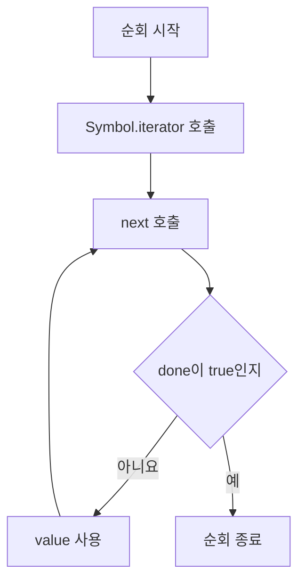

## 34.5 이터레이션 프로토콜 중요성

자료구조마다 내부 저장 방식은 다르나 소비자는 Symbol.iterator와 next라는 공통 인터페이스를 사용

| 공급자                                | 인터페이스                            | 소비자                              |
| ------------------------------------- | ------------------------------------- | ----------------------------------- |
| Array·String·Set·Map·사용자 정의 객체 | Symbol.iterator -> next -> value/done | for...of·배열 Spread·배열 구조 분해 |

