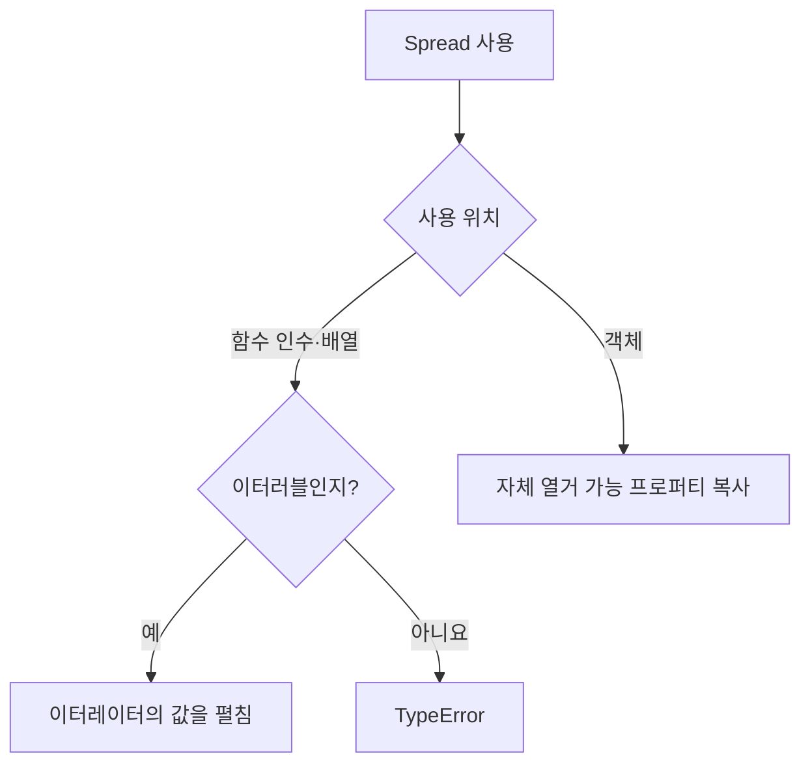

## 35.3 객체 리터럴 내부

### 객체 복사·병합·변경·추가

```js
const original = { x: 1, y: 2 };
const copy = { ...original };
const merged = { ...original, ...{ y: 10, z: 3 } };
const changed = { ...original, y: 100 };
const added = { ...original, z: 0 };

console.log(copy); // { x: 1, y: 2}
console.log(copy === original); // false
console.log(merged); // { x: 1, y: 10, z: 3}
console.log(changed); // { x: 1, y: 100}
console.log(added); // { x: 1, y: 2, z: 0}
console.log({ y: 100, ...original }); // { y: 2, x: 1}

console.log(Object.assign({}, original, { y: 10, z: 3 })); // { x: 1, y: 10, z: 3}
```

동일한 키의 값은 뒤에 나온 값이 우선. 중첩 객체를 자동으로 병합하는 것은 아님

### 무엇을 복사

| 항목                                  | 객체 Spread          |
| ------------------------------------- | -------------------- |
| 자체 열거 가능한 문자열·심벌 프로퍼티 | 복사                 |
| 상속 프로퍼티·비열거 프로퍼티         | 복사하지 않음        |
| 원본 프로토타입                       | 이어받지 않음        |
| 중첩 객체                             | 참조 공유            |
| getter·sette의 프로퍼티 정의          | 그대로 복사하지 않음 |

```js
const key = Symbol("memo");
const source = { name: "Lee", [key]: "메모" };
Object.defineProperty(source, "hidden", { value: 1 });

const copy = { ...source };
console.log(copy[key]); // '메모'
console.log(Object.hasOwn(copy, "hidden")); // false
console.log({ ...[10, 20] }); // { '0': 10, '1': 20}
console.log({ ...null, ...undefined }); // {}
```

객체 Spread는 이터러블 조건을 요구하지 않음. 반면 `[...null]`처럼 배열에 사용하는 것은 오류

### Object.assign과 차이

Object.assign은 첫 번째 대상 객체를 변경. 객체 Spread는 새 객체 리터럴의 프로퍼티를 만든다. 둘 다 원본의 getter를 읽을 수 있으나, 대상 setter 처리에 차이가 있음

```js
const events = [];
const target = {
  set x(value) {
    events.push(value);
  },
};
Object.assign(target, { x: 1 });

const spread = {
  set x(value) {
    events.push(value);
  },
  ...{ x: 2 },
};

console.log(events); // [1]
console.log(spread.x); // 2
```



## 질문, 답변

### 1. Spread는 단독 값을 만드는 연산자인지

- 아니다. 인수·배열 요소·객체 프로퍼티 위치에서 사용

### 2. 모든 Spread가 이터러블을 요구하는 지

- 아님. 객체 Spread는 자체 열거 가능 프로퍼티를 복사

### 3. Math.max(array)와 Math.max(...array)의 차이

- 배열 하나를 전달하는 것과 요소들을 개별 인수로 전달하는 차이

### 4. Math.max(...[])의 결과는

- -Infinity

### 5. 아주 큰 배열을 함수 인수로 펼쳐도 되는 지

- 엔진 인수 개수 제한이 있어 반복문 등의 대안을 고려

### 6. Rest 파라미터와 Spread 방향

- Rest는 모으고 Spread는 펼침

### 7. 배열 Spread는 깊은 평탄화인지

- 아님. 내부 배열은 그대로 요소로 남는다

### 8. splice에 배열을 그대로 저달

- 배열 자체가 하나의 요소로 삽입

### 9. Splice는 원본을 바꾸는 지

- 맞음. 삭제한 요소들을 새 배열로 반환

### 10. Spread 복사는 깊은 복사인지

- 아님. 중첩 객체 참조를 공유

### 11. 희소 배열에 slice와 Spread 차이는

- slice는 빈 슬롯을 보존하고 Spread는 undefined 요소로 만듬

### 12. 이터러블이 아닌 유사 배열 변환

- Array.from이나 조건에 맞는 slice.call을 사용

### 13. 객체 병합에 같은 키는 누가 우선하는지

- 뒤에 나온 값이 우선한다

- [MDN: Spread](https://developer.mozilla.org/en-US/docs/Web/JavaScript/Reference/Operators/Spread_syntax)
