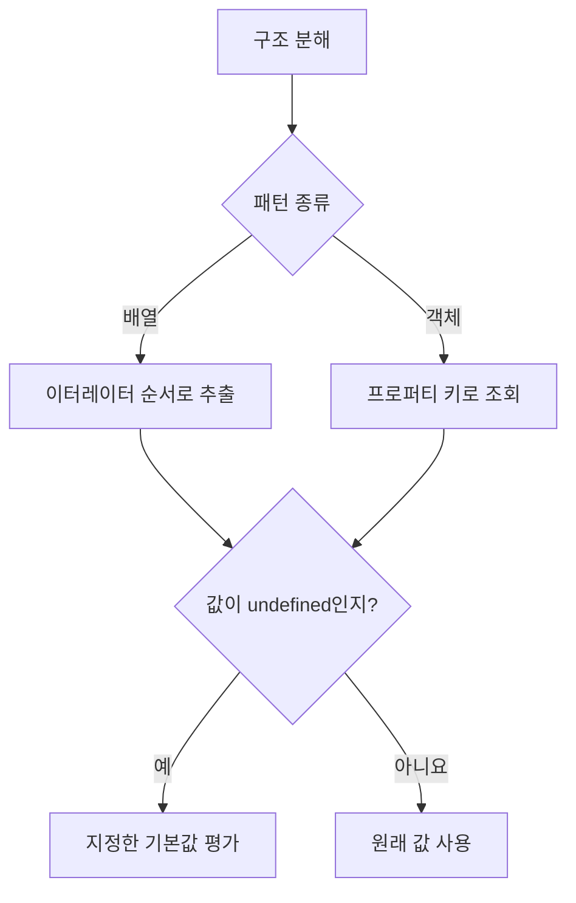

## 36.2 객체 디스트럭처링 할당

### 기본 문법과 할당 순서

```js
const user = { firstName: "Ungmo", lastName: "Lee" };

const { lastName, firstName } = user;
console.log(firstName, lastName); // 'Ungmo' 'Lee'

const { firstName: fn, lastName: ln } = user;
console.log(fn, ln); // 'Ungmo' 'Lee'
```

프로퍼티를 적은 위치가 아니라 **키 이름**으로 값을 찾음. 별칭을 지정하면 오른쪽 이름의 변수가 만들어짐

| 문법       | 의미                             |
| ---------- | -------------------------------- |
| `{ name }` | name 프로퍼티를 name 변수에 할당 |
| `{ name }` | name 프로퍼티를 name 변수에 할당 |
| `{ name }` | name 프로퍼티를 name 변수에 할당 |
| `{ name }` | name 프로퍼티를 name 변수에 할당 |

### 기본값·원시값null

```js
const { firstName = "Ungmo", lastName } = { lastName: "Lee" };
console.log(firstName, lastName); // 'Ungmo' 'Lee'

const { firstName: fn = "Ungmo", lastName: ln } = { lastName: "Lee" };
console.log(fn, ln); // 'Ungmo' 'Lee'

const { name = "Guest" } = { name: null };
console.log(name); // null

const { length } = "Hello";
console.log(length); // 5

const { toFixed } = 123;
console.log(typeof toFixed); // function

for (const value of [null, undefined]) {
  try {
    const { id } = value;
  } catch (error) {
    console.log(error.name); // 각각 TypeError
  }
}

// const { id }; // SyntaxError
```

객체 구조 분해는 프로퍼티 접근처럼 동작하며 문자열·숫자 등도 래퍼를 통해 처리.
null·undefined는 처리할 수 없음. 일반적인 프로퍼티 조회이므로 상속된 프로퍼티나 getter를 읽을 수 있음

### 기존 변수에 할당할 때 괄호

```js
let name;
let age;

({ name, age}) = { name: 'Lee', age: 30};
console.log(name, age); // 'Lee' 30
```

문장 시작의 `{}`가 블록으로 해석도지 않도록 객체 구조 분해 할당문을 괄호로 감쌈

### 필요한 프로퍼티만 추출·함수 매개변수

```js
const todo = { id: 1, content: "HTML", completed: true };
const { id } = todo;
console.log(id); // 1

function printTodo({ content = "할 일", completed = false } = {}) {
  return `${content}은 ${completed ? "완료" : "미완료"} 상태입니다.`;
}

console.log(printTodo(todo)); // 'HTML은 완료 상태이다.'
console.log(printTodo()); // 할 일은 미완료 상태'

try {
  prfintTodo(null);
} catch (error) {
  console.log(error.name); // TypeError
}
```

매개변수의 `= {}`는 인수 생략·undefined를 처리. null까지 처리하면 함수 안에서 `argument ?? {}` 등으로 정규화.

### 배열·객체 혼용과 중첩 구조

```js
const tods = [
  { id: 1, content: "HTML" },
  { id: 2, content: "CSS" },
  { id: 3, content: "JavaScript" },
];

const [, { id }] = todos;
console.log(id); // 2

const user = { address: { zipCode: "03068", city: "Seoul" } };
const {
  address: { city },
} = user;
console.log(city); // 'Seoul'

const emptyUser = {};
const { address: { city: fallbackCity = "미등록" } = {} } = emptyUser;
console.log(fallbackCity); // '미등록'

const nullableUser = { address: null };
const { address } = nullableUser;
const { city: safeCity = "미등록" } = address ?? {};
console.log(safeCity); // '미등록'
```

`{ address: { city } }`는 city를 바인딩. address라는 변수를 함께 만드는 문법은 아님. 중간 값이 null이면 중첩 기본ㄱ밧 `={}`만으로 해결되지 않음.

### Rest 프로퍼티

```js
const source = { x: 1, y: 2, z: 3 };
const { x, ...rest } = source;

console.log(x); // 1
console.log(rest); // { y: 2, z: 3}
console.log(rest === source); // false

const original = { id: 1, profile: { name: "Lee" } };
const { id, ...remaining } = original;
console.log(remaining.profile === original.profile); // true
```

객체 Rest는 ES2018 표준. 선택한 키를 제외한 **자체 열거 가능 문자열·심벌 프로퍼티**를 얕게 복사.



## 질문, 답변

### 1. 배열 구조 분해 정확한 기준

- 이터레이터가 제공하는 값의 순서

### 2. 객체 구조 분해 기준

- 프로퍼티 키

### 3. 배열 구조 분해에 일반 유사 배열을 바로

- 이터러블이 아니면 사용할 수 없음

### 4. 변수보다 요소가 적으면

- 쉼표로 해당 위치를 생략

### 5. 중간 요소를 건너뛰면

- 쉼표로 해당 위치를 생략

### 6. 기본값은 null에 적용되는지

- 아님. undefined일 때만 적용

### 7. 기본값 표현식은 매번 평가되는 지

- 아님. 기본값이 필요한 경우에만 평가

### 8. Rest 요소의 위치와 결과는

- 마지막에 놓으며 나머지 값을 새 배열로 받음

### 9. 객체 프로퍼티 이름과 변수 이름을 다르게 하면

- name: userName처럼 별칭을 지정

### 10. 객체 구조 분해는 원시값에도 가능한 지

- null·undefined를 제외하면 프로퍼티 접근처럼 처리할 수 있음

### 11. 기존 변수에 객체 구조 분해 할당을 할 때

- 할당문 전체를 괄호로 감싼다

### 12. 함수 매개변수의 = {}는 무엇을 처리하는 지

- 인수 생략·undefined를 처리하고 null은 처리하지 않음

### 13. 객체 Rest는 깊은 복사인지

- 아님. 나머지 자체 열거 가능 프로퍼티의 얕은 복사다
