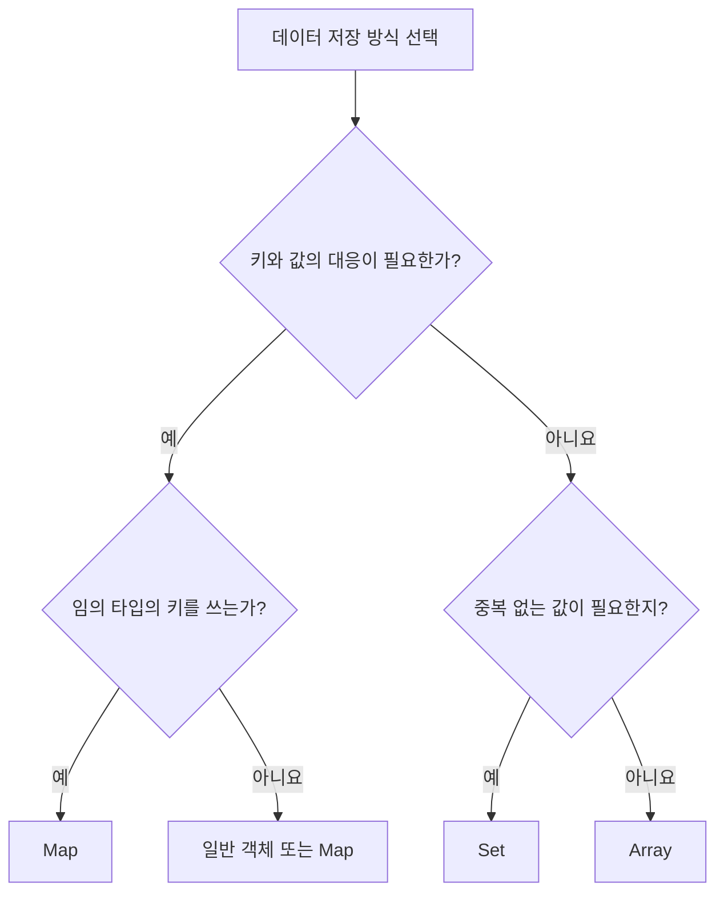

## 37.2 Map

일반 객체와 달리 문자열·심벌뿐 아니라 객체·함수·숫자 등 모든 값을 키로 사용할 수 있음

일반 객체에 `Object.keys(object).length`는 자체 열거 가능 문자열 키만 센다. Map의 엔트리 개수는 size로 확인

### 37.2.1 Map 객체 생성

```js
const empty = new Map();
const map = new Map(["key1", "value"], ["key2", "value2"]);
const overwritten = new Map([
  ["key1", "value1"],
  ["key2", "value2"],
]);

console.log(empty.size); // 0
console.log([...map]); // [['key1', 'value1'], ['key2', 'value2']]
console.log(overwritten.size); // 1
console.log(overwritten.get("key1")); // 'value2'

try {
  new Map([1, 2]);
} catch (error) {
  console.log(error.name); // TypeError
}
```

이터러블의 각 요소는 일반적으로 `[key, value]` 형태의 엔트리 객체여야 한다. 중복 키는 나중 값으로 덮어쓴다

### 37.2.2 요소 개수

```js
"use strict";

const map = new Map(["a", 1], ["b", 2]);
const { size } = map;
console.log(size); // 2
console.log(Object.getOwnPropertyDescriptor(Map.prototype, "size").set); // undefined

try {
  map.size = 10;
} catch (error) {
  console.log(error.name); // TypeError
}
console.log(map.size); // 2
```

### 37.2.3 요소 추가

```js
const map = new Map();
console.log(map.set("key1", "value1") === map); // true
map.set("key2", "value2").set("key1", "updated");

console.log([...map]); // [['key1', 'updated'], ['key2', 'value2']]

map.set(NaN, "first").set(NaN, "last");
map.set(0, "zero").set(-0, "updated zero");
console.log(map.size); // 4
console.log(map.get(NaN)); // 'last'
console.log(map.get(0)); // 'updated zero'
```

set은 같은 Map을 반환. 기존 키의 값만 바꾸어도 처음 삽입된 위치는 유지. Map의 키 비교도 sameValueZero다

### 37.2.4 요소 취득 / 37.2.5 존재 확인

```js
const lee = { name: "Lee" };
const kim = { name: "Kim" };
const map = new Map([
  [lee, "developer"],
  [kim, "designer"],
]);

console.log(map.get(lee)); // 'developer'
console.log(map.get({ name: "Lee" })); // undefined
console.log(map.has(lee)); // true
console.log(map.has("missing")); // false

map.set("optional", undefined);
console.log(map.get("optional")); // undefined
console.log(map.get("absent")); // undefined
console.log(map.has("optional")); // true
console.log(map.has("absent")); // false
```

객체 키는 같은 참조로 조회한다. get 결과가 undefined라는 사실만으로 키가 없다고 판단할 수 없다

`map.key = value`는 일반 객체 프로퍼티 대입. Map 엔트리를 추가하면 set을 사용

### 37.2.6 요소 삭제 / 37.2.7 일괄 삭제

```js
const map = new Map([
  ["a", 1],
  ["b", 2],
]);

console.log(map.delete("a")); // true
console.log(map.delete("a")); // false
console.log([...map]); //[['b', 2]]
console.log(map.clear()); // undefined
console.log(map.size); // 0
```

delete는 삭제 성공 여부를 반환하므로 체이닝할 수 없음

| API             | 반환값            | 원본 변경 |
| --------------- | ----------------- | --------- |
| set(key, value) | 같은 Map          | O         |
| get(key)        | 값 또는 undefined | X         |
| has(key)        | 불리언            | X         |
| delete(key)     | 삭제 성공 여부    | O         |
| clear()         | undefined         | O         |

### 37.2.8 요소 순회

```js
const map = new Map([
  ["Lee", "developer"],
  ["Kim", "designer"],
]);
const rows = [];
map.forEach((value, key, original) => {
  rows.push([value, key, original === map]);
});
console.log(rows); // [['developer', 'Lee', true], ['designer', 'Kim', true]]

const visited = [];
for (const [key, value] of map) {
  visited.push(`${key}:${value}`);
}
console.log(visited); // ['Lee:developer', 'Kim:designer']

console.log([...map.keys()]); // ['Lee', 'Kim']
console.log([...map.values()]); // ['developer', 'designer']
console.log([...map.entries()]); // [['Lee', 'developer'], ['Kim', 'designer']]

const [first, second] = map;
console.log(first); // ['Lee', 'developer']
console.log(second); // ['Kim', 'designer']
```

| forEach 종류 | 콜백 인수           |
| ------------ | ------------------- |
| Array        | value, index, array |
| Set          | value, value, set   |
| Map          | value, key, map     |

Set, Map의 forEach는 두 번째 매개변수로 thisArg를 받을 수 있음. 일반 함수에 적용되나 화살표 함수의 this는 바꾸지 않는다. 중간에 break가 필요하면 for...of를 사용

```js
const labels = [];
const map = new Map(["a", 1], ["b", 2]);
map.forEach(
  function (value, key) {
    labes.push(`${this.prefix}:${key}:${value}`);
  },
  { prefix: "item" },
);

console.log(labels); // ['item:a:1', 'item:b:2']

const iterator = map.keys();
console.log([...iterator]); // ['a', 'b']
console.log([...iterator]); // []
```

keys, values, entries가 반환하는 객체는 이터러블이며 이터레이터다. 같은 이터레이터를 소진하면 다시 처음부터 읽지 않음

## 자료구조 선택 흐름



## 질문 및 답변

### 1. Set은 배열과 무엇이 다른지

- 중복을 허용하지 않고 배열 인덱스로 접근하지 않음

### 2. Set, Map의 순회 순서는 표준인지

- 기본 순회는 삽입 순서

### 3. Set 중복 제거는 객체 내용까지 비교하는지

- 객체 참조가 같은지 비교

### 4. NaN과 +0은, -0은 어떻게 취급하는 지

- NaN끼리 같고, +0과 -0도 같음

### 5. size에 숫자를 대입하면 개수가 바뀌는 지

- 아님

### 6. 구조 분해한 size는 실시간 값인지

- 추출 당시의 숫자

### 7. add, set, delete, clear의 반환값은

- 같은 컬렉션·같은 컬렉션·불리언·undefined

### 8. Set.forEach의 두 번째 인수는 인덱스인지

- 첫 번째 인수와 같은 요소값

### 9. 삭제 후 같은 값을 다시 넣으면 순서는

- 끝에 새로 추가

### 10. 집합 연산을 구현하려고 표준 프로토타입을 덮어써야 하는지

- 별도 함수나 지원되는 표준 메서드를 사용

### 11. 직접 구현한 isSuperset의 표준 대응 이름은

- isSupersetOf

### 12. Map 객체 키를 같은 내용의 새 객체로 조회

- 다른 참조이므로 일치하지 않음

### 13. get이 undefined면 키가 없는지

- has로 존재 여부를 구분

### 14. Map의 기본 순회와 forEach 인수는

- 기본 순서는 Key·value 배열 forEach는 value, eky, map
