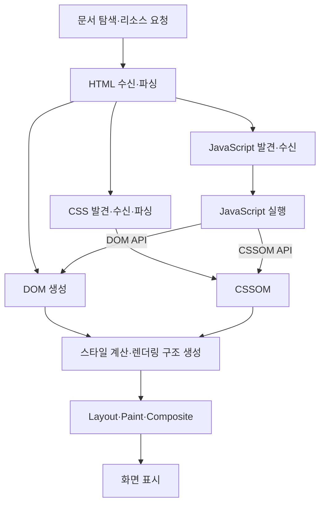

# 38장. 브라우저의 렌더링 과정

> **브라우저는 리소스를 받아 DOM과 스타일 정보를 만들고, 레이아웃·페인트·합성을 거쳐 화면을 표시한다. JavaScript는 이 과정에 영향을 줄 수 있음**

### 브라우저 전체 렌더링 흐름



정적 파일은 캐시나 서비스 워커에 제공될 수도 있음. 모든 화면 데이터가 매번 원격 서버에 새로 다운로드 되는 것은 아님

## 38.1 요청과 응답

브라우저는 HTML뿐 아니라 CSS·JavaScript·이미지·폰트 등을 요청. 이후 JavaScript가 fetch 등으로 API 데이터를 요청할 수 있음

주소를 입력하면 필요에 따라 DNS 조회, 연결 설정, HTTPS의 TLS 협상, HTTP 요청·응답 등이 진행. 캐시·기존 연결 재사용에 따라 일부 과정은 생략

### URL 구성

예시 주소

```text
https://www.mydomain.com:8080/docs/search?category=javascript&lang=ko#intro
```

| 구성     | 값                          | 의미                  |
| -------- | --------------------------- | --------------------- |
| Scheme   | https                       | 접근 방식             |
| Hostname | www.mydomain.com            | 호스트 이름           |
| Port     | 8080                        | 포트                  |
| Path     | /docs/search                | 경로                  |
| Query    | category=javascript&lang=ko | 쿼리 문자열           |
| Fragment | intro                       | 문서의 부분 등을 식별 |

HTTPS 기본 포트는 443이다. 예시 8080은 별도로 지정한 포트 HTTPS가 가능한 서버 설정을 전제

**사진의 URL·URN 괄호는 그대로 사용하지 않음** 쿼리나 fragment가 URN인 것은 아님

- URI는 자원을 식별하는 표현의 개념
- HTTPS URL은 위치·접근 방식을 나타내는 URI 한 예
- URN은 `urn:example:fruit`처럼 urn 스킵을 사용하는 별도의 식별자다
- fragment는 URL의 일부이고 일반적인 HTTP 요청 대상에 포함되지 않음

```js
const url = new URL(
  "https://www.mydomain.com:8080/docs/search?category=javascript&lang=ko#intro",
);

console.log(url.protocol); // 'https:'
console.log(url.hostname); // 'www.mydomain.com:'
console.log(url.port); // '8080'
console.log(url.pathname); // '/docs/search'
console.log(url.searchParams.get("lang")); // 'ko'
console.log(url.hash); // '#intro'
console.log(url.pathname + url.search); // '/docs/search?category=javascript&lang=ko'
```

GET / 요청에 index.html을 반환하는 것은 서버 설정의 한 방식. `/`와 `/index.html`은 요청 경로가 서로 달라 모든 서버에 같은 응답을 보장하지 않음. 파일 경로와 URL 경로도 반드시 일치하지 않음

### Network 패널 읽기

| 항목               | 내용                                     |
| ------------------ | ---------------------------------------- |
| Name·Type          | 문서·CSS·스크립트·이미지 등 리소스 종류  |
| Request URL·Method | 실제 요청 주소와 HTTP 메서드             |
| Status             | 200·304·404 등 응답 상태                 |
| Headers            | 요청·응답 헤더, Content-Type 등          |
| Response           | HTML·CSS·Javascript·JSON 등의 응답 본문  |
| Initiator          | HTML 파서·스크립트 등 요청을 시작한 원인 |
| Protocol           | http/1.1·h2·h3 등 실제 사용 프로토콜     |
| Waterfall·Timing   | 요청 시작·대기·다운로드 등의 시간        |
| Size               | 전송량·캐시 사용 여부 등                 |

1. 개발자 도구에서 Network 패널을 연다
2. 페이지를 새로고침하여 요청을 기록
3. 문서 요청과 style.css·app.js 요청을 각각 선택
4. Initiaotr와 Headers·Response·Timing을 비교
5. 필요하면 캐시를 끄고 다시 확인, 캐시가 커진 경우와 비교

HTML에 link·script·img 등이 있으면 브라우저가 그 참조를 바탕으로 요청. CSS 폰트·이미지 참조와 JavaScript의 fetch도 추가 요청의 원인이 된다.
**외부 리소스를 발견할 때마다 HTML 파싱이 항상 중단되는 것은 아님** CSS·이미지 다운로드와 기본 클래식 script의 파싱 차단을 구분해야 한다
