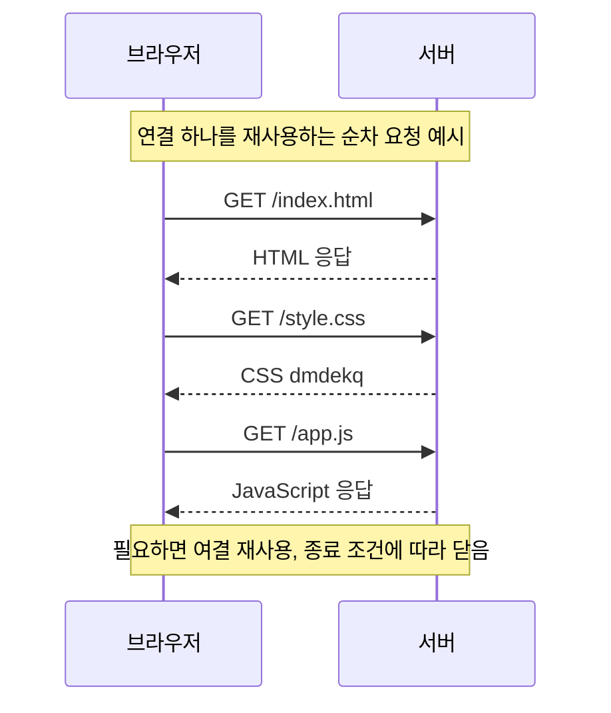
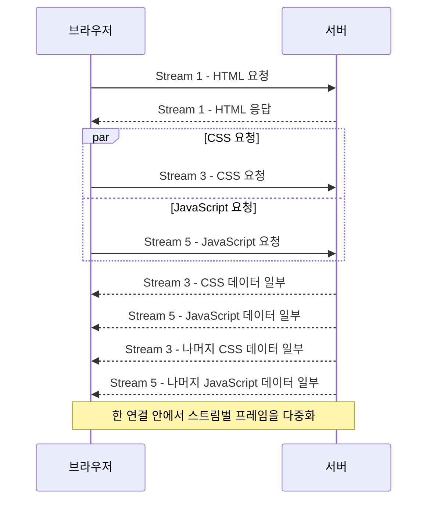

## 38.2 HTTP/1.1과 HTTP/2

| 구분                     | HTTP/1.1                           | HTTP/2                           |
| ------------------------ | ---------------------------------- | -------------------------------- |
| 연결 재사용              | 기본적으로 지속 연결 사용          | 연결 재사용                      |
| 한 연결의 요청·응답 처리 | HTTP/2 방식의 스트림 다중화 없음   | 여러 스트림을 다중화             |
| 병렬 리소스 처리         | 여러 연결 등을 사용할 수 있음      | 한 연결에서 여러 스트림 진행     |
| 응답 처리                | 파이프라이닝을 써도 응답 순서 제약 | 스트림별 프레임을 섞어 전송 가능 |

HTTP/1.1 "연결 하나로 요청 하나만 처리하고 반드시 닫는 방식"은 아님. 지속 연결을 재사용할 수 있고, 사양에 파이프라이닝도 있음. 현대 브라우저에 파이프라이닝은 사용되지 않고 HTTP/2 다중화와 다름

### HTTP/1.1 지속 연결 순차 처리

실제 브라우저가 모든 리소스를 이 순서로만 요청한다는 뜻은 아님

### HTTP/2 스트림 다중화

HTTP/2가 모든 페이지에 정확히 50%빠른 보장은 없음. 파일 크기·서버·지연·캐시 등에 따라 결과가 달라짐. TCP 패킷 손실에 따른 전송 계층의 대기 문제도 남음
