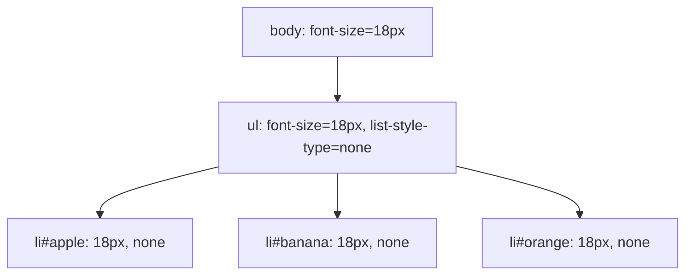

## 38.4 CSS 파싱과 CSSOM 생성

### style.css

```css
body {
  font-size: 18px;
  color: #222;
}

ul {
  list-style-type: none;
}

.highlight {
  color: red;
}
```

CSSOM은 스타일시트·규칙 등을 다룸. document.styleSheets와 CSSStyleSheet.csRules 등으로 접근할 수 있음. 실제 요소의 최종 스타일은 캐스케이드·상속 등의 계산을 거침

### CSS 규칙과 상속 결과

| 위치       | 선언                  | 결과                                     |
| ---------- | --------------------- | ---------------------------------------- |
| body       | font-size: 18px       | 다른 선언이 덮어쓰지 않으면 ul·li도 18px |
| ul         | list-style-type: none | li에 상속                                |
| .highlight | color: red            | 해당 클래스를 가진 요소에 적용           |

아래는 사진을 옮긴 **계산도니 스타일의 상속 관계 개념도**. CSSOM API 실제 객체 배치를 그대로 그린 것은 아님



기본 페이지를 연 뒤 Console에 다음 코드를 실행

```js
{
  const apple = document.getElementById("apple");
  console.log(getComputedStyle(apple).fontSize); // '18px'
  console.log(getComputedStyle(apple).listStyleType); // 'none'
  console.log(document.styleSheets[0].cssRules[0].selectorText); // 'body'
}
```

같은 출처 style.css를 전제.

CSS 다운로드 자체는 일반적으로 HTML 파싱을 직접 중단하지 않음. 렌더링에 필요한 스타일시트는 화면 표시를 지연시킬 수 있고, 뒤따르는 일부 script가 앞선 스타일시트를 기다리며 파싱 중단으로 이어질 수 있음.
