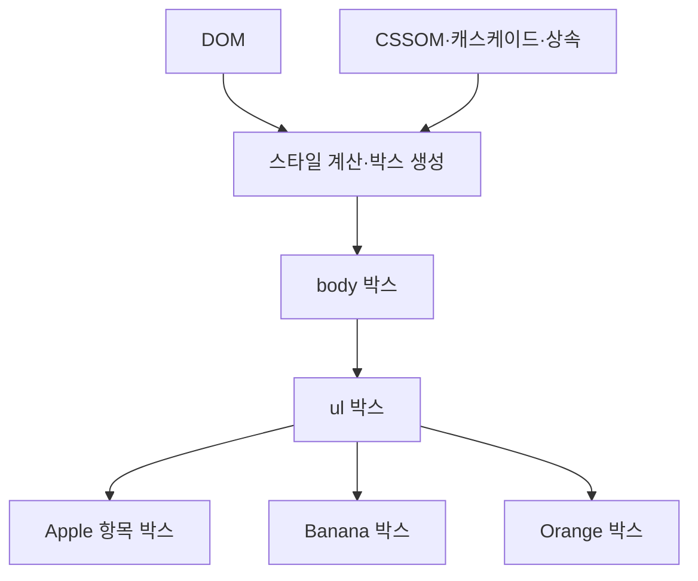
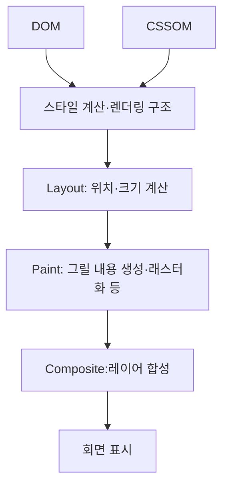

## 38.5 렌더 트리 생성

### DOM과 스타일 결합

DOM과 스타일 정보를 이용해 화면 배치에 필요한 구조를 만듬

### DOM, 스타일 결합

| 예시                              | DOM | 공간     |
| --------------------------------- | --- | -------- |
| 일반적인 li                       | O   | O        |
| head 안 meta·script               | O   | 보통없음 |
| display: none 요소와 그 하위 영역 | O   | 없음     |
| visibility: hidden 요소           | O   | 유지     |
| opacity: 0 요소                   | O   | 유지     |

DOM 요소와 렌더링 박스도 언제나 일대일 관계는 아님

### Layout·Paint·Composite

브라우저 구현에서 페인트 명령 생성·래스터화 등이 더 세분화될 수 있음. 그림은 학습용 핵심 흐름. 최초 표시 이후에 변경에 필요한 단계가 반복
