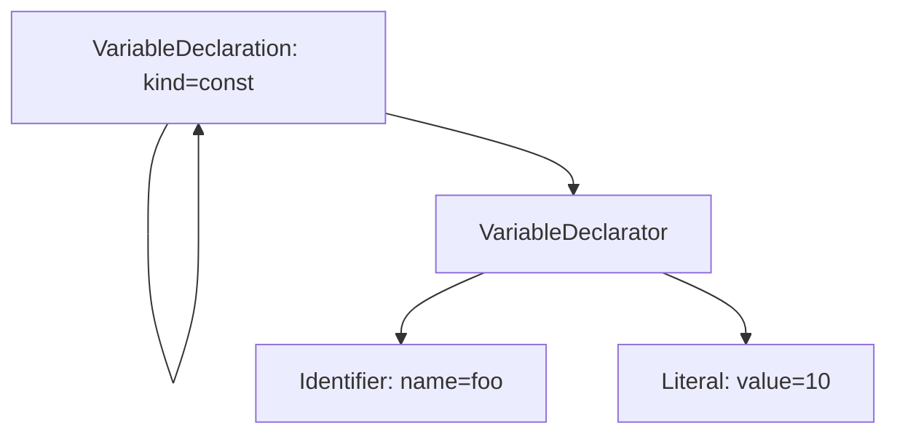

## 38.6 JavaScript 파싱과 실행

JS 엔진은 코드를 해석하고 실행. DOM API는 브라우저가 제공하는 기능, JS 언어 자체의 문법과 구분. Node.js에 JS를 실행한다고 브라우저 DOM이 자동으로 존재하는 것은 아님

### 소스에서 실행까지

```mermaid
flowchart TD
    S["JavaScript 소스"] --> T["토큰화"]
    T --> A["구문 분석·AST"]
    A --> B["바이트코드 생성"]
    B --> I["인터프리터 실행"]
    I --> D{"최적화할 코드인지"}
    D -->|"예"| O["최적화된 머신 코드"]
    D -->|"아니요"| C["실행 계속"]
    O -->|"최적화 가정이 무너지는 경우"|
```

흐름은 대표적인 엔진의 구현을 이해하기 위한 개념도. ECMAScript가 모든 엔진에 동일한 바이트코드·컴파일러 구조를 강제하는 것은 아님. V8에 Ignition 인터프리터 등이 있고 구체적인 실행 계층은 버전에 따라 달라 질 수 있음

분석 대상 코드는 한줄이다

```js
const foo = 10;
```

| 단계       | 예시                                           |
| ---------- | ---------------------------------------------- |
| 소스       | const foo = 10;                                |
| 토큰       | const, foo, =, 10, ;                           |
| AST        | 상수 변수 선언, 이름 foo, 초기값 10이라는 구조 |
| 바이트코드 | 엔진이 실행하는 중간 명령 표현                 |
| 머신 코드  | CPU가 실행하는 명령                            |

토큰화는 어휘 단위 분리, 구문 분석은 단위의 문법적 단계를 만드는 과정. 최적화 해제는 타입 등 최적화에 사용한 가정이 맞지 않는 상황과 관련되고 사용 빈도가 줄었다는 이유만으로 설명하지 않음

### AST Explorer 화면 코드로 옮기기

왼쪽 소스와 오른쪽 AST 비교

1. [AST Explorer](https://astexplorer.net/)를 연다
2. JavaScript를 선택 Acorn 등 파서를 선택
3. const foo = 10;을 입력
4. 변수 이름과 초기값을 바꿔 AST의 해당 노드가 어떻게 바뀌는지 확인

ESTree 형태의 AST 예시. 파서에 따라 루트나 Literal 노드 이름 등이 다를 수 있음

```json
{
  "type": "Program",
  "sourceType": "module",
  "body": [
    {
      "type": "VariableDeclaration",
      "kind": "const",
      "declarations": [
        {
          "type": "VariableDeclarator",
          "id": { "type": "Identifier", "name": "foo" },
          "init": { "type": "Literal", "value": 10 }
        }
      ]
    }
  ]
}
```



AST는 Babel 변환 도구, TypeScript 도구 체인, 포매터·린터 등에서 활용. AST Explorer의 AST와 브라우저 엔진 내부 AST가 완전히 같은 형식은 것은 아님
