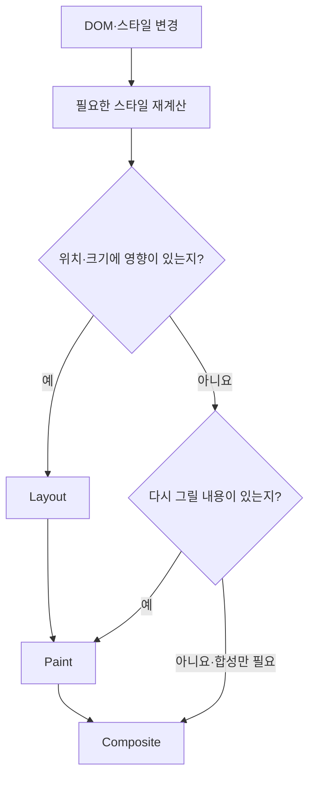

## 38.7 리플로우와 리페인트

| 과정            | 의미                         | 예                                      |
| --------------- | ---------------------------- | --------------------------------------- |
| 스타일 재계산   | 적용할 스타일을 다시 결정    | 클래스·스타일 변경                      |
| 리플로우·Layout | 위치·크기 재계산             | width 변경·배치에 영향을 주는 노드 추가 |
| 리페인트·Paint  | 화면에 그릴 내용을 다시 준비 | 글자색·배경색 변경 등                   |
| Composite       | 준비된 레이어를 합성         | 조건이 맞는 transform·opacity 변경 등   |

레이어 구성·다른 스타일·브라우저 최적화에 따라 필요한 작업이 달라짐

### DOM API 변경 이후의 분기



화면에 영향이 없는 변경은 화면 갱신 자체가 필요 없을수도 있음. JavaScript 모든 DOM 변경이 즉시 전체 페이지 리플로우로 이어지는 것은 아님

### app.js: 기본 페이지 실행

index.html·style.css와 함께 사용. 페이지 아래 실습 버튼 생성

```js
const list = document.getElementById("fruits");
const apple = document.getElementById("apple");
const controls = document.createElement("div");

function addControl(label, action) {
  const button = document.createElement("button");
  button.type = "button";
  button.textContent = label;
  button.addEventListener("click", action);
  controls.append(button);
}

addControl("색 변경", () => {
  apple.classList.toggle("highlight");
});

addControl("항목 추가", () => {
  const item = document.createElement("li");
  item.textContent = `추가 과일 ${list.children.length + 1}`;
  list.append(item);
});

let moved = false;
addControl("이동", () => {
  moved = !moved;
  apple.style.transform = moved ? "translateX(24px)" : "none";
});

document.body.append(controls);
```

| 버튼      | 변화                                            |
| --------- | ----------------------------------------------- |
| 색        | Apple의 클래스와 글자색 변경                    |
| 항목 추가 | DOM 노드 증가, 목록 높이 변화                   |
| 이동      | transform 변경, 조건에 따라 합성 단계 활용 가능 |

개발자 도구 Performance에 기록하여 버튼을 누름. Rendering 패널 Paint flashing도 도움이 됨.

### 레이아웃 읽기·쓰기 순서

스타일을 바꾼 직후 offsetWidth 같은 정보를 읽으면 브라우저가 최신 값을 구하기 위해 동기적으로 레이아웃을 계산

```js
{
  const list = document.getElementById("fruits");
  const items = [...list.querySelectorAll("li")];
  const width = list.offsetWidth; // 필요한 읽기를 먼저 모음

  for (const item of items) {
    item.style.width = `${width}px`; // 이후 쓰기를 모음
  }
}
```
