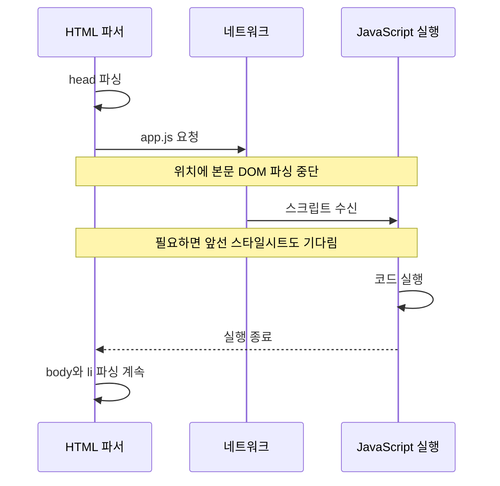

## 38.8 JavaScript 의한 HTML 파싱 중단

HTML 퍄서가 삽입한 기본 클래식 script는 async·defer 등이 없으면 실행 준비와 실행 동안 파싱을 막을 수 있음. 실제 브라우저의 모든 네트워크·파싱 작업이 단일 스레드에서 직렬로만 진행된다는 뜻은 아님

### 기본 클래식 script



### DOM이 아직 없는 실패 예제

```html
<!doctype html>
<html lang="ko">
  <head>
    <meta charset="UTF-8" />
    <title>실행 시점 실패 예제</title>
    <script>
      const apple = document.getElementById("apple");
      console.log(apple); // null
      apple.style.color = "red"; // TypeError
    </script>
  </head>
  <body>
    <ul>
      <li id="apple">Apple</li>
    </ul>
  </body>
</html>
```

코드가 실행될 때 li는 아직 파싱되지 않았음.

### 해결방법

| 방법                                  | 특징                               |
| ------------------------------------- | ---------------------------------- |
| body 끝에 script 배치                 | 앞서 파싱한 요소에 접근 가능       |
| 외부 클래식 script에 defer            | HTML 파싱 후 실행                  |
| type=module 사용                      | 기본적으로 지연 실행               |
| DOMContentLoaded 또는 readyState 확인 | 이미 DOM 파싱이 끝난 경우까지 고려 |

body 끝의 script가 실행될때 앞선 요소들은 생성되어, 이미 끝났다고 보장하지 않음

```js
{
  function initialize() {
    const apple = document.getElementById("apple");
    if (apple) {
      apple.classList.add("highlight");
    }

    if (document.readyState === "loading") {
      document.addEventListener("DOMContentLoaded", initialize, { once: true });
    } else {
      initialize();
    }
  }
}
```
