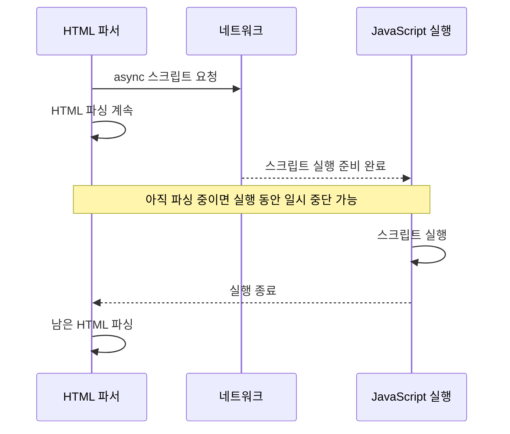

## 38.9 script와 async·defer

아래 classic 비교 **HTML 파서가 삽입한 외부 클래식 스크립트**를 기준으로 한다

| 종류              | 다운로드            | 실행 시점                             | 순서                            | DOMContentLoaded                 |
| ----------------- | ------------------- | ------------------------------------- | ------------------------------- | -------------------------------- |
| 기본 외부 classic | 파싱을 막을 수 있음 | 해당 위치에 준비 후 실행              | 일반적인 순차 실행              | 실행 완료가 선행                 |
| async classic     | HTML 파싱과 병행    | 준비되는 대로, DOM 파싱 전일수도 있음 | X                               | 기본적으로 기다리지 않음         |
| defer classic     | HTML 파싱과 병행    | HTML 파싱 후                          | O                               | 실행 완료 후 이벤트              |
| module            | 의존 모듈도 로드    | 기본적으로 HTML 파싱 후               | 모듈 의존 관계·평가 규칙에 따름 | 일반적인 지연 모듈 평가를 기다림 |

```html
<!-- 각각의 방식 비교용 예시, 모두 동시에 넣으라는 뜻은 아님 -->
<script src="app.js"></script>
<script async src="app.js"></script>
<script defer src="app.js"></script>
<script type="module" src="app.js"></script>
```

인라인 클래식 script에 async·defer가 같은 효과를 주지 않음. 모듈은 별도 규칙을 사용하여 "src가 없으면 모든 종류의 script에 async가 무의미하다"고 일반화하지 않음

### async 가능한 실행 순서



async 스크립트 두 개의 다운로드가 어느 순서로 끝날지 정해져 있지 않다. 서로 의존하거나 DOM 생성 완료가 필요한 코드에 그 조건을 별도로 처리해야 함

### defer 가능한 실행 순서

```meramid
sequenceDiagram
  participant P as HTML 파서
  participant N as 네트워크
  participant J as JavaScript 실행
  P->>N: a.js와 b.js 다운로드 시작
  P->>P: HTML 파싱 계속·완료
  N-->>P: b.js 다운로드 완료
  N-->>P: a.js 다운로드 완료
  P->>J: 먼저 선언한 a.js 실행
  J->>P: 완료
  P->>J: 다음에 선언한 b.js 실행
  J-->>P: 완료
  P->>P: DOMContentLoaded 발생
```

다운로드가 HTML 파싱보다 먼저 끝나는 경우도 있지만, defer 실행은 HTML 파싱 완료 이후ㅗ. defer 클래식 script는 문서에 선언한 순서로 실행

```html
<script defer src="a.js"></script>
<script defer src="b.js"></script>
```

### DOMContentLoaded, load

| 이벤트           | 의미                                                     |
| ---------------- | -------------------------------------------------------- |
| DOMContentLoaded | HTML 파싱과 관련 defer·기본 module 처리 등 DOM 준비 시점 |
| load             | 문서와 이벤트가 기다리는 종속 리소스 로드 완료 시점      |

DOMContentLoaded는 이미지 전체 다운로드를 기다리는 이벤트가 아님. CSS를 기다리는 defer 스크립트 때문에 간접 지연될 수 있음. 모듈 top-level await 등 비동기 평가 세부 동작은 별도 규칙이 있음

## 질문, 답변

### 1. DOM과 CSSOM 역할

- 문서 구조와 스타일 규칙 등의 객체 모델

### 2. 계산된 스타일과 CSS 규칙은 같은지

- 아님. 실제 요소의 스타일은 캐스케이드·상속 등의 계산을 거침

### 3. 쿼리·fragment를 URN이라 부르는가

- 아님. URN은 run 스킵을 사용하는 별도의 식별자

### 4. fragment가 HTTP 요청 대상에 포함되는 지

- 일반적으로 포함되지 않고 클라이언트에서 처리

### 5. GET /와 GET /index.html 항상 같은 지

- 아님. 서버 설정과 라우팅에 따라 달라짐

### 6. 주소창에서 요청하지 않은 CSS·JS가 나타난 이유

- HTML·CSS·스크립트 참조나 실행이 추가 요청을 만들기 때문

### 7. HTTP/1.1은 요청마다 반드시 연결을 닫는지

- 아님. 지속 연결을 재사용할 수 있음

### 8. HTTP/2의 개선은

- 한 연결에서 여러 스트림의 프레임을 다중화하는 것

### 9. meta charset이 HTTP 헤더를 자동 설정하는지

- 문서 선언과 서버 응답 헤더는 별도

### 10. CSS를 만나면 HTML 파싱이 항상 멈추는 지

- 렌더 차단과 스크립트 대기 등 조건을 구분

### 11. visibility: hidden은 레이아웃 공간을 없애는지

- 일반적으로 공간은 유지

### 12. AST, DOM 같은 트리인지

- JavaScript 문법 구조와 HTML 문서 구조를 각각 표현

### 13. 모든 엔진이 같은 바이트코드를 쓰는지

- 엔진 구현에 따라 다름

### 14. async는 선언 순서대로 실행되는지

- 실행 준비 시점 등에 따라 달라짐

### 15. defersms DOMContentLoaded 모든 이미지를 기다리는지

- load와 구분

- [WHATWG: HTML 파싱](https://html.spec.whatwg.org/multipage/parsing.html)
- [MDN: 브라우저의 동작](https://developer.mozilla.org/en-US/docs/Web/Performance/Guides/How_browsers_work)
- [RFC 3986: URI](https://www.rfc-editor.org/rfc/rfc3986)
- [RFC 8141: URN](https://www.rfc-editor.org/rfc/rfc8141)
- [RFC 9113: HTTP/2](https://www.rfc-editor.org/rfc/rfc9113)
- [MDN: HTTP/1.x 연결 관리](https://developer.mozilla.org/en-US/docs/Web/HTTP/Guides/Connection_management_in_HTTP_1.x)
- [CSSOM 표준](https://drafts.csswg.org/cssom/)
- [V8: Ignition](https://v8.dev/docs/ignition)
- [Chrome: Network 패널](https://developer.chrome.com/docs/devtools/network/reference)
- [web.dev: 렌더링 성능](https://web.dev/articles/rendering-performance)
- [MDN: script](https://developer.mozilla.org/en-US/docs/Web/HTML/Reference/Elements/script)
- [MDN: DOMContentLoaded](https://developer.mozilla.org/en-US/docs/Web/API/Document/DOMContentLoaded_event)
- [AST Explorer](https://astexplorer.net/)
