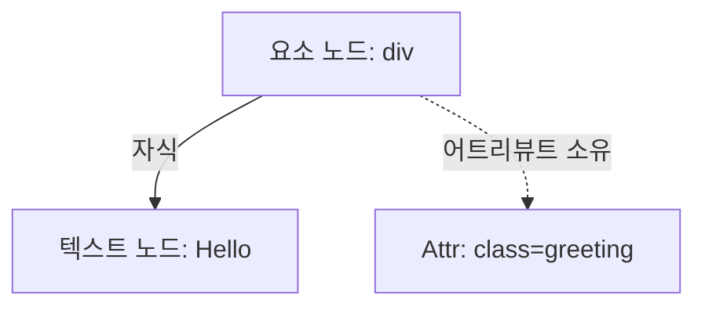
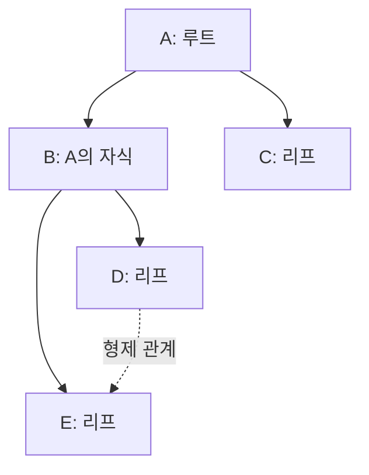
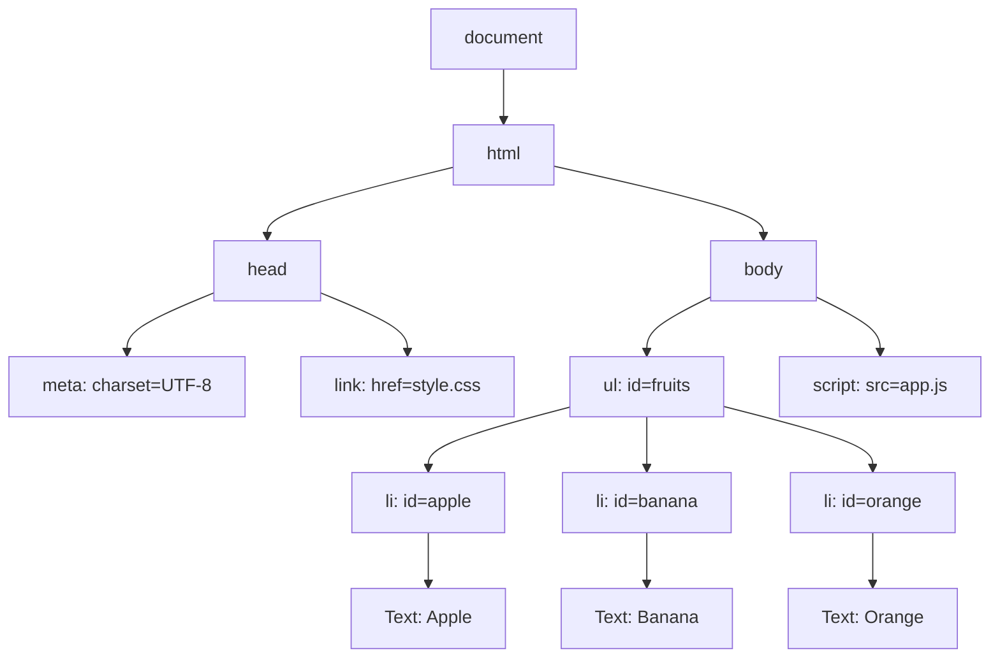
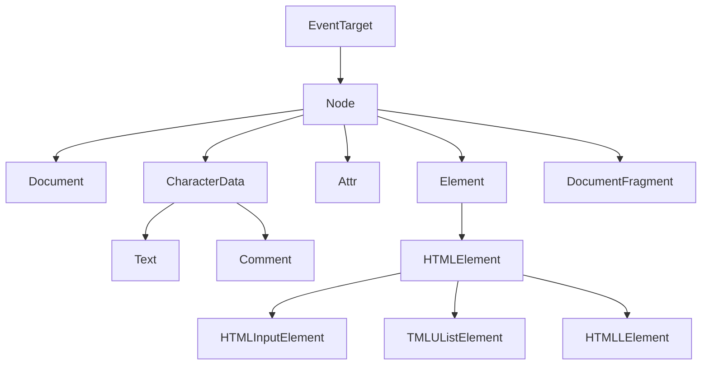
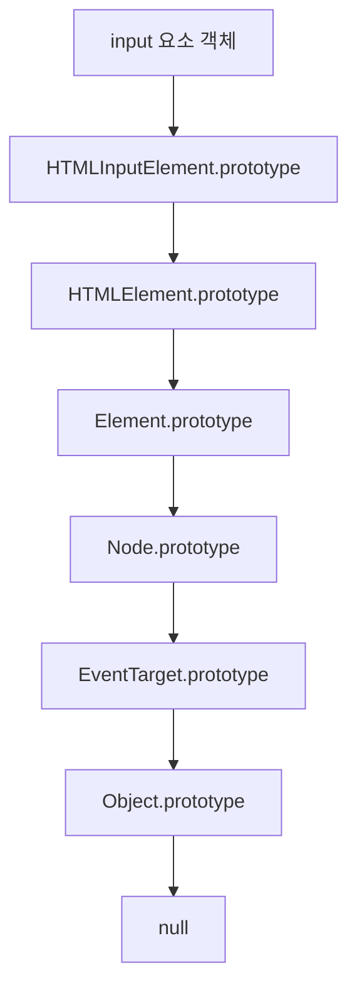

# 39장. DOM

> **DOM은 문서를 노드 객체의 트리로 표현, 문서의 구조·내용·스타일·이벤트를 다룰 수 있게 하는 프로그래밍 인터페이스**

## 실습용 공통 HTML과 CSS

`app.js`를 `defer`로 불러와 HTML 파싱이 끝난 뒤 요소에 접근한다.

```html
<!DOCTYPE html>
<html lang="ko">
  <head>
    <meta charset="UTF-8" />
    <title>DOM 실습</title>
    <link rel="stylesheet" href="style.css" />
    <script src="app.js" defer></script>
  </head>
  <body>
    <ul id="fruits">
      <li id="apple" class="red">Apple</li>
      <li id="banana" class="red">Banana</li>
      <li id="orange" class="red">Orange</li>
    </ul>
    <div id="foo">Hello <span>world!</span></div>
    <label for="user">이름</label>
    <input id="user" type="text" value="Lee" />
    <input id="agree" type="checkbox" checked />
    <div id="box" class="box">Hello World</div>
  </body>
</html>
```

`style.css`:

```css
.red {
  color: red;
}
.blue {
  color: blue;
}
.box {
  padding: 8px;
  border: 1px solid black;
}
.box::before {
  content: "DOM ";
}
.active {
  font-weight: bold;
}
```

## 39.1 노드

### 39.1.1 HTML 요소와 노드 객체

브라우저는 HTML을 파싱하여 노드 객체를 만들고, 노드들의 관계를 DOM 트리로 구성. HTML 소스와 DOM은 같은 개념이 아님. DOM에 파싱 결과가 반영, JavaScript로 바뀐 구조도 존재

```html
<div class="greeting">Hello</div>
```

| HTML 구성        | DOM 표현                  |
| ---------------- | ------------------------- |
| div 요소         | Element 계열 요소 노드    |
| class="greeting" | 요소가 소유하는 Attr 노드 |
| Hello            | 요소의 자식인 Text 노드   |

#### 요소·어트리뷰트·텍스트



**Attr는 Node 한 종류지만 요소 자식 노드는 아님.** 점선은 소유 관계, `childNodes`에 어트리뷰트가 포함되는 것은 아님

```js
const div = document.createElement("div");
div.className = "greeting";
div.textContent = "Hello";

const attr = div.getAttributeNode("class");
console.log(div.firstChild.nodeType); // 3: Text
console.log(attr.ownerElement === div); // 3: Text
console.log(attr.parentNode); // 3: Text
```

#### 트리의 관계



| 용어      | 의미                              | 예                |
| --------- | --------------------------------- | ----------------- |
| 루트      | 부모가 없는 최상위 노드           | A                 |
| 부모·자식 | 직접 연견될 상위·하위 노드        | B와 D             |
| 형제      | 부모가 같은 노드                  | D와 E             |
| 조상·자손 | 여러 단계를 포함한 상위·하위 관계 | A와 D             |
| 리프      | 자식이 없는 노드                  | C, D, E           |
| 간선      | 노드 사이의 연결                  | A에서 B로 가는 선 |

#### DOM 트리

핵심 구조를 보여 주기 위해 공백 텍스트 노드와 doctype은 생략. 어트리뷰트는 요소 안에 표시, 실제 자식 관계만 실선으로 연결



### 39.1.2 노드 객체의 타입

노드 종류는 `nodeType`로 구분. 주요 타입

| 종류       | 상수                             | nodeType | 역할                       |
| ---------- | -------------------------------- | -------- | -------------------------- |
| 요소       | Node.ELEMENT_NODE                | 1        | HTML/XML 요소              |
| 어트리뷰트 | Node.ATTRIBUTE_NODE              | 2        | 요소가 소유하는 어트리뷰트 |
| 텍스트     | Node.TEXT_NODE                   | 3        | 텍스트 내용                |
| CDATA      | Node.CDATA_SECTION_NODE          | 4        | 주로 XML의 CDATA           |
| 처리 명령  | Node.PROCESSING_INSTRUCTION_NODE | 7        | XML 처리 명령              |
| 주석       | Node.COMMENT_NODE                | 8        | 주석 내용                  |
| 문서       | Node.DOCUMENT_NODE               | 9        | 문서 전체                  |
| 문서 형식  | Node.DOCUMENT_TYPE_NODE          | 10       | doctype                    |
| 문서 조각  | Node.DOCUMENT_FRAGMENT_NODE      | 11       | 노드들을 담는 문서 조각    |

역사적으로 12개의 상수가 정의되었으나 5·6·12는 현재 사용되지 않는 과거 타입. Document·Element·Attr·Text를 먼저 구분

`document`는 현재 페이지 문서 객체. iframe에 별도 문서가 있고, DOMParser 등으로 화면에 연결되지 않은 문서를 만들 수 있음

### 39.1.3 노드 객체의 상속 구조

노드 객체는 공통 기능을 상속, 구체적인 요소 인터페이스가 추가 기능을 제공. JavaScript 표준 빌트인 객체와 달리 DOM 인터페이스는 브라우저가 제공하는 Web API

#### 주요 인터페이스 상속

화살표는 상위 인터페이스에 하위 인터페이스로 향한다



HTMLHtmlElement·HTMLHeadElement·HTMLMetaElement·HTMLLinkElement·HTMLScriptElement·HTMLBodyElement 등도 해당 HTML 요소 인터페이스다.

#### input 인스턴스의 프로토타입 체인

다음 화살표는 **실제 객체의 [[Prototype]] 방향**이다



```js
const input = document.createElement("input");

console.log(input instanceof HTMLInputElement); // true
console.log(input instanceof HTMLElement); // true
console.log(input instanceof Element); // true
console.log(input instanceof Node); // true
console.log(input instanceof EventTarget); // true
console.log(Object.getPrototypeOf(input) === HTMLInputElement.prototype); // true
```

#### 개발자 도구에서 상속 확인

Elements 패널에 input을 선택 Properties 패널. Console의 `$0` 개발자 도구가 제공하는 선택 요소 참조, 앱 코드에 사용하는 전역 변수가 아님

| 계층             | 대표 기능                              |
| ---------------- | -------------------------------------- |
| Object           | 일반 객체 공통 메서드                  |
| EventTarget      | addEventListener, dispatchEvent        |
| Node             | nodeType, parentNode, appendChild      |
| Element          | getAttribute, querySelector, classList |
| HTMLElement      | style, HTML 요소 공통 동작             |
| HTMLInputElement | value, checked, defaultValue           |

실제 API 일부 여러 인터페이스에 섞어 제공하는 mixin으로 정의.
