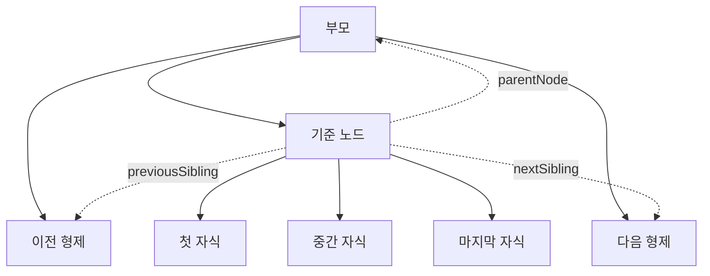

## 39.3 노드 탐색

선택자로 요소를 찾은 뒤 부모·자식·형제 관계를 따라 다른 노드로 이동할 수 있음. 탐색 프로퍼티는 읽기용, 관계 변경에 DOM 조작 메서드를 사용

#### 탐색 관계



실선은 부모·자식 관계이고, 점선은 기준 노드에서 탐색하는 방향. 텍스트·주석일 수도 있음

| 목적        | 모든 노드       | 요소                   |
| ----------- | --------------- | ---------------------- |
| 부모        | parentNode      | parentElement          |
| 자식 목록   | childNodes      | children               |
| 첫 자식     | firstChild      | firstElementChild      |
| 마지막 자식 | lastChild       | lastElementChild       |
| 이전 형제   | previousSibling | previousElementSibling |
| 다음 형제   | nextSibling     | nextElementSibling     |
| 자식 존재   | hasChildNodes() | childElementCount > 0  |

대상이 없으면 단일 노드 탐색은 null, 목록은 길이 0을 반환. parentNode가 Document나 DocumentFragment이면 parentElement는 null일 수 있음

### 39.3.1 공백 텍스트 노드

HTML의 들여쓰기와 줄바꿈도 텍스트 노드가 될 수 있음. `#friuts` 태그 사이 공백도 자식

#### 공통 HTML의 ul.childNodes

| 인덱스 | 노드 | nodeType | 내용                              |
| ------ | ---- | -------: | --------------------------------- |
| 0      | Text |        3 | 첫 li 앞의 줄바꿈·공백            |
| 1      | LI   |        1 | Apple 요소                        |
| 2      | Text |        3 | 첫 li와 두 번째 li tkdl rhdqor    |
| 3      | LI   |        1 | Banana 요소                       |
| 4      | Text |        3 | 두 번째 li와 세 번째 li 사이 공백 |
| 5      | LI   |        1 | Orange 요소                       |
| 6      | Text |        3 | 마지막 li 뒤의 줄바꿈·공백        |

```js
const fruits = document.getElementById("fruits");

console.log(fruits.childNodes.length); // 7
console.log(fruits.children.length); // 3
console.log(fruits.firstChild.nodeType); // 3
console.log(fruits.firstElementChild.id); // 'apple'
```

줄바꿈을 없애거나 주석을 추가하면 개수와 순서가 달라짐. 자식 요소만 필요하면 children이나 Element 계열 탐색 프로퍼티를 사용

### 39.3.2 자식 노드 탐색

```js
const fruits = document.getElementById("fruits");

console.log(fruits.firstElementChild.textContent); // 'Apple'
console.log(fruits.lastElementChild.textContent); // 'Orange'
console.log(Array.from(fruits.children, (element) => element.id)); // ['apple', 'banana', 'orange']
```

### 39.3.3. 자식 노드 존재 확인

```js
const div = document.createElement("div");
div.appendChild(document.createTextNode(" "));

console.log(div.hasChildNodes()); // true: 공백 Text가 있음
console.log(div.childElementCount()); // 0
console.log(div.children.length > 0); // false
```

### 39.3.4 요소의 텍스트 노드 탐색

```js
const apple = document.getElementById("apple");
const text = apple.firstChild;

if (text?.nodeType === Node.TEXT_NODE) {
  console.log(text.nodeValue); // 'Apple'
}
```

firstChild가 항상 Text라고 가정하면 안됨.

### 39.3.5 부모 노드 탐색

```js
const apple = document.getElementById("apple");
console.log(apple.parentNode.id); // 'fruits'
console.log(apple.firstChild.parentNode === apple); // true

const attr = apple.getAttributeNode("id");
console.log(attr.parentNode); // null
console.log(attr.ownerElement === apple); // true
```

### 39.3.6 형제 노드 탐색

```js
const apple = document.getElementById("apple");
console.log(apple.nextSibling.nodeType); // 3. 태그 사이 공백
console.log(apple.nextElementSibling.id); // 'banana'
console.log(apple.previousElementSibling); // null
```
