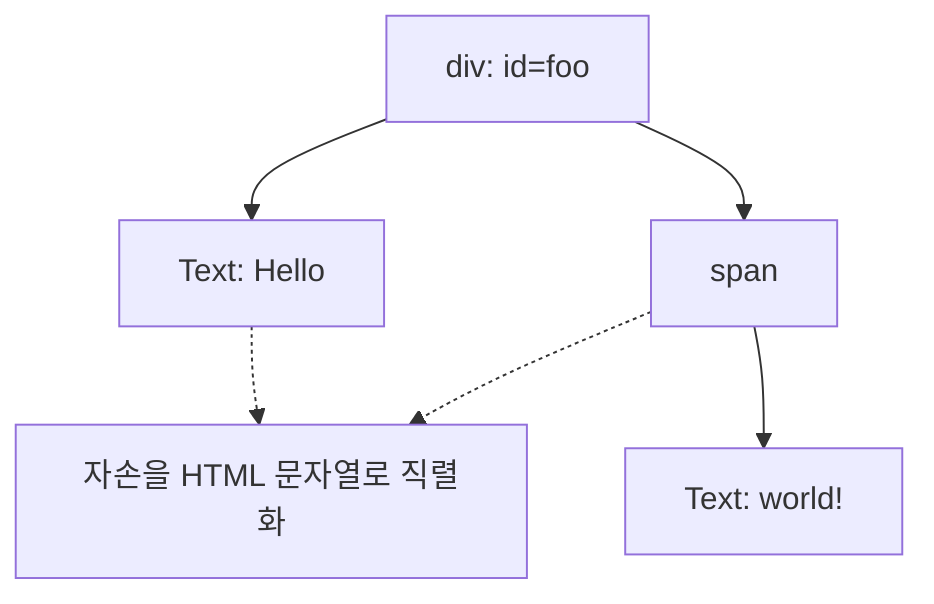
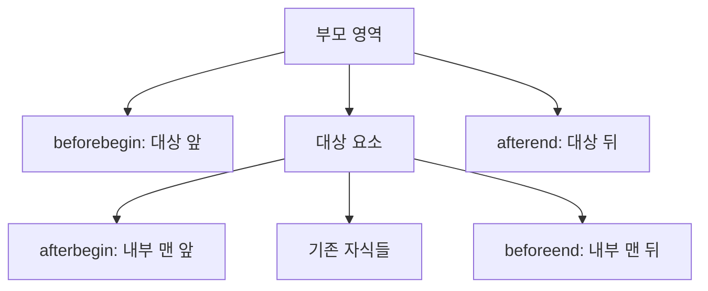
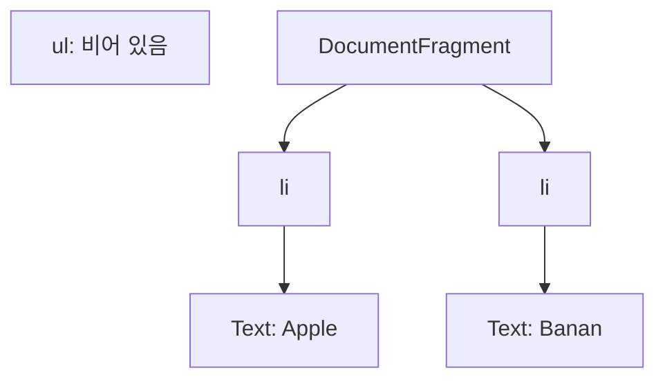
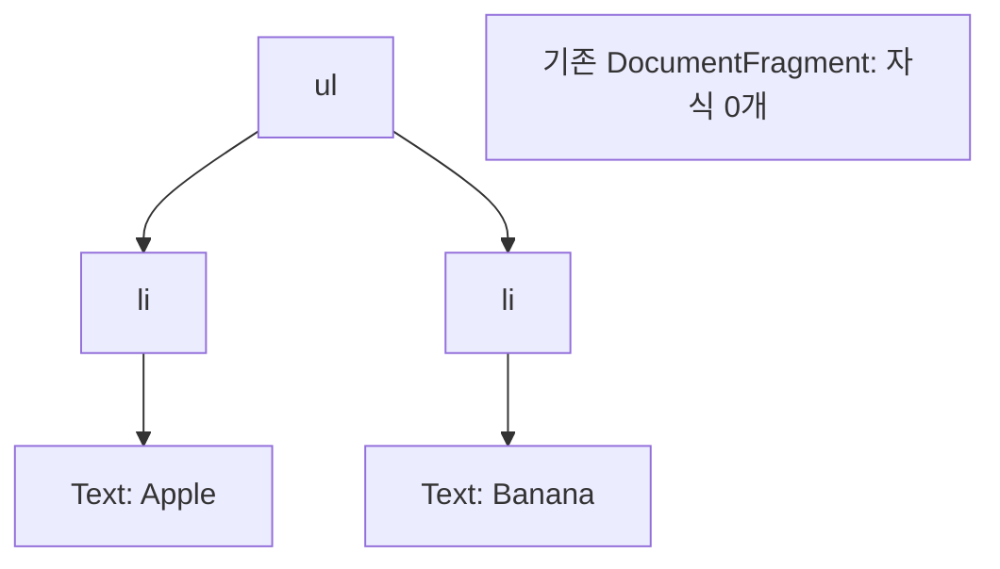

## 39.6 DOM 조작

DOM 조작은 노드를 생성·삽입·이동·복제·교체·삭제하는 것임. 문서에 연결된 구조나 스타일이 바뀌면 필요한 렌더링 작업이 뒤따를 수 있음. API 호출 한 번마다 반드시 Layout과 Paint가 한 번씩 실행되는 것은 아님

### 39.6.1 innerHTML

innerHTML을 읽으면 대상 요소의 **자식들을 HTML 문자열로 직렬화한 결과**을 얻음. 대상 요소 자신의 시작·종료 태그는 포함되지 않음

#### innerHTML 취득 범위



문자열은 아래 코드에 확인. 직렬화 형식은 원래 HTML 소스의 따옴표·공백 표현을 그대로 보존하는 기능과 다르다

```js
const foo = document.getElementById("foo");
console.log(foo.innerHTML); // 'Hello <span>world!</span>'

foo.innerHTML = "<strong>새 내용</strong>";
console.log(foo.firstElementChild.tagName); // 'STRONG'
```

innerHTML은 대입은 문자열을 파싱하고 기존 자식을 교체. `+=` 도 기존 내용을 직렬화한 뒤 전체 문자열을 다시 대입

```js
const container = document.createElement("div");
container.innerHTML = "<button>확인</button>";
const original = container.firstElementChild;

container.innerHTML += "<span>추가</span>";

console.log(container.firstElementChild === original); // false
console.log(original.parentNode); // false
```

원래 버튼 객체에 addEventListener로 등록한 리스너는 새 버튼 객체로 옮겨지지 않음. 기존 노드를 유지하며 추가하려면 노드 삽입 API나 insertAdjacentHTML을 사용

#### 사용자 입력과 HTML 문자열

```js
const message = "<b>사용자가 입력한 문장</b>";
const output = document.createElement("p");
output.textContent = message;
document.body.appendChild(output);
```

HTML 표시가 필요한 기능이면 유지보수되는 HTML sanitizer를 적절히 적용. DOMPurify를 프로젝트에 설치한 경우 다음과 같이 사용

```js
import DOMPurify from "dompurify";

const rawHTML = "<p>안내 <strong>내용</strong></p>";
const output = document.createElement("div");
output.innerHTML = DOMPurify.sanitize(rawHTML);
```

### 39.6.2 insertAdjacentHTML

기존 자식 전체를 교체하지 않고 지정한 위치에 HTML 문자열을 파싱하여 삽입

| 위치        | 삽입                              |
| ----------- | --------------------------------- |
| beforebegin | 대상 요소 바로 앞, 같은 부모 내부 |
| afterbegin  | 대상 요소 내부의 맨 앞            |
| beforeend   | 대상 요소 내부의 맨 뒤            |
| afterend    | 대상 요소 바로 뒤, 같은 부모 내부 |



```js
const fruits = document.getElementById("fruits");
const originalApple = fruits.firstElementChild;

fruits.insertAdjacentHTML("beforeend", "<li>Grape</li>");

console.log(fruits.children.length); // 4
console.log(fruits.firstElementChild === originalApple); // true
```

beforebegin·afterend에 적절한 부모가 필요. insertAdjacentHTML도 HTML을 파싱하여 상요자 입력을 자동으로 안전하게 처리해 주지 않음

### 39.6.3 노드 생성과 추가

| 메서드                        | 동작                   |
| ----------------------------- | ---------------------- |
| document.createElement(tag)   | 요소 노드 생성         |
| document.createTextNode(text) | 텍스트 노드 생성       |
| parent.appendChild(node)      | 노드를 마지막으로 삽입 |

```js
const fruits = document.getElementById("fruits");
const li = document.createElement("li");
const text = document.createTextNode("Grape");

li.appendChild(text);
console.log(li.parentNode); // null: 아직 ul에 연결하지 않음

const inserted = fruits.appendChild(li);
console.log(inserted === li); // true
console.log(li.parentNode === fruits); // true
```

단순한 텍스트는 `li.textContent = 'Grape'`로 설정. createElement만 호출해서 화면에 나타나지 않음

### 39.6.4 여러 노드 생성과 추가

DocumentFragment는 노드들을 임시로 모을 수 있는 문서 조각. 별도의 div를 끼워 넣지 않고 여러 자식을 함께 삽입할수 있음

#### 삽입 전



#### 삽입 후



```js
const ul = document.createElement("ul");
const fragment = document.createDocumentFragment();

for (const name of ["Apple", "Banana"]) {
  const li = document.createElement("li");
  li.textContent = name;
  fragment.appendChild(li);
}

console.log(fragment.childNodes.length); // 2
const returned = ul.appendChild(fragment);

console.log(ul.children.length); // 2
console.log(fragment.childNodes.length); // 0
console.log(returned === fragment); // true
document.body.appendChild(ul);
```

**Fragment 자체가 ul의 자식이 되는 것이 아닌 그 자식들이 이동.** Fragment 객체는 삭제되지 않고 비어 있는 상태로 남는다

Fragment는 구조를 모아 조립하기에 유용. 다만 반복 삽입보다 언제나 빠르거나, 반드시 리플로우가 한 번만 일어난다고 단정하지 않음. 브라우저의 처리 묶음과 레이아웃 읽기 여부 등에 따라 달라짐

### 39.6.5 노드 삽입

appendChild는 맨 뒤, insertBefore는 기준 자식 앞에 삽입

```js
const fruits = document.getElementById("fruits");
const li = document.createElement("li");
li.textContent = "Grape";

fruits.insertBefore(li, fruits.firstElementChild);
console.log(fruits.firstElementChild === li); // true

// 기준 노드가 null이면 맨 뒤로 이동
fruits.insertBefore(li, null);
console.log(fruits.lastElementChild === li); // true
```

기준 노드는 호출 대상의 직접 자식이거나 null이어야 한다. 다른 부모의 자식을 기준으로 주면 NotFoundError가 발생

### 39.6.6. 노드 이동

이미 존재하는 노드를 appendChild나 insertBefore에 전달하면 복사본이 만들어지는 것이 아니라 기존 노드가 이동

```js
const fruits = document.getElementById("fruits");
const apple = document.getElementById("apple");

fruits.appendChild(apple);

console.log(fruits.lastElementChild === apple); // true
console.log(Array.from(fruits.children, (element) => element.id)); // ['banana', 'orange', 'apple']
```

### 39.6.7 노드 복사

| 호출             | 복사                   |
| ---------------- | ---------------------- |
| cloneNode(false) | 해당 노드와 어트리뷰트 |
| cloneNode(true)  | 해당 노드와 자손 전체  |

```js
const apple = document.getElementById("apple");
const shallow = apple.cloneNode(false);
const deep = apple.cloneNode(true);

console.log(shallow.textContent); // ''
console.log(deep.textContent); // 'Apple'
console.log(deep === apple); // ''
console.log(deep.id); // 'apple': id도 복사

deep.id = "apple-copy";
apple.parentNode.appendChild(deep);
```

addEventListener나 onClick 프로퍼티로 등록한 리스너는 복제되지 않음. HTML 이벤트 핸들러 어트리뷰트는 어트리뷰트로서 복사될 수 있어 구분. 같은 문서에 붙일 때 id 중복도 처리

### 39.6.8 노드 교체

```js
const fruits = document.getElementById("fruits");
const banana = document.getElementById("banana");
const replacement = document.createElement("li");
replacement.textContent = "Peach";

const removed = fruits.replaceChild(replacement, banana);

console.log(removed === banana); // true
console.log(banana.parentNode); // null
```

replaceChild의 인수 순서는 **새 노드, 기존 노드.** 기존 노드는 호출 대상의 직접 자식이어야 함

### 39.6.9 노드 삭제

```js
const fruits = document.getElementById("fruits");
const apple = document.getElementById("apple");

const removed = fruits.removeChild(apple);
console.log(removed === apple); // true
console.log(apple.parentNode); // null

fruits.appendChild(removed); // 삭제된 노드 객체는 참조가 있으면 다시 사용할 수 있음
```

요소 스스로 제거할 때 `apple.remove()`도 사용할 수 있음. 모든 자식을 제거하면 `fruits.replaceChildren()`를 사용할 수 있음

#### DOM 조작 API 비교

| API                                | 동작                          | 반환값         |
| ---------------------------------- | ----------------------------- | -------------- |
| appendChild(node)                  | 마지막 자식으로 삽입·이동     | 전달한 node    |
| insertBefore(node, reference)      | 기준 자식 앞에 삽입·이동      | 삽입한 node    |
| cloneNode(deep)                    | 노드 복제, 자동 삽입하지 않음 | 복제한 node    |
| replaceChild(newNode, oldNode)     | 직접 자식 교체                | 제거된 oldNode |
| removeChild(child)                 | 직접 자식 제거                | 제거된 child   |
| insertAdjacentHTML(position, html) | 위치에 HTML 파싱·삽입         | undefined      |

appendChild에 Fragment를 전달했을 때 반환값은 비워진 Fragment, 마지막으로 이동한 자식이 아님
