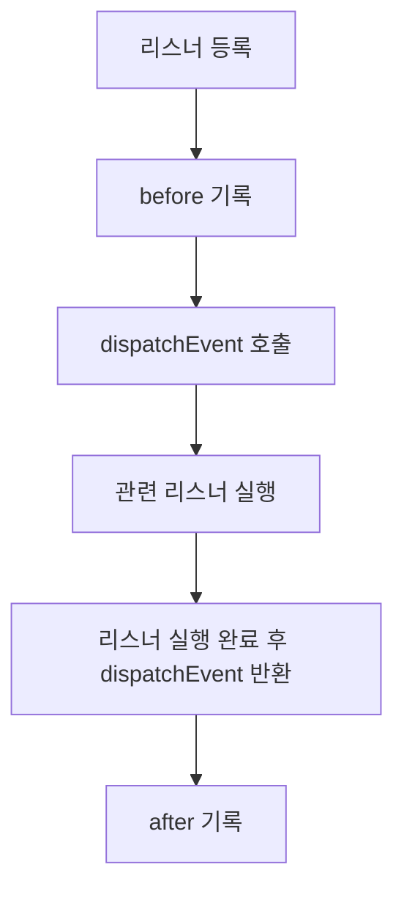

## 40.11 커스텀 이벤트

### 40.11.1 이벤트 객체 생성

```js
const evnet = new CustomEvent("app:notice", {
  detail: { message: "Hello" },
});

console.log(event.type); // 'app:notice'
console.log(event.detail.message); // 'Hello'
console.log(event.bubbles); // 'false'
console.log(event.cancelable); // 'false'
console.log(event.composed); // 'false'
console.log(event.isTrusted); // 'false'
```

생성은 객체를 만드는 작업일 뿐 리스너를 호출하지 않음. 생성자로 만든 이벤트는 기본적으로 버블링하지 않고 취소할 수 없고, 필요한 값은 생성자의 옵션으로 지정.

```js
const mouse = new MouseEvent("click", {
  bubbles: true,
  cancelable: true,
  clientX: 50,
  clientY: 100,
});
const keyboard = new KeyboardEvent("keyup", { key: "Enter" });

console.log(mouse.bubbles); // true
console.log(mouse.cancelable); // true
console.log(mouse.clientX); // 50
console.log(keyboard.key); // 'Enter'
```

기존 타입 이벤트도 코드로 만들 수 있음.

### 40.11.2 dispatchEvent로 디스패치

```js
const button = document.getElementById("button");
const order = [];

button.addEventListener("app:notice", (event) => {
  order.push(event.detail.message);
});

order.push("before");
button.dispatchEvent(new CustomEvent("app:notice"), {
  detail: { message: "handler" },
});
order.push("after");

console.log(order); // ['before', 'handler', 'after']
```

dispatchEvent는 관련 리스너들을 **동기적으로 호출**한 뒤 반환. handler가 after보다 먼저 기록. 등록 이전에 보낸 이벤트를 나중에 등록한 리스너가 소급해서 받지 않음



핸들러가 async 함수여도 dispatchEvent가 Promise 완료를 기다리는 것은 아님. 리스너 내부의 예외가 호출자에게 일반적인 함수 호출과 전파되는 것이 아니라 직접 함수 호출과 동일하다고 해석하지 않음

### 버블링과 detail 전달

```js
const fruits = document.getElementById("fruits");
const banana = document.getElementById("banana");
const trace = [];

fruits.addEventListener("app:select", (event) => {
  trace.push([event.target.id, event.currentTarget.id, event.detail.id]);
});

banana.dispatchEvent(
  new CustomEvent("app:select", {
    bubbles: true,
    detail: { id: 2 },
  }),
);

console.log(trace); // [['banana', 'fruits', 2]]
```

banana에서 보낸 이벤트가 bubbles=true라 조상의 fruits에 도달. target은 banana, currentTarget은 fruits고, 업무 데이터는 detail.id에서 읽음. detail로 객체를 전달하면 객체 참조를 전달

### 취소 가능한 이벤트와 반환값

```js
const button = document.getElementById("button");

button.addEventListener("app:before-save", (event) => {
  event.preventDefault();
});

const event = new CustomEvent("app:before-save", { cancelable: true });
const accepted = button.dispatchEvent(event);

console.log(event.defaultPrevented); // true
console.log(accpeted); // false
```

cancelable=true인 이벤트를 리스너가 취소하면 dispatchEvent는 false를 반환한다. 앱은 이 값을 보고 후속 저장을 진행할 지 결정할 수 있음. 등록된 리스너가 없거나 취소되지 않았으면 반환값은 true다.

### 임의의 onfoo 프로퍼티는 리스너가 아님

```js
const button = document.getElementById("button");
let calls = 0;
button.onfoo = () => {
  calls++;
};

button.dispatchEvent(new CustomEvent("foo"));
console.log(calls); // 0

button.addEventListener("foo", () => {
  calls++;
});
button.dispatchEvent(new CustomEvent("foo"));
console.log(calls); // 1
```

onfoo는 이 요소가 제공하는 이벤트 핸들러 슬롯이 아니라 단순히 일반 프로퍼티를 추가한 것이다. 임의의 커스텀 타입은 addEventListener로 등록.

## 질문 및 답변

### 1. 이벤트 드리븐 프로그래밍

- 사건에 반응할 핸들러를 등록하고 이벤트 중심으로 흐름을 구성하는 방식

### 2. onclick에 함수를 대입하면 즉시 실행되는 지

- 아님. 함수 호출이 아닌 핸들러 등록

### 3. addEventListener에 onclick을 전달

- 아님. click처럼 on 없는 타입을 전달

### 4. onclick에 두 번 대입

- 나중 함수가 앞 함수를 대체

### 5. 프로퍼티 핸들러와 리스너는 공존하는 지

- 그렇다. 각각 등록한 처리가 실행될 수 있음

### 6. 중복 리스너 판정 핵심

- 같은 대상 type·콜백 참조·capture다

### 7. 제거할 때 옵션 객체도 같아야 하는 지

- 아님. capture 일치가 핵심

### 8. 익명 함수는 제거 불가능인지

- 참조를 저장하면 제거할 수 있음

### 9. 한번 실행 후 자동 제거

- once: truefmf tkdyd

### 10. onclick 핸들러를 해제

- 해당 프로퍼티 null을 대입

### 11. target과 currentTarget 차이

- 이벤트가 향하는 대상 / 현재 리스너 등록 대상

### 12. currentTarget은 이벤트 종료 뒤에도 같은지

- 아님. 보통 null로 돌아가 필요한 요소를 따로 저장

### 13. 실제 클릭은 MouseEvent 바로 아래 인스턴스 인지

- 아님. PointerEvent 일 수 있음

### 14. clientX, pageX 차이

- 뷰포트 기준 / 문서 기준 좌표

### 15. 반복 드래그에서 누적 위치를 반영하는 이유

- 이미 이동한 상자를 다시 잡을 때 위치가 튀지 않게 하기 위해

### 16. key, code 차이

- 입력 의미 / 물리적인 키 위치

### 17. 이벤트 전파 세 단계

- 캡처링·타깃·버블링

### 18. 이벤트 위임

- 조상 리스너에서 여러 자식 이벤트를 처리하는 방식

### 19. preventDefault가 전파도 막는지

- 아님. 기본 동작 취소와 전파 제어는 다름

### 20. 같은 노드 다음 리스너까지 막으려면

- stopImmediatePropagation을 사용

### 21. 일반 함수 리스너 this

- 별도로 bind하지 않으면 currentTarget

### 22. 클래스 메서드를 전달할 때 this를 유지하려면

- bind 참조를 저장하거나 클래스 필드 화살표 함수를 사용

### 23. 등록 때 함수를 호출해도 되는 경우

- 호출 결과가 실제 핸들러 함수

### 24. CustomEvent 업무 데이터는

- detail에 담음

- [MDN: 이벤트 소개](https://developer.mozilla.org/en-US/docs/Learn_web_development/Core/Scripting/Events)
- [MDN: addEventListener](https://developer.mozilla.org/en-US/docs/Web/API/EventTarget/addEventListener)
- [MDN: removeEventListener](https://developer.mozilla.org/en-US/docs/Web/API/EventTarget/removeEventListener)
- [MDN: click](https://developer.mozilla.org/en-US/docs/Web/API/Element/click_event)
- [MDN: timeStamp](https://developer.mozilla.org/en-US/docs/Web/API/Event/timeStamp)
- [MDN: isTrusted](https://developer.mozilla.org/en-US/docs/Web/API/Event/isTrusted)
- [MDN: dispatchEvent](https://developer.mozilla.org/en-US/docs/Web/API/EventTarget/dispatchEvent)
