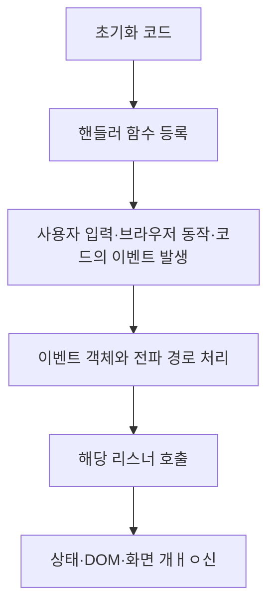

# 40장. 이벤트

> **이벤트는 브라우저나 코드에서 발생한 사건을 나타냄. 이벤트 핸들러는 그 사건에 반응, 이벤트 객체에 대상·전파 단계·입력 정보를 읽음**

## 실습용 공통 HTML과 CSS

`app.js`를 `defer`로 불러와 HTML 파싱이 끝난 뒤 요소에 접근한다.

```html
<!DOCTYPE html>
<html lang="ko">
  <head>
    <meta charset="UTF-8" />
    <title>이벤트 실습</title>
    <link rel="stylesheet" href="style.css" />
    <script src="app.js" defer></script>
  </head>
  <body>
    <button id="button" type="button">Click me!</button>

    <form id="profileForm">
      <label for="username">이름</label>
      <input id="username" name="username" type="text" />
      <label><input id="agree" type="checkbox" />동의</label>
      <button type="submit">저장</button>
    </form>

    <ul id="fruits">
      <li id="apple" class="active"><button type="button">Apple</button></li>
      <li id="banana"><button type="button">Banana</button></li>
      <li id="orange"><button type="button">Orange</button></li>
    </ul>

    <p>결과: <output id="message"></output></p>
    <div id="dragBox" class="drag-box">드래그</div>
  </body>
</html>
```

`style.css`:

```css
#profileForm {
  margin-block: 1rem;
}
#fruits {
  display: flex;
  gap: 1rem;
  padding: 0;
  list-style: none;
}
#fruits button {
  cursor: pointer;
}
#fruits .active > button {
  color: red;
  text-decoration: underline;
}
#message {
  white-space: pre-wrap;
}
```

## 40.1 이벤트 드리븐 프로그래밍

사용자가 언제 클릭할지 개발자가 미리 정할 수 없다. 실행할 함수를 등록해 두고, 이벤트가 전달될 때 브라우저가 호출하도록 한다. 사건을 중심으로 흐름을 구성하는 방식이 이벤트 드리븐 프로그래밍

```js
const button = document.getElementById("button");
const message = document.getElementById("message");

button.onClick = function (event) {
  message.textContent = `발생할 이벤트: ${event.type}`;
};
```

대입 시점에 함수를 등록할 뿐 본문을 실행하지 않음. 이후 버튼을 클릭하면 브라우저가 이벤트 객체를 인수로 전달하며 함수를 호출, 결과 영역에 발생할 이벤트: click이 표시



등록, 이벤트 발생, 핸들러 실행을 구분. 모든 이벤트가 사용자 입력으로만 발생하는 것도 아닌, 모든 이벤트 처리 API가 비동기로 실행되는 것도 아님
