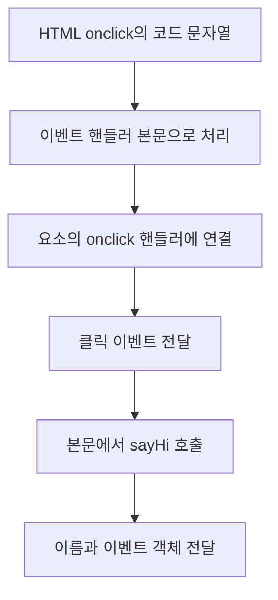
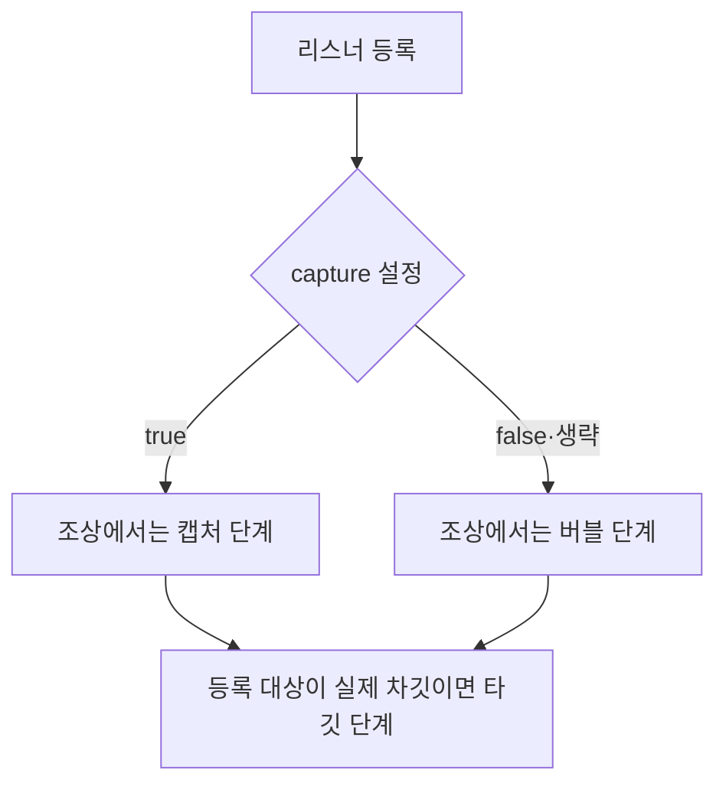

## 40.3 이벤트 핸들러 등록

### 40.3.1 이벤트 핸들러 어트리뷰트 방식

아래 버튼을 추가하고 app.js에 sayHi를 정의. 예제는 app.js는 module이 아닌 일반 스크립트

```html
<button id="greet" type="button" onclick="sayHi('Lee', event)">인사</button>
```

```javascript
function sayHi(name, event) {
  console.log(`Hi, ${name}!`);
  console.log(event.type); // 클릭하면 'click'
}
```

HTML 안의 문자열은 HTML을 읽자마자 sayHi을 실행하라는 뜻이 아님. 브라우저가 이벤트 때 실행할 핸들러 본문으로 처리. 따라서 인사 버튼을 클릭할 때 Hi, Lee!와 click이 출력

#### 어트리뷰트에 핸들러로



개념적으로 function onclick(event) { sayHi('Lee', event); } 같은 본문을 생각할 수 있음.

### 40.3.2 이벤트 핸들러 프로퍼티 방식

#### 대상·타입·핸들러

| 코드      | 역할                                  |
| --------- | ------------------------------------- |
| button    | 리스너를 연결할 대상 객체             |
| onclick   | on과 click으로 구성된 핸들러 프로퍼티 |
| 할당 함수 | 이벤트가 전달될 때 실행할 함수        |

```js
const button = document.getElementById("button");

button.onclick = function () {
  console.log("첫 번째 핸들러");
};
button.onclick = function () {
  console.log("두 번째 핸들러");
};

button.click(); // '두 번째 핸들러'
```

onclick라는 하나의 슬롯에 두 번 대입하므로 나중 함수가 앞 함수를 대체. 테스트르 위해 코드로 클릭을 발생시킨 것. onclick 함수 호출의 결과를 대입하지 말고, 실행할 함수 자체를 대입

### 40.3.3 addEventListener 방식

```text
target.addEventListener(type, listener, options)
```

#### 인수의 의미

| 인수     | 의미                                |
| -------- | ----------------------------------- |
| target   | 이벤트를 관찰할 객체                |
| type     | click 같은 문자열. on을 붙이지 않음 |
| listener | 실행할 함수 등                      |
| options  | capture·once·passive·signal 등 설정 |

```js
const button = document.getElementById("button");
const order = [];

button.onClick = () => order.push("property");
button.addEventListener("click", () => order.push("listener 1"));
button.addEventListener("click", () => order.push("listener 2"));

button.click();
console.log(order); // ['property', 'listener 1', 'listener 2']
```

프로퍼티 방식의 핸들러와 addEventListener 리스너는 함께 실행될 수 있음. 같은 대상의 같은 단계에 등록한 순서대로 실행. 서로 다른 노드나 전파 단계에서 캡처링·타깃·버블링 순서도 고려해야 한다

```js
const button = document.getElementById("button");
let calls = 0;
function handleClick() {
  calls++;
}

button.addEventListener("click", handleClick);
button.addEventListener("click", handleClick);
button.click();

console.log(calls); // 1
```

같은 대상에 type·콜백 참조·capture가 같은 등록을 반복하면 중복 리스너가 추가되지 않음. 모양이 같은 익명 함수를 새로 만들면 서롤 다른 참조이므로 별도로 등록

| 옵션           | 의미                                                  |
| -------------- | ----------------------------------------------------- |
| capture: true  | 조상에서는 캡처 단계에서 처리                         |
| capture: false | 조상에서는 버블 단계에서 처리. 기본값                 |
| once: true     | 한 번 처리한 뒤 자동 제거                             |
| passive: true  | 해당 리스너에 preventDefault로 취소하지 않겠다는 약속 |
| signal         | AbortSignal로 등록을 해제할 수 있게 연결              |



capture=false는 타깃에 등록된 리스너는 타깃 단계에서 실행
