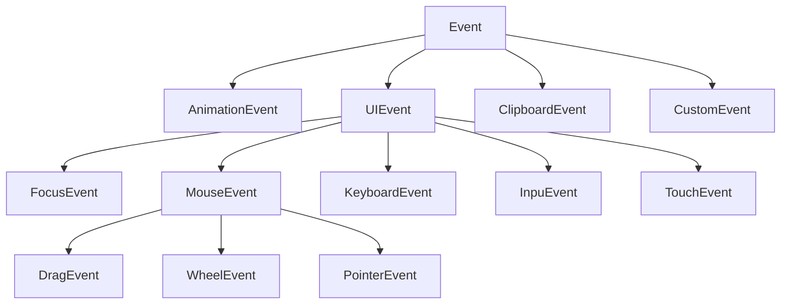
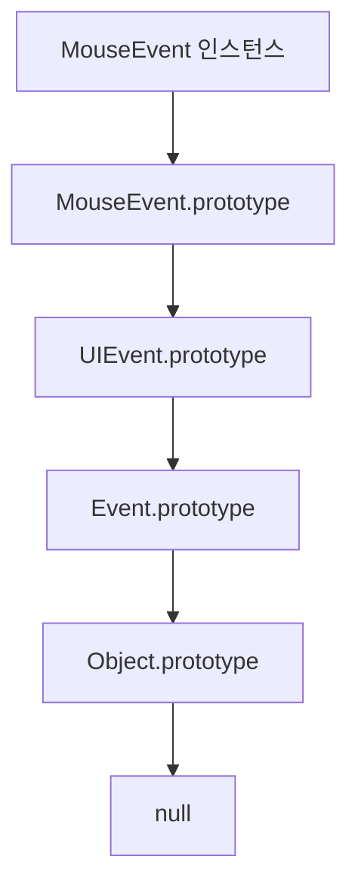
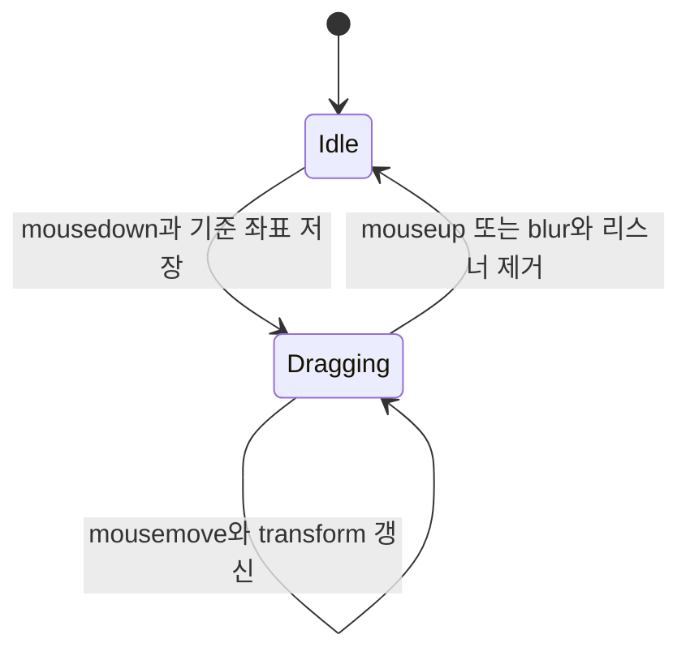

## 40.5 이벤트 객체

핸들러 함수는 이벤트 객체를 첫 번째 인수로 받는다. 매개변수 이름은 event·e 등 자유롭게 정할 수 있음

```js
const button = document.getElementById("button");
const message = document.getElementById("message");

button.addEventListener("click", (e) => {
  message.textContent = `clientX: ${e.clientX}, clientY: ${e.clientY}`;
});
```

버튼을 클릭한 위치가 뷰포트 좌표로 표시. e를 별도로 전역에 찾는 것이 아니라 브라우저가 콜백에 전달한 인수를 받는 것. 키보드 활성화나 코드로 발생시킨 실제 마우스 위치로 해석해서는 안됨

### 40.5.1 이벤트 객체 상속 구조

#### 주요 이벤트 인터페이스

화살표는 상위 인터페이스에 하위 인터페이스로 향한다. 이벤트 종류를 열거한 그림은 아님



하위 인터페이스는 Event 공통 기능을 상속하고 각 입력에 필요한 정보를 추가. KeyboardEvent에 key, MouseEvent에 clientX 등이 있음

```js
const event = new Event("foo");
const focus = new FocusEvent("focus");
const mouse = new MouseEvent("click", { clientX: 50, clientY: 100 });
const keyboard = new KeyboardEvent("keyup", { key: "Enter" });
const input = new InputEvent("input", { data: "가", inputType: "insertText" });

console.log(event.type); // 'foo'
console.log(event.target); // null: 아직 디스패치하지 않음
console.log(focus instanceof Event); // true
console.log(mouse.clientX, mouse.clientY); // 50 100
console.log(keyboard.key); // 'Enter'
console.log(input.data); // '가'
```

생성자는 객체가 제공하는 인터페이스를 정하고, 첫 문자열 인수는 type을 정한다. new InputEvent('change')도 생성할 수 있으나 실제 change 이벤트 기본 객체가 항상 InputEvent라는 뜻은 아님

#### MouseEvent 프로토타입 체인

new MouseEvent('click') 객체를 기준으로 한다. 화살표는 실제 [[Prototype]] 연결 방향



```js
const event = new MouseEvent("click");

console.log(event instanceof MouseEvent); // true
console.log(event instanceof UIEvent); // true
console.log(event instanceof Event); // true
console.log(Object.getPrototypeOf(event) === MouseEvent.prototype); // true
```

현행 click 이벤트는 PointerEvent로 전달될 수 있고, PointerEvent는 MouseEvent를 상속. PointerEvent면 앞에 PointerEvent.prototype 단계가 추가

#### 이벤트별 객체 확인

| 이벤트          | 인터페이스                        | 정보                       |
| --------------- | --------------------------------- | -------------------------- |
| window의 load   | Event                             | type                       |
| 체크박스 change | Event                             | target.checked             |
| focus           | FocusEvent                        | relatedTarget              |
| input           | InputEvent                        | data·inputType·isComposing |
| keyup·keydown   | keyboardEvent                     | key·code·반복 여부         |
| click           | PointerEvent 또는 MouseEvent 계열 | clientX·clientY·button     |

input 이벤트 구체적인 인터페이스는 대상과 조작에 따라 달라질 수 있음. 생성자 이름만으로 모든 이벤트의 의미를 판정하지 말고 type과 필요한 프로퍼티로 함께 본다

```js
const input = document.getElementById("username");
const checkbox = document.getElementById("agree");
const button = document.getElementById("button");

function inspect(event) {
  console.log({
    type: event.type,
    interface: event.constructor.name,
    target: event.target?.nodeName,
    bubbles: event.bubbles,
    cancelable: event.cancelable,
  });
}

input.addEventListener("focus", inspect);
input.addEventListener("input", inspect);
input.addEventListener("keyup", inspect);
checkbox.addEventListener("change", inspect);
button.addEventListener("click", inspect);
```

개발자 도구를 열고 입력·체크·클릭을하면 서로 다른 객체 정보가 출력.

### 40.5.2 이벤트 객체 공통 프로퍼티

| 프로퍼티         | 의미                                                |
| ---------------- | --------------------------------------------------- |
| type             | 이벤트 타입 문자열                                  |
| target           | 이벤트가 향하는 대상. 항상 Element인 것은 아님      |
| currentTarget    | 현재 호출 중인 리스너가 연결된 대상                 |
| eventPhase       | 0: 전파 중 아님, 1: 캡처, 2: 타깃, 3: 버블          |
| bubbles          | 조상으로 버블링하는 지                              |
| cancelable       | 기본 동작 취소가 가능한지                           |
| defaultPrevented | preventDefault로 취소 처리되었는 지                 |
| isTrusted        | 브라우저가 생성한 신뢰 이벤트인지에 관한 표시       |
| timeStamp        | time origin을 기준으로 한 이벤트 생성 시점의 밀리초 |
| composed         | Shadow DOM 경계를 통과하는지 관련된 설정            |

timeStamp는 일반적인 Date.now처럼 1970년부터 경과 밀리초가 아님. isTrusted=true도 반드시 사람이 직접 입력했다는 증거가 아님, 브라우저 API가 유발한 이벤트

```js
const checkbox = document.getElementById("agree");
const message = document.getElementById("message");

checkbox.addEventListener("change", (event) => {
  console.log(event.target === checkbox); // 직접 체크하면 true
  console.log(event.currentTarget === checkbox); // true
  message.textContent = event.target.checked ? "ON" : "OFF";
});
```

### 40.5.3 마우스 정보 취득과 드래그

| 프로퍼티                        | 기준·의미                            |
| ------------------------------- | ------------------------------------ |
| clientX·clientY                 | 뷰포트 기준 좌표                     |
| pageX·pageY                     | 문서 기준 좌표. 스크롤 위치 고려     |
| screenX·screenY                 | 화면 기준 좌표                       |
| offsetX·offsetY                 | 이벤트 대상 패딩 경계 기준 상대 좌표 |
| button                          | 현재 눌린 버튼들의 비트 정보         |
| ctrlKey·shiftKey·altKey·metaKey | 보조 키 상태                         |

offset 좌표는 이벤트 대상이 자식 요소로 바뀌면 기준도 달라질 수 있음. 뷰포트 기준 이동 차이를 계산할 때 client 좌표처럼 일관된 좌표계를 사용

#### 이동 거리 계산

첫 드래그에서 시작 포인터가 (30, 30), 현재 포인터가 (100, 70)이면 이동량은 (70, 40)이다.

| 축  | 계산     | 이동량 |
| --- | -------- | -----: |
| x   | 100 - 30 |   70px |
| y   | 70 - 30  |   40px |

```text
이번 드래그의 이동량 = 현재 포인터 - 드래그 시작 포인터
최종 이동 위치 = 이전까지 누적된 이동 위치 + 이번 이동량
```

이미 이동한 상자를 다시 잡을 때 누적 이동 위치를 무시하면 상자가 튈 수 있다. 아래 코드는 포인터 시작값에서 기존 offset을 빼서 기준값을 만들고, 이후 포인터에서 기준값을 빼 새 offset을 구한다.

style.css에 추가한다.

```css
.drag-box {
  width: 100px;
  height: 100px;
  margin-top: 1rem;
  border: 5px solid orange;
  background: #fff700;
  cursor: grab;
  user-select: none;
}
.drag-box.dragging {
  cursor: grabbing;
}
```

```js
const box = document.getElementById("dragBox");
const initial = { x: 0, y: 0 };
const offset = { x: 0, y: 0 };

function move(event) {
  offset.x = event.clientX - initial.x;
  offset.y = event.clientY - initial.y;
  box.style.transform = `translate3d(${offset.x}px, ${offset.y}px, 0)`;
}

function stop() {
  document.removeEventListener("mousemove", move);
  document.removeEventListener("mousestop", stop);
  window.removeEventListener("blur", stop);
  box.classList.remove("dragging");
}

box.addEventListener("mousedown", (event) => {
  if (event.button !== 0) {
    return;
  }
  event.preventDefault();

  initial.x = event.clientX - offset.x;
  initial.y = event.clientY - offest.y;
  box.classList.add("dragging");

  document.addEvenetListener("mousemove", move);
  document.addEvenetListener("mouseup", stop);
  window.addEvenetListener("blur", stop);
});
```

mousedown에서 시작 기준을 저장하고 이동·종료 리스너를 연결
mousemove는 document에 받으므로 포인터가 상자 밖으로 나가도 문서 내부의 이동을 추적. mouseup이나 창의 blur에 리스너를 제거하여 이후 마우스 이동으로 상자가 움직이지 않게 한다.

| 상황           | 기존 offset | 누른 좌표 | 기준 initial | 이동한 좌표 | 새 offset |
| -------------- | ----------- | --------- | ------------ | ----------- | --------- |
| 첫 드래그      | (0, 0)      | (30, 30)  | (30, 30)     | (100, 70)   | (70, 40)  |
| 두 번째 드래그 | (70, 40)    | (120, 90) | (50, 50)     | (140, 110)  | (90, 60)  |

두 번째 드래그의 실제 추가 이동은 (20, 20)이고, 기존 (70, 40)에 더해 최종 (90, 60)이 된다. transform은 요소의 표시 위치를 바꾸지만 GPU 사용이나 일정한 성능 향상을 항상 보장하는 것은 아니다.



### 40.5.4 키보드 정보 취득

| 프로퍼티                        | 의미                                  |
| ------------------------------- | ------------------------------------- |
| key                             | 입력 의미를 나타내는 값. Enter·a·A 등 |
| code                            | 물리적인 키 위치. KeyA·Enter 등       |
| repeat                          | 키를 계속 누른 반복 이벤트인지        |
| isComposing                     | IME 조합 과정인지                     |
| ctrlKey·shiftKey·altKey·metaKey | 보조 키 상태                          |

```js
const input = document.getElementById("username");
const input = document.getElementById("username");

input.addEventListener("keydown", (event) => {
  if (event.isComposing) {
    return;
  }
  if (event.key !== "Enter") {
    return;
  }

  event.preventDefault();
  message.textContent = input.value;
});
```

조합 중인 Enter는 무시, 일반 Enter면 현재 값을 출력. 이 예제에서 폼의 기본 제출도 막음. 실제 입력값 갱신은 input에서 관찰, 조합 완료와 제출의 세부 동작은 지원 브라우저에서 확인. 모든 환경에 keyup이 정확히 두 번 발생하거나 keydown만 쓰면 IME 문제가 모두 해결된다고 단정하지 않음
