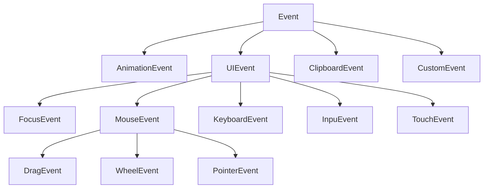
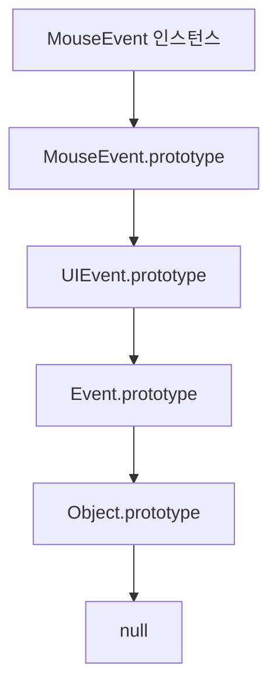

## 40.5 이벤트 객체

핸들러 함수는 이벤트 객체를 첫 번째 인수로 받는다. 매개변수 이름은 event·e 등 자유롭게 정할 수 있음

```js
const button = document.getElementById("button");
const message = document.getElementById("message");

button.addEventListener("click", (e) => {
  message.textContent = `clientX: ${e.clientX}, clientY: ${e.clientY}`;
});
```

버튼을 클릭한 위치가 뷰포트 좌표로 표시. e를 별도로 전역에 찾는 것이 아니라 브라우저가 콜백에 전달한 인수를 받는 것. 키보드 활성화나 코드로 발생시킨 실제 마우스 위치로 해석해서는 안됨

### 40.5.1 이벤트 객체 상속 구조

#### 주요 이벤트 인터페이스

화살표는 상위 인터페이스에 하위 인터페이스로 향한다. 이벤트 종류를 열거한 그림은 아님



하위 인터페이스는 Event 공통 기능을 상속하고 각 입력에 필요한 정보를 추가. KeyboardEvent에 key, MouseEvent에 clientX 등이 있음

```js
const event = new Event("foo");
const focus = new FocusEvent("focus");
const mouse = new MouseEvent("click", { clientX: 50, clientY: 100 });
const keyboard = new KeyboardEvent("keyup", { key: "Enter" });
const input = new InputEvent("input", { data: "가", inputType: "insertText" });

console.log(event.type); // 'foo'
console.log(event.target); // null: 아직 디스패치하지 않음
console.log(focus instanceof Event); // true
console.log(mouse.clientX, mouse.clientY); // 50 100
console.log(keyboard.key); // 'Enter'
console.log(input.data); // '가'
```

생성자는 객체가 제공하는 인터페이스를 정하고, 첫 문자열 인수는 type을 정한다. new InputEvent('change')도 생성할 수 있으나 실제 change 이벤트 기본 객체가 항상 InputEvent라는 뜻은 아님

#### MouseEvent 프로토타입 체인

new MouseEvent('click') 객체를 기준으로 한다. 화살표는 실제 [[Prototype]] 연결 방향



```js
const event = new MouseEvent("click");

console.log(event instanceof MouseEvent); // true
console.log(event instanceof UIEvent); // true
console.log(event instanceof Event); // true
console.log(Object.getPrototypeOf(event) === MouseEvent.prototype); // true
```

현행 click 이벤트는 PointerEvent로 전달될 수 있고,
