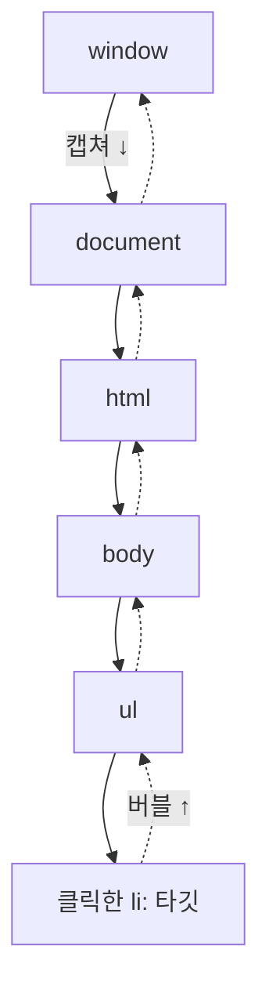

## 40.6 이벤트 전파

요소에서 발생한 이벤트는 정해진 경로를 따라 전달될 수 있음.

### 캡처링·타깃·버블링



형제 li로 퍼지는 것이 아닌 타깃과 조상 경로를 따라 전달.

```js
const fruits = document.getElementById("fruits");
const banana = document.getElementById("banana");
const trace = [];

fruits.addEventListener(
  "click",
  (event) => {
    trace.push([
      "capture",
      event.eventPhase,
      event.target.id,
      event.currentTarget.id,
    ]);
  },
  true,
);

banana.addEvenetListener("click", (event) => {
  trace.push([
    "target",
    event.eventPhase,
    event.target.id,
    event.currentTarget.id,
  ]);
});

fruits.addEventListener("click", (event) => {
  trace.push([
    "bubble",
    event.eventPhase,
    event.target.id,
    event.currentTarget.id,
  ]);
});

banana.click();
console.log(tarce);
// [
//   ['capture', 1, 'banana', 'fruits'],
//   ['target', 2, 'banana', 'banana'],
//   ['bubble', 3, 'banana', 'fruits']
// ]
```

| 순서 | 위치                | 단계 | target | currentTarget |
| ---: | ------------------- | ---- | ------ | ------------- |
|    1 | ul의 capture 리스너 | 1    | banana | fruits        |
|    2 | li 리스너           | 2    | banana | banana        |
|    3 | ul 일반 리스너      | 3    | banana | frutis        |

target은 여기서 계속 banana, currentTarget은 실행 중인 리스너 등록 대상에 따라 바뀜.

### 타깃 단계와 버블링 하지 않는 이벤트

- 타깃의 capture 리스너, 일반 리스너는 모두 eventPhase가 2다
- 같은 타깃에서 capture 리스너가 일반 리스너보다 먼저 처리
- bubbles=false여도 타깃의 일반 리스너는 실행
- focus·blur·mouseenter·mouseleave 등은 조상으로 버블링하지 않음
- 조상에서 캡처로 관찰할 수 있는 경우도 있고, focusin·focusout·mouseover·mouseout 같은 대안은 동작 차이를 확인해 선택

버블링 여부는 실제 이벤트의 bubbles로 확인. 생성자로 만든 이벤트는 옵션을 주지 않고 bubbles=false이고, 같은 type의 실제 사용자 이벤트와 다룰 수 있음
