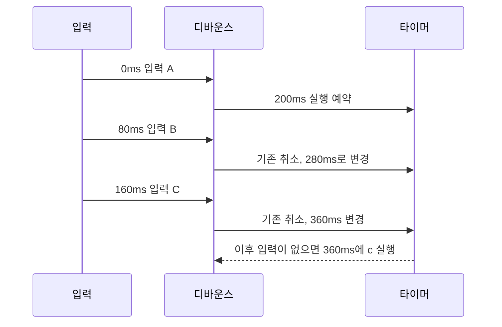
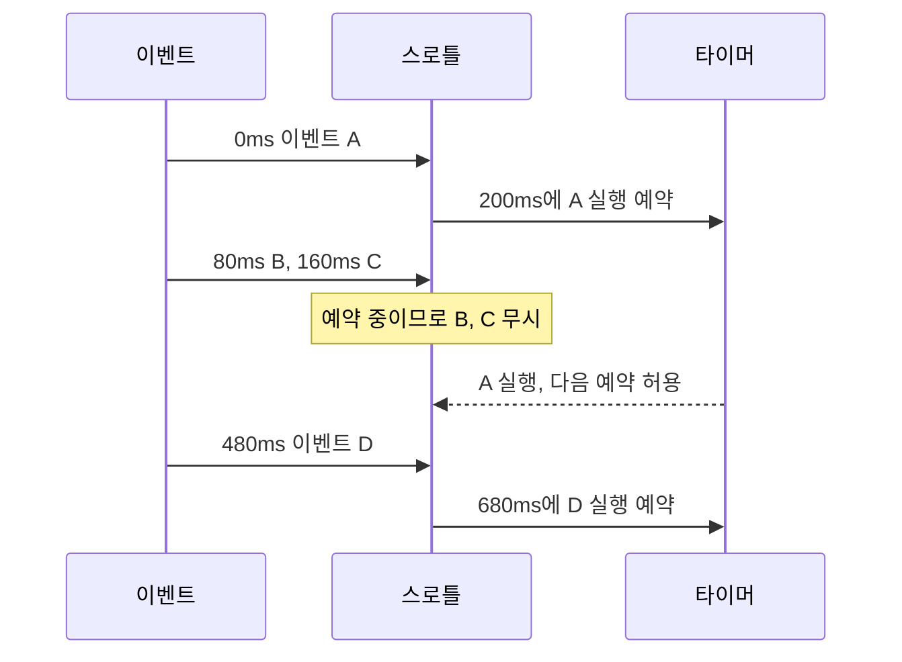

## 41.3 디바운스와 스로틀

### 41.3.1 어떤 방식을 고르는 지

| 방식        | 기준                                                       | 예시                                 |
| ----------- | ---------------------------------------------------------- | ------------------------------------ |
| 일반 핸들러 | 이벤트가 올 때마다 처리                                    | 클릭 횟수 기록                       |
| 디바운스    | 마지막 이벤트 이후 일정 시간 동안 새 이벤트가 없을 때 처리 | 검색 자동완성, 리사이즈 완료 후 개선 |
| 스로틀      | 이벤트가 계속되어도 정한 간격마다 최대 한 번 처리          | 스크롤 위치 읽기, 이동 중 상태 갱신  |

핸들러 호출을 줄이는 기법. 이벤트가 발생하는 횟수 자체를 줄이지 않음. 무한 스크롤에서 목록 끝의 도달 여부만 필요하다면 `IntersectionObserver`도 선택지

### 41.3.2 디바운스

**마지막 입력 이후 실행하는 방식**. 입력이 들어올 때마다 기존 예약을 취소하고 새로 예약. 실행할 때 마지막 호출 인수를 사용



### 41.3.3 스로틀

스로틀은 여러 방식으로 구현할 수 있음. 이 구현은 **구간의 첫 이벤트를 받아 지연 후 실행** 예약이 있으면 중간 호출을 버림. 첫 이벤트를 즉시 실행하는 방식이나 구간의 마지막 입력을 따로 보관하는 방식도 있음. 어떤 값을 실행하는 지 구현에 따라 다름



지연 200ms를 가정한 비교.

|     시각 | 디바운스                   | 스로틀: 첫 입력을 지연 실행 |
| -------: | -------------------------- | --------------------------- |
|   0ms: A | A를 200ms에 예약           | A를 200ms에 예약            |
|  80ms: B | A 취소, B를 280ms에 예약   | 무시                        |
| 160ms: C | B 취소, C를 360ms에 예약   | 무시                        |
| 480ms: D | C 실행 후 D를 680ms에 예약 | A 실행 후 D를 680ms에 예약  |
| 550ms: E | D 취소, E를 750ms에 예약   | 무시                        |
|     결과 | C: 360ms, E: 750ms         | A: 200ms, D: 680ms          |

### 41.3.4 구현: timer-utils.js

```js
export function debounce(callback, delay) {
  let timerId = null;

  function wrapped(...args) {
    if (timerId !== null) {
      clearTimeout(timerId);
    }
    timerId = setTimeout(() => {
      timerId = null;
      callback.apply(this, args);
    }, delay);
  }

  wrapped.cancel = () => {
    if (timerId !== null) {
      clearTimeout(timerId);
    }
    timerId = null;
  };
  return wrapped;
}

export function throttle(callback, delay) {
  let timerId = null;

  function wrapped(...args) {
    if (timerId !== null) {
      return;
    }
    timerId = setTimeout(() => {
      timerId = null;
      callback.apply(this, args);
    }, delay);
  }

  wrapped.cancel = () => {
    if (timerId !== null) {
      clearTimeout(timerId);
    }
    timerId = null;
  };
  return wrapped;
}
```

두 함수 모두 클로저에 `timerId`를 저장. 일반 함수인 `wrapped`를 호출할 때 `this`와 인수를 콜백에 전달. 콜백 호출 전ㄷ에 ID를 초기화하므로 콜백 내부에 다시 예약할 수 있음. `cancel()`은 대기 중인 실행만 취소

### 41.3.5 브라우저 실습: 클릭·입력·스크롤

**index.html**

```html
<!doctype html>
<html lang="ko">
  <head>
    <meta charset="UTF-8" />
    <title>타이머 실습</title>
    <link rel="stylesheet" href="style.css" />
    <script type="module" src="app.js"></script>
  </head>
  <body>
    <button id="countButton" type="button">여러 번 클릭</button>
    <p>일반: <output id="normal">0</output></p>
    <p>디바운스: <output id="debounced">0</output></p>
    <p>스로틀: <output id="throttled">0</output></p>

    <label for="query">검색어</label>
    <input id="query" type="search" />
    <p>마지막 검색어: <output id="searchOutput"></output></p>

    <div id="scrollBox" tabindex="0" aria-label="스크롤 실습">
      <div class="scroll-content">아래로 스크롤하세요.</div>
    </div>
    <p>스크롤 이벤트: <output id="scrollRaw">0</output></p>
    <p>스로틀 처리: <output id="scrollLimited">0</output></p>
  </body>
</html>
```

**style.css**

```css
#scrollBox {
  width: 18rem;
  height: 9rem;
  overflow: auto;
  border: 1px solid #888;
}

.scroll-content {
  min-height: 40rem;
  background: linear-gradient(white, lavender);
}
```

**app.js**

```js
import { debounce, throttle } from "./timer-utils.js";

function increment(id) {
  const output = document.getElementById(id);
  output.textContent = String(Number(output.textContent) + 1);
}

const button = document.getElementById("countButton");
button.addEventListener("click", () => increment("normal"));
button.addEventListener(
  "click",
  deboune(() => increment("debounced"), 300),
);
button.addEventListener(
  "click",
  throttle(() => increment("throttled"), 300),
);

const query = document.getElementById("query");
const searchOutput = document.getElementById("searchOutput");
const showQuery = debounce((value) => {
  searchOutput.textContent = value;
}, 300);

query.addEventListener("input", (event) => {
  // 리스너 안에 문자열을 읽어 예약
  showQuery(event.currentTarget.value);
});

const scrollBox = document.getElementById("scrollBox");
scrollBox.addEventListener("scroll", () => increment("scrollRaw"));
scrollBox.addEventListener(
  "scroll",
  throttle(() => increment("scrollLimited"), 200),
);
```

- 클릭을 300ms보다 짧은 간격으로 이어 가면 일반 카운터는 매번 증가. 디바운스 카운터는 클릭이 멈춘 뒤 증가, 스로틀 카운터는 연속 클릭 중에도 간격을 두고 증가한다. 정확한 횟수는 클릭 간격에 따라 달라짐
- 입력에서 이벤트 객체 대신 읽은 **검색어 문자열**을 전달. 리스너가 끝난 뒤 계속 같은 요소를 가리키지 않음
- 스크롤을 길게 하면 일반 처리 횟수와 스로틀 처리 횟수의 차이를 볼 수 있음. 화면을 제거하고 다시 마운트하는 코드에서 리스너 제거와 대기 타이머 취소를 함께 처리

## 질문 및 답변

### 1. `setTimeout(fn, 0)`은 즉시 실행되는 지

- 아님. 현재 코드가 먼저 끝나고 실행 기회가 필요하다

### 2. `fn`과 `fn()`을 전달하는 차이

- 전자는 함수 참조, 후자는 함수를 지금 호출한 결과

### 3. `clearTimeout`이미 실행한 요청까지 취소하는 지

- 아님. 대기 중인 타이머만 취소.

### 4. 디바운스 기준 시각은

- 마지막 입력이 들어온 시각

### 5. 스로틀에 중간 이벤트가 들어오면

- 다른 구현은 마지막 값을 보관할 수 있음

### 6. 비동기 interval 콜백 요청이 겹칠 수 있는 지

- interval은 콜백의 Promise 완료를 기다리지 않음

[HTML Standard — Timers](https://html.spec.whatwg.org/multipage/timers-and-user-prompts.html#timers)
[Node.js — Timers](https://nodejs.org/api/timers.html)
