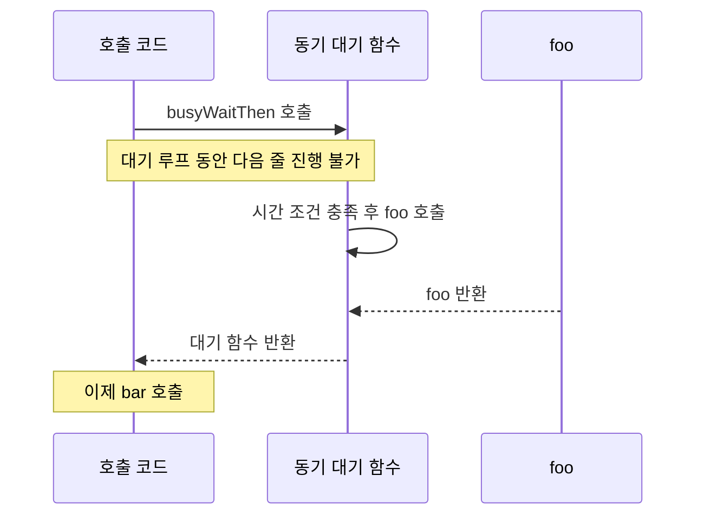
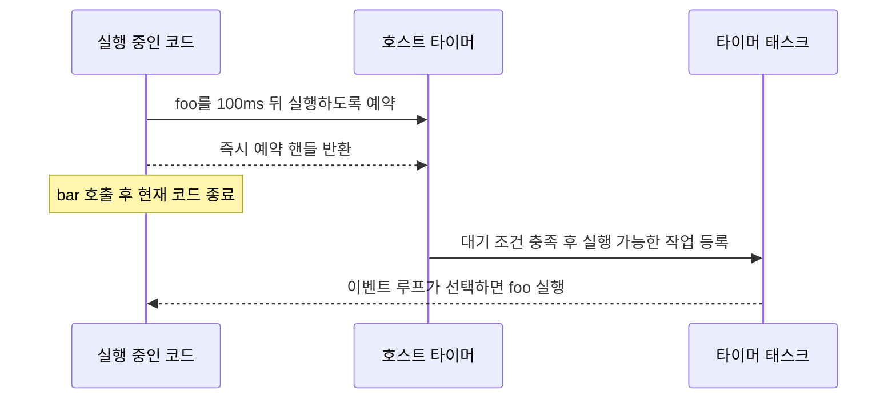

# 42장. 비동기 프로그래밍

> **비동기 작업을 요청한 코드는 결과를 기다리느라 멈추지 않음. 결과를 처리하는 JavaScript 콜백은 실행 기회가 왔을 때 콜 스택에 실행된다**

## 42.1 동기 처리, 비동기 처리

### 42.1.1 콜 스택

함수를 호출하면 실행 컨텍스트가 콜 스택에 들어가고, 함수가 끝나면 제거된다. 스택의 맨 위에 있는 컨텍스트가 현재 실행 중

```js
function foo() {
  console.log("foo");
}

function bar() {
  console.log("bar");
}

foo();
bar();

// foo -> bar
```

| 순서 | 실행           | 콜 스택: 아래 -> 위 |
| ---: | -------------- | ------------------- |
|    1 | 전역 코드 시작 | 전역                |
|    2 | `foo()` 호출   | 전역 -> foo         |
|    3 | foo 종료       | 전역                |
|    4 | `bar()` 호출   | 전역 -> bar         |
|    5 | bar 종료       | 전역                |
|    6 | 전역 코드 종료 | 비어 있음           |

foo와 bar는 중첩 호출 관계가 아님. foo가 끝나고 스택에 빠진 뒤 bar가 들어감. foo 안에서 bar를 호출했다면 스택은 잠시 `전역 -> foo -> bar`가 된다

### 42.1.2 동기 처리와 블로킹

동기 호출은 호출한 함수가 반환되어야 다음 줄로 진행.

```js
function busyWaitThen(callback, delay) {
  const end = performance.now() + delay;

  while (performance.now() < end) {
    // 콜 스택을 점유한 채 시간 조건을 계속 확인
  }

  callback();
}

function foo() {
  console.log("foo");
}
function bar() {
  console.log("bar");
}

busyWaitThen(foo, 100);
bar();

// 약 100ms 대기 -> foo -> bar
```



대기 중에 콜 스택이 비지 않음. 브라우저 메인 스레드에 실행하면 그동안 화면 갱신이나 사용자 입력 처리도 늦어질 수 있음. 블로킹 위한 실험

### 42.1.3 비동기 처리

```js
function foo() {
  console.log("foo");
}
function bar() {
  console.log("bar");
}

setTimeout(foo, 100);
bar();

// bar -> 나중에 foo
```



타이머 **등록 호출**은 동기적으로 반환. 예약한 **콜백 실행**은 나중에 이루어짐. 대기 중에도 bar가 실행. foo가 실제로 실행될 때 긴 연산을 하면 여전히 메인 스레드를 막을 수 있음

| 비교                  | 동기 대기                              | 타이머로 비동기 예약                                 |
| --------------------- | -------------------------------------- | ---------------------------------------------------- |
| 기다리는 동안 다음 줄 | 실행되지 않음                          | 진행 가능                                            |
| 예제 출력             | foo -> bar                             | bar -> foo                                           |
| 완료 순서             | 함수 반환을 기준으로 이어짐            | 작업이 준비되고 실행될 기회에 따라 달라짐            |
| 오류 처리             | 호출과 같은 스택에 예외를 잡을 수 있음 | 나중 콜백 예외는 등록 코드 `try/catch`로 잡히지 않음 |

비동기 작업끼리 순서가 필요하면 완료를 연결. Promise `then`, `await`가 관계를 표현
