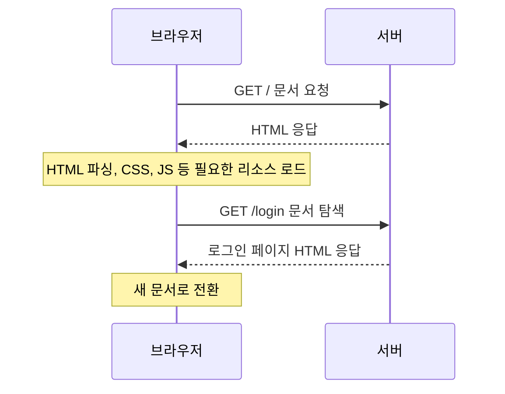
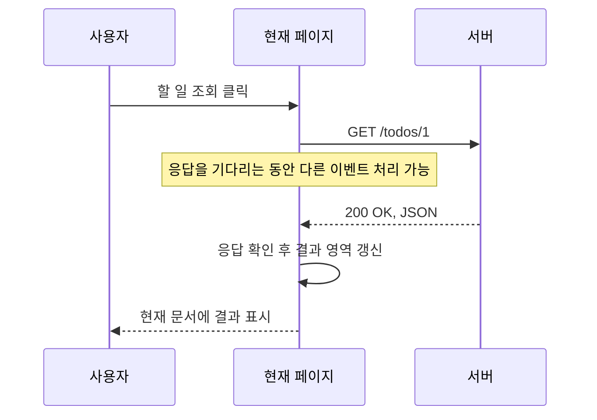

# 43장. Ajax

> **Ajax는 브라우저가 HTTP로 데이터를 요청한 뒤, 현재 문서를 유지하면서 필요한 화면을 갱신하는 방식**

## 43.1 Ajax

Ajaxsms Asynchronous JavaScript and XML 약자. XML을 반드시 사용하지 않음.
응답은 JSON, 텍스트, HTML 조각 등으로 받을 수 있음. 브라우저에 `XMLHttpRequest`나 `fetch`로 비동기 요청을 보낼 수 있음

### 43. 문서 탐색

HTML, CSS·JavaScript 파일이 한 HTTP 응답에 항상 묶여 오는 것은 아님. 브라우저는 HTML에 연결된 리소스를 필요에 따라 별도로 요청하거나 캐시로 가져온다. 문서 탐색 또한 그 자체로 JavaScript의 동기 네트워크 호출을 뜻하지 않음

### 43. Ajax 요청과 부분 갱신

| 비교      | 문서 탐색          | Ajax 요청                             |
| --------- | ------------------ | ------------------------------------- |
| 요청 목적 | 새로운 문서로 이동 | 현재 화면에 필요한 데이터 교환        |
| 흔한 응답 | HTML 문서          | JSON 등 API가 약속한 형식             |
| 화면 변화 | 새 문서를 표시     | 응답을 받아 코드가 필요한 영역을 갱신 |

부분 갱신으로 전송량이나 불필요한 화면 전환을 줄일 수 있음. 응답을 처리하는 JavaScript가 오래 실행되면 화면은 여전히 늦어질 수 있음
