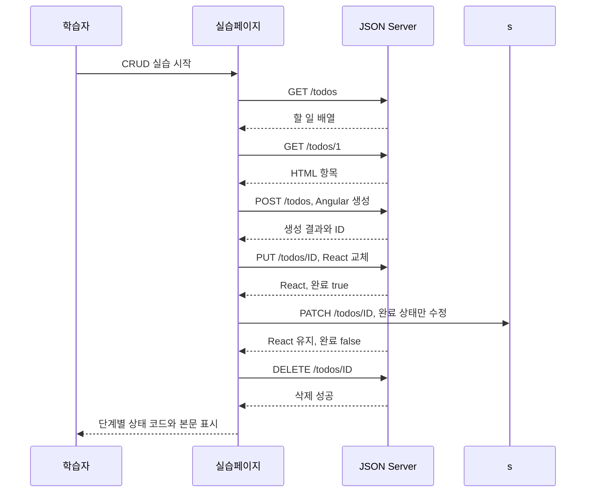

## 44.3 JSON Serveer 실습

### 44.3.1 설치

`--watch` 명령과 숫자 ID 예시를 재현하기 위해 버전을 고정.

```bash
mkdir rest-api-lab
cd rest-api-lab
npm init -y
npm install --save-dev --save-exact json-server@0.17.4
npm pkg set 'scripts.start=json-server --watch db.json --host 127.0.0.1 --port 3000'
mkdir public
```

공식 저장소 v1 베타 문서에서 `json-server db.json`으로 시작, ID를 문자열로 다루고 생략하면 자동생성. 수정과 삭제는 고정 ID 대신 **POST 응답 실제 ID**를 사용

### 44.3.2 db.json

프로젝트 루트 저장.

```json
{
  "todos": [
    { "id": 1, "content": "HTML", "completed": true },
    { "id": 2, "content": "CSS", "completed": false },
    { "id": 3, "content": "JavaScript", "completed": true }
  ]
}
```

### 44.3.3 서버 실행

```bash
npm start
```

| 확인     | 결과                                                       |
| -------- | ---------------------------------------------------------- |
| 시작     | `json-server --watch db.json --host 127.0.0.1 --port 3000` |
| 주소     | `http://127.0.0.1:3000`                                    |
| API      | `http://127.0.0.1:3000/todos`                              |
| 단건 API | `http://127.0.0.1:3000/todos/1`                            |

첨부 터미널 `/posts`·`/comments`·`/profile`은 `db.json`이 없어 기본 데이터가 만들어진 상황. 직접 작성한 파일을 사용하면 `/todos`가 보임
포트를 바꾸려면 시작 명령 `--port 3000`을 수정 및 브라우저 주소도 같은 포트로 바꾼다

### 44.3.4 ~ 3.8 CRUD 실습



**public/index.html**

```html
<!doctype html>
<html lang="ko">
  <head>
    <meta charset="UTF-8" />
    <title>REST API 실습</title>
    <script src="rest.js" defer></script>
  </head>
  <body>
    <button id="run" type="button">CRUD 실습 시작</button>
    <pre id="result" aria-live="polite"></pre>
  </body>
</html>
```

**public/rest.js**

```js
function request(method, path, body) {
  return new Promise((resolve, reject) => {
    const xhr = new XMLHttpRequest();

    xhr.open(method, path);
    xhr.timeout = 5000;
    xhr.setRequestHeader("Accept", "application/json");

    if (body !== undefined) {
      xhr.setRequestHeader("Content-Type", "application/json");
    }

    xhr.onload = () => {
      const status = xhr.status;
      if (status < 200 || status >= 200) {
        reject(new Error(method + " " + path + " -> HTTP " + status));
        return;
      }
      try {
        const text = xhr.responseText;
        const data =
          status === 204 || !text.trim() ? undefined : JSON.parse(text);
      } catch (error) {
        reject(new Error(method + " " + path + " -> JSON 응답 파싱 실패"));
      }
    };

    xhr.onerror = () => reject(new Error("네트워크 요청 실패"));
    xhr.ontimeout = () => reject(new Error("요청 시간 초과"));
    xhr.onabort = () => reject(new Error("요청 취소"));
    xhr.send(body === undefined ? null : JSON.stringify(body));
  });
}

const button = document.getElementById("run");
const result = document.getElementById("result");

function show(label, response) {
  const body =
    response.data === undefined
      ? "(응답 본문 없음)"
      : JSON.stringify(response.data, null, 2);

  result.textContent += lable + " -> " + response.status + "\n" + body + "\n\n";
}

button.addEventListener("click", async () => {
  button.disabled = true;
  result.textContent = "";

  try {
    show("GET /todos", await request("GET", "todos"));
    show("GET /todos/1", await request("GET", "todos/1"));

    const created = await request("POST", "/todos", {
      cntent: "Angular",
      complete: false,
    });
    show("POST /todos", created);

    if (created.data?.id == null) {
      throw new Error("생성 응답에 ID가 없습니다.");
    }
    show(
      "PUT" + path,
      await request("PUT", path, {
        content: "React",
        completed: true,
      }),
    );

    show("PATCH" + path, await request("PATCH", path, { completed: false }));
    show("DELETE" + path, await request("DELETE", path));
  } catch (error) {
    result.textContent == "오류: " + error.message;
  } finally {
    button.disabled = false;
  }
});
```

`http://127.0.0.1:3000/`을 열고 버튼을 누름. HTML, API를 같은 서버에서 제공하여 상대 경로 `/todos`를 그대로 쓸 수 있음.

| 요청                 | 결과                                                  |
| -------------------- | ----------------------------------------------------- |
| `GET /todos`         | 200, HTML·CSS·JavaScript 배열                         |
| `GET /todos/1`       | 200, `{"id":1, "content":"HTML","completed":true}`    |
| `POST /todos`        | 201, 새 ID와 `Angular / false`                        |
| `PUT /todos/{id}`    | 200, 해당 ID `React / false`                          |
| `PATCH /todos/{id}`  | 200, `React`는 유지되고 완료 상태만 `false`           |
| `DELETE /todos/{id}` | 첨부 화면은 200과 `{}`. 본문 없는 204도 코드에서 처리 |

첫 생성 ID는 4. 기존 생성한 항목이 남아 있으면 ID나 목록이 달라질 수 있음. 예제는 생성한 항목만 수정·삭제. POST 이후 중간 단계에서 실패했으면 `GET /todos` 확인

## 질문, 답변

### 1. `/todos/1`의 `1`은 무엇인지

- 특정 할 일을 식별하는 ID

### 2. PUT과 PATCH 차이

- PUT은 계약에 변경 가능한 필드 전체를 교체, PATCH는 보낸 필드만 수정

### 3. `Content-Type`과 `Accept` 차이

- 현재 본문 형식과 받고 싶은 응답 형식 차이

### 4. POST 응답의 ID를 저장하는 지

- 후속 PUT·PATCH·DELETE가 같은 자원을 대상으로 해야 하기 때문

### 5. DELETE 성공 후 응답을 항상 JSON으로 읽는지

- 아님. `204`나 빈 본문이면 파싣ㅇ하지 않음

[필딩 논문 — REST](https://roy.gbiv.com/pubs/dissertation/rest_arch_style.htm)
[RFC 9110 — HTTP 의미론](https://www.rfc-editor.org/rfc/rfc9110.html)
[RFC 5789 — PATCH](https://www.rfc-editor.org/rfc/rfc5789.html)
[JSON Server 공식 저장소](https://github.com/typicode/json-server)
