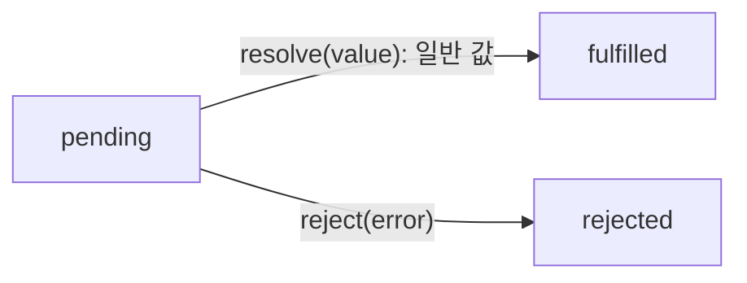

## 45.2 프로미스 생성과 상태

`Promise`는 ECMAScript 표준 객체. `new Promise(executor)`에 넘긴 실행 함수는 생성 시 **동기적으로** 호출되며 `resolve`, `reject`를 받음.
실행 함수가 타이머나 요청을 등록했으면 그 콜백은 나중에 실행. `then`에 등록한 후속 처리 역시 동기 코드가 끝난 뒤 실행

```js
function wait(ms, value) {
  return new Promise((resolve) => {
    setTimeout(() => resolve(value), ms);
  });
}

wait(100, "완료").then((value) => console.log(value)); // 완료
```

### 프로미스 상태



| 상태        | 의미               | 결과                      |
| ----------- | ------------------ | ------------------------- |
| `pending`   | 아직 완료되지 않음 | 정해진 값이나 이유가 없음 |
| `fulfilled` | 성공으로 완료      | 처리 값                   |
| `rejecgted  | 실패로 완료        | 거부 이유, `Error`        |

`fulfilleed`와 `rejected`를 합쳐 **settled**라고 한다. 한 번 settled가 된 프로미스 상태는 바뀌지 않음.
일반 값을 넘깅 경우. `resolve(다른 프로미스)`는 프로미스 결과를 따르므로, 상대가 아직 대기 중이면 현재 프로미스도 바로 `fulfilled`가 되지 않음. 상대가 거부되면 현재 프로미스도 거부된다. `then` 메서드를 가진 thenable도 같은 방식으로 처리할 수 있음
thenable도 같은 방식으로 처리할 수 있음

### fulfilled 프로미스

```js
const fulfilled = new Promise((resolve) => resolve(1));
console.log(fulfilled); // 콘솔 표시 예: Promise {<fulfilled>: 1}
fulfilled.then((value) => console.log(value)); // 1
```

### rejected 프로미스

```js
const rejected = new Promise((_, reject) => {
  reject(new Error("error occurred"));
});

console.log(rejected); // 콘솔 표시 예: Promise {<rejected>: Error: error occurred}
rejected.catch((error) => console.log(error.message)); // error occurred
```

개발자 도구 상태와 결과 표시는 브라우저 버전에 따라 다름. `[[PromiseState]]`, `[[PromiseResult]]` 같은 내부 슬롯은 일반 프로퍼티처럼 접근할 수 없음.

### XHR 요청을 프로미스로 감싸기

`/todos/1`을 조회. `load`에 HTTP 상태와 JSON 파싱 오류를 각각 확인

```js
function promiseGet(url) {
  return new Promise((resolve, reject) => {
    const xhr = new XMLHttpRequest();
    xhr.open("GET", url);
    xhr.timeout = 5000;

    xhr.onload = () => {
      if (xhr.status < 200 || xhr.status >= 300) {
        reject(new Error("HTTP" + xhr.status));
        return;
      }
      try {
        resolve(JSON.parse(xhr.responseText));
      } catch (error) {
        reject(error);
      }
    };

    xhr.onerror = () => reject(new Error("네트워크 요청 실패"));
    xhr.ontimeout = () => reject(new Error("요청 시간 초과"));
    xhr.onabort = () => reject(new Error("요청 취소"));
    xhr.send();
  });
}

promiseGet("/todos/1")
  .then((todo) => console.log(todo))
  .catch((error) => console.error(error.message));
```

실행 함수에 동기적으로 던진 예외는 생성자가 거부로 바꾼다. 나중에 실행되는 `onload` 안의 예외는 생성자가 쉽지 않아, 예제에서 `try...catch`로 감싸 `reject`를 호출
