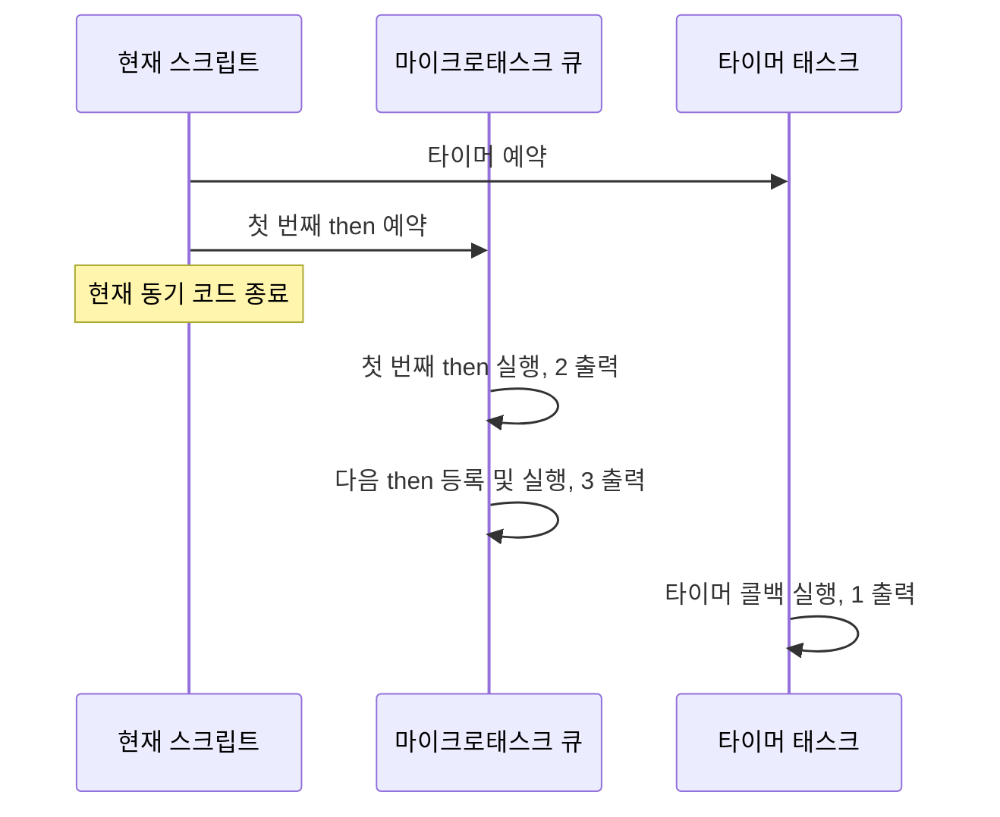

## 45.7 마이크로태스크 큐

```js
setTimeout(() => console.log(1), 0);

Promise.resolve()
  .then(() => console.log(2))
  .then(() => console.log(3));

// 2 -> 3 -> 1
```



브라우저 다음 태스크로 넘어가기 전 마이크로태스크 체크포인트에 대기 중인 작업을 처리. 마이크로태스크 실행중 새로 등록된 마이크로태스크도 같은 체크포인트에서 처리.
