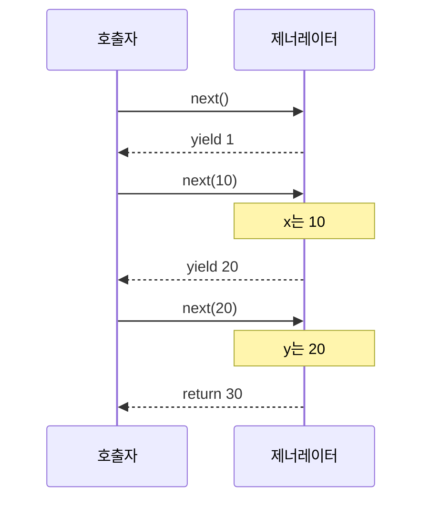

## 46.4 제너레이터의 일시 중지와 재개

```js
function* exchange() {
  const x = yield 1;
  const y = yield x + 10;
  return x + y;
}

const generator = exchange();
console.log(generator.next()); // { value: 1, done: false }
console.log(generator.next(10)); // { value: 20, done: false }
console.log(generator.next(20)); // { value: 30, done: true }
```



첫 번째 `next()`에 재개할 `yield`가 없어 인수를 줘도 무시된다. 두 번째 `next(10)`의 `10`은 **이전에 멈춘** `yield 1` 표현식의 값이 되어 `x`에 들어간다. 마지막 `return` 값은 `done: true`와 함께 반환되고, `for...of`의 반복 값에 포함되지 않음
