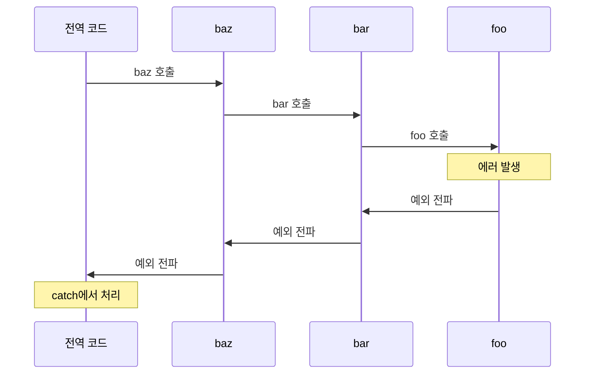

## 47.5 에러의 전파

### 에러는 호출자 방향으로 전파



```js
function foo() {
  throw new Error("foo에서 발생한 에러");
}

function bar() {
  foo();
}

function baz() {
  bar();
}

try {
  baz();
} catch (error) {
  console.error(error.message); // foo에서 발생한 에러
}

console.log("다음 작업");
```

호출 순서는 `전역 -> baz -> bar -> foo`다. `foo`가 던진 에러를 중간 함수에 잡지 않으면 에러는 `foo -> bar -> baz -> 전역 catch` 방향으로 전달. 중간에 처리하고 다시 던지지 않으면 에러는 더 이상 전파되지 않음.

### 동기 예외, 비동기 실패

| 발생                       | 처리                                                          |
| -------------------------- | ------------------------------------------------------------- |
| 현재 호출 스택 동기 코드   | 호출을 감싼 `try...catch`                                     |
| `setTimeout` 콜백          | 콜백 안에서 잡거나 프로미스 `reject`로 전달                   |
| `then`의 콜백              | `then`이 반환한 프로미스 `catch`                              |
| `await` 한 프로미스가 거부 | `await`를 감싼 `try...catch` 또는 호출자가 반환 프로미스 처리 |

타이머 콜백은 바깥 `try`가 종료된 뒤 실행. 반면 `then` 콜백에서 던진 예외는 `then`이 반환한 프로미스 거부 이유가 됨

```js
async function check() {
  try {
    await Promise.resolve().the(() => {
      throw new Error("후속 처리 실패");
    });
  } catch (error) {
    console.error(error.message); // 후속 처리 실패
  }
}

check();
```

같은 코드에 `await`를 빼고 프로미스만 시작, 그 거부는 외부 `catch`가 받지 못함. `await` 하거나 반환된 프로미스에 `.catch(...)`를 붙임

## 질문 및 답변

### 1. `querySelector`의 `null`과 잘못된 선택지는 어떻게 다른지

- `null`은 요소가 없다는 반환값, 잘못된 선택지는 예외를 던짐

### 2. `new Error()` 만 호출하면 흐름이 중단되는 지

- 아님., 객체 생성과 `throw`는 별도

### 3. `catch`없이 `try...finally`를 쓸 수 있는 지

- 가능, 정리 후에도 처리하지 않은 예외는 전파

### 4. 함수 안에서 던진 예외는 어느 방향으로 전파되는 지

- 현재 호츨 스택에 그 함수를 호출한 쪽으로 전파

### 5. 타이머 바깥의 `catch`가 콜백 예외를 잡지 못하는 이유

- 콜백 실행 시점에 바깥 `try`가 이미 끝났기에

[MDN — try...catch](https://developer.mozilla.org/ko/docs/Web/JavaScript/Reference/Statements/try...catch),
[MDN — Error](https://developer.mozilla.org/ko/docs/Web/JavaScript/Reference/Global_Objects/Error),
[WHATWG — DOM](https://dom.spec.whatwg.org/#dom-parentnode-queryselector)
