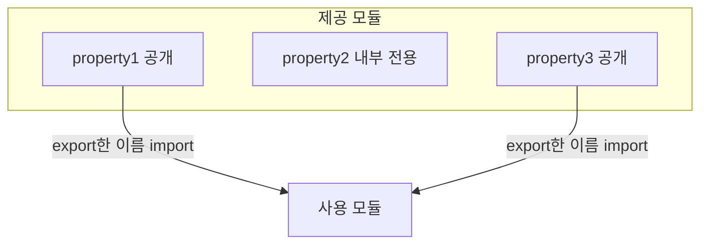

# 48장. 모듈

> **모듈은 파일별로 범위를 나누고, 외부에서 사용할 값만 `export`하며, 필요한 곳에서 `import`해 재사용하는 코드 단위.**

## 48.1 모듈의 일반적 의미

모듈은 보통 기능을 기준으로 나눈 파일이다. 모듈 내부의 식별자는 기본적으로 그 모듈 안에서 사용한다. 외부에서 사용할 기능은 명시적으로 공개.

| 용어        | 의미                             | 예시                                  |
| ----------- | -------------------------------- | ------------------------------------- |
| 모듈 스코프 | 모듈 내부 식별자가 속한 범위     | `lib.mjs` 내부 변수                   |
| export      | 다른 모듈에서 사용할 이름을 공개 | `export { square };`                  |
| import      | 공개된 이름을 현재 모듈에서 사용 | `import { square } from './lib.mjs';` |
| 모듈 사용자 | 공개된 기능을 사용하는 쪽        | `app.mjs`                             |

### 그림 48-1. 모듈의 import와 export

`property2`처럼 내보내지 않은 이름은 직접 가져올 수 없다. 파일 단위로 기능과 의존 관계가 드러나면 변경 범위와 재사용할 기능을 찾기 쉬워진다. 이 범위 분리는 코드를 보안상 비밀로 숨기는 수단은 아니다. 브라우저에 전달한 코드는 확인할 수 있다.
