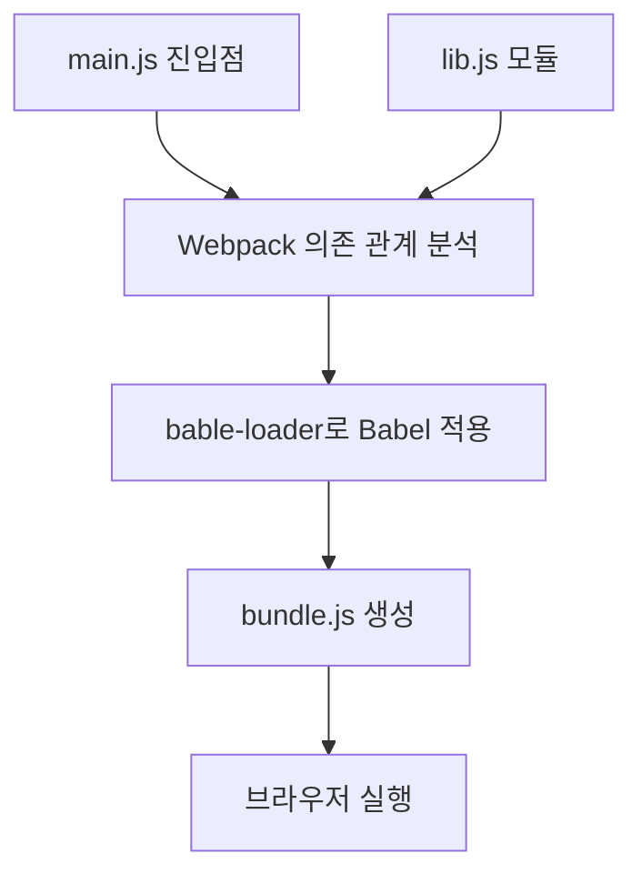

## 49.2 Webpack

### Webpack 번들링



Webpack은 설정에 따라 하나 또는 여러 출력 파일을 만듬. CSS·이미지도 처리할 수 있으나, CSS에 로더 등 별도 설정이 필요.

### 49.2.1 Webpack 설치

```bash
npm install --save-dev --save-exact webpack@5 webpack-cli@6
```

### 49.2.2 babel-loader 설치와 명령 등록

```bash
npm install --save-dev --save-exact babel-loader@9 http-server@14
npm pkg set "scripts.build=webpack --config webpack.config.cjs"
npm pkg set "scripts.watch=webpack --config webpack.config.cjs --watch"
npm pkg set "scripts.start=http-server . -p 5500 -c-1"
```

Babel 7, Webpack 5와 호환되는 `babel-loader` 9 조합을 사용. `http-server`는 빌드 도구가 아니라 HTML과 생성 파일을 제공하는 정적 서버

### 49.2.3 Webpack 설정 파일

프로젝트 루트에 **webpack.config.cjs**를 만듬. `cjs`는 설정 파일을 CommonJS로 해석

```js
const path = require("node:path");

module.exports = {
  mode: "development",
  entry: "./src/js/main.js",
  target: ["web", "es5"],
  output: {
    path: path.resolve(__dirname, "dist/js"),
    filename: "bundle.js",
  },
  module: {
    rules: [
      {
        test: /\.js$/,
        exclude: /node_modules/,
        use: "babel-loader",
      },
    ],
  },
  devtool: "source-map",
};
```

`babel-loader`는 기존 `babel.config.json`을 읽음. `modules: "auto"`는 도구가 제공하는 정보를 이용. Webpack에서 모듈 분석을 위해 ESM을 유지, Babel CLI에서 CommonJS로 변환

| 설정           | 의미                                       |
| -------------- | ------------------------------------------ |
| `entry`        | 의존성을 따라가기 시작하는 파일            |
| `output`       | 번들 경로와 이름                           |
| `target`       | Webpack이 생성하는 런타임 코드와 실행 대상 |
| `module.rules` | 소스 파일에 적용할 로더                    |
| `exclude`      | 로더 처리에 제외할 경로                    |
| `devtool`      | 디버깅용 소스맵 생성                       |

`target: ['web', 'es5']`가 앱 문법까지 변환하는 것은 아님. 소스 문법은 Babel이 변환

### 번들 실행 결과 확인

루트에 **index.html**을 저장

```html
<!doctype html>
<html lang="ko">
  <head>
    <meta charset="UTF-8" />
    <title>Babel과 Webpack 실습</title>
  </head>
  <body>
    <script src="./dist/js/bundle.js" defer></script>
  </body>
</html>
```

```bash
npm run build
npm start
```

`http://127.0.0.1:5500/` 열고 개발자 도구의 Console에 네 결과를 확인. `lib.js`나 `main.js`를 HTML에서 따로 로드하지 않음. 자동 재빌드가 필요하면 별도 터미널에 `npm run watch`를 실행하고 페이지를 새로고침

### 49.2.4 폴리필

Babel이 화살표 함수를 일반 함수로 바꿔도, 없는 `Promise`나 `Array.from`까지 문법만으로 생기지 않음.

```bash
npm install --save-exact core-js@3
```

**babel.config.json을 다음 내용으로 교체**

```json
{
  "presets": [
    [
      "@babel/preset-env",
      {
        "targets": { "ie": "11" },
        "modules": "auto",
        "useBuiltIns": "usage",
        "corejs": "3.0"
      }
    ]
  ]
}
```

`corejs: "3.0"`은 사용할 폴리필 기능 집합의 기준.

**src/js/main.js 끝에 추가**

```js
new Promise((resolve) => setTimeout(() => resolve(1), 100)).then((value) =>
  console.log(value),
); // 나중에 1

console.log(Object.assign({}, { x: 1 }, { y: 2 })); // { x: 1, y: 2}
console.log(Array.from([1, 2, 3], (value) => value + value)); // [2, 4, 6]
```

다시 `npm run build`를 실행. `usage` 방식은 대상 환경과 사용 코드에 맞는 `core-js` import를 자동추가.
**소스 첫 줄이나 Webpack entry에 전체 폴리필을 중복 추가하지 않음**

| 항목                       | 의미                                       |
| -------------------------- | ------------------------------------------ |
| 번들의 `core-js` 관련 모듈 | 실행에 필요한 보완 기능이 포함             |
| 더 커진 출력 파일          | 폴리필 코드도 배포 결과에 들어감           |
| `bundle.js.map`            | 변환 전 소스와 실행 코드를 연결하는 소스맵 |
| 빌드 성공 메시지           | 이 단계 문법 변환과 번들 생성이 완료       |

## 질문 및 답변

### 1. Babel과 Webpack은 무엇이 다른지

- Babel은 문법 변환, Webpack은 모듈 분석과 번들 생성을 담당

### 2. Babel CLI 결과가 Node.js에 실행될 때 브라우저에 실패하는 이유

- CommonJS 출력이면 브라우저에 없는 `require`나 `exports`를 사용

### 3. 클래스 필드에 예전 proposal 플러그인이 항상 필요한 지

- 아님. 실습은 표준화된 기능을 preset-env로 처리

### 4. `core-js`는 실행 의존성인지

- 코드가 최종 번들에 포함되어 실제 실행 중 기능을 보완하기 때문

### 5. ES5 target만 지정하면 소스의 문법도 전부 바뀌는 지

- 아님. Webpack 런타임 대상과 Babel 소스 변환 설정을 함께 확인.

[Babel — preset-env](https://babeljs.io/docs/babel-preset-env),
[Babel — 클래스 필드](https://babeljs.io/docs/babel-plugin-transform-class-properties),
[Babel — polyfill 사용 중단 안내](https://babeljs.io/docs/babel-polyfill),
[Webpack — babel-loader](https://webpack.js.org/loaders/babel-loader/),
[Webpack — target](https://webpack.js.org/configuration/target/)
